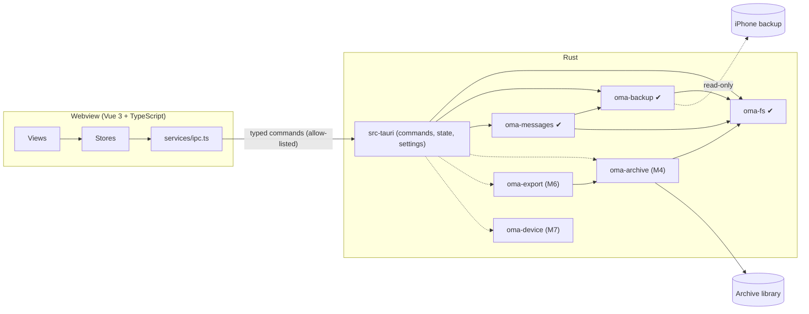

# Architecture

Status: Milestone 3 (the extraction check) is implemented; its sign-off
is pending (see the README roadmap). Sections marked *planned* describe the
intended design for later milestones. They will be revised against evidence
as each milestone lands. Nothing in them is implemented yet.

## Invariants

Every design decision below serves these five rules. A change that weakens
one of them needs an explicit decision record, not a quiet exception.

The app's [`AGENTS.md`](../AGENTS.md) lists seven invariants, numbered I1 to
I7, and the milestone 2 and 3 sections below cite that numbering. This document
numbers its five rules differently:

| This document | AGENTS.md | Rule |
|---|---|---|
| 1 | I1 | Source backups are read-only |
| 2 | I3 | No network |
| 3 | I2 | Paths from outside go through `oma-fs` (backups are hostile input) |
| 4 | I5 | Do not fabricate |
| 5 | I4 | The webview never supplies paths |
| — | I6 | Never log content or passwords |
| — | I7 | Render untrusted text as text |

1. **The source backup is immutable.** The application opens backups read-only
   and never writes inside one. Archive data cannot be stored inside a backup,
   inside the system's MobileSync store, or inside iMazing's default backup
   store. This is enforced in
   `crates/oma-fs`, not by convention.
2. **Message data never leaves the machine unless the user exports it.** The
   application has no telemetry, no update check, and no HTTP client. The
   webview's CSP allows connections to the IPC channel only.
3. **Backups are hostile input.** Manifest paths, filenames, plists, SQLite
   files and attachments may be malformed or malicious. Every untrusted path
   goes through `oma_fs::resolve_within` or `oma_fs::sanitize_filename`, which
   reject anything they cannot prove safe.
4. **Do not fabricate.** A value missing from the source stays missing.
   Unknown schema versions are reported as unsupported; they are not
   approximated. A message state the source does not record (delivered, read)
   is never shown.
5. **The frontend is a presentation layer.** It holds no business logic and
   has no filesystem access. Paths come from native dialogs that Rust opens,
   or from settings that Rust has already validated.

## Components



| Unit | Responsibility | State |
|---|---|---|
| `src/` | Vue 3 UI: views, Pinia stores, the typed IPC client, the shortcut registry, and the capability roadmap | M1, M2 (Backups page), M3 (extraction report) |
| `src-tauri/` | Tauri shell. Holds IPC commands, application state, settings persistence, archive-location validation, the backup registry, job table and DTOs, and (M3) the report mapping and the panic hook. Contains no domain logic. | M1, M2, M3 |
| `crates/oma-fs` | Filesystem safety: filename sanitization, contained path resolution, and guards for backups, MobileSync, iMazing's default store and cloud sync. From M4: volume facts (`volume`: free space, network/virtualised/FAT detection), the Unix private-permission check (`perm::check_private`), and durable placement (`place`: `fsync_dir`, `create_dir_durable`, `place_noreplace`, `open_nofollow`) | M1, M4 (slice 4a) |
| `crates/oma-backup` | Discovers backups, parses Manifest.plist, Info.plist and Status.plist under a budget, classifies them, unwraps the keybag, stages and validates Manifest.db, checks sms.db in place, and extracts single files. From M3 it also stages sms.db with its `-wal` (blob stamps, content digest, WAL facts), opens staged databases under a read-only authorizer and operation budgets, and probes attachment blobs without extracting them | ✔ M2, M3 |
| `crates/oma-messages` | Scans and probes the sms.db schema by capability, streams typed records (handles, chats, the joins, messages, attachments, Recently Deleted links) as `Col<T>` values, decodes `attributedBody` with a clean-room typedstream decoder, and produces the aggregate `ExtractionReport`. Persists nothing. | ✔ M3 |
| `crates/oma-archive` | Owns the versioned archive schema and migrations, runs transactional and resumable imports, builds FTS5 indexes, verifies integrity | planned, M4 |
| `crates/oma-export` | Exports to TXT, CSV, JSON, HTML, PDF and XLSX | planned, M6 |
| `crates/oma-device` | Detects devices and creates backups behind a platform trait | planned, M7 |

Each library crate can be built and tested without Tauri. The shell only
converts between IPC types and library calls.

## The IPC boundary

- **Allow-listed commands.** `build.rs` declares every command, so
  `tauri-build` generates an `allow-<command>` permission for each one.
  `capabilities/default.json` grants exactly those permissions. The webview
  has no core window, filesystem, shell, HTTP, dialog or opener permissions.
  The dialog and opener plugins are driven from Rust.
- **Types defined once.** IPC types are Rust structs annotated with
  `#[derive(TS)]`. `cargo test` writes them to `src/types/generated/`, and
  CI fails if the committed copies are stale.
- **Inputs validated by deserialization.** Input types use
  `deny_unknown_fields`, and enums are closed. For example, `SettingsUpdate`
  has no `archiveDirectory` field, so the webview cannot set one.
- **Uniform errors.** Every failure crosses as `IpcError { code, message }`.
  `code` is a closed enum. `message` is a user-facing sentence. Errors never
  carry message content or secrets.
- **Progress and cancellation (M2).** `open_backup` returns a job id at once
  and runs the job on a dedicated `std::thread` (`oma-job-<n>`). Progress
  and exactly one terminal event (`finished`, `failed` or `cancelled`, each
  carrying `stagingRemoved`) travel over a `tauri::ipc::Channel<JobEvent>`
  passed as a command argument. `cancel_job` sets a `CancelToken` that the
  crate checks inside every loop, and a per-connection SQLite interrupt
  watcher covers long statements. One job runs at a time (D7); a second
  request gets `busy`. Progress is throttled to phase changes and at most one
  event per 100 ms.
- **No `core:*` permission for channels.** Small channel payloads (under
  8 KiB) are delivered with `webview.eval`. Larger ones are fetched through
  `plugin:__TAURI_CHANNEL__|fetch`, which Tauri 2.12.4 exempts from the ACL
  check (`src/webview/mod.rs`, under `// TODO: Remove this special check in
  v3`). **Every Tauri upgrade must re-verify, by hand, that a `finished`
  event over 8 KiB arrives without a `core:*` grant.** A channel cannot be
  reattached after a page reload, so the UI polls `get_backup_details`
  every 2 s while a job it cannot hear is active. A failed delivery never
  cancels the job.
- **The extraction check (M3).** `check_extraction` takes the `backupId`
  hash and an optional password (`deny_unknown_fields`), and runs one job
  on the same model: open, validate, check, close (D21). Its terminal event
  is a new variant, `extractionFinished` (D34), which carries **only a
  summary**: the outcome, `sourceChanged`, `stagingRemoved` and
  `plaintextRemovedAfterRowPass` (D47). The full report is fetched with
  `get_backup_details` as `lastExtractionReport`, so the check never
  depends on the channel's ACL-exempt fetch path. A guard test keeps the
  summary under 1 KiB. The report DTO has no free-text strings, and a
  key-based structural test walks every reachable DTO type (I7). Counters
  that are not recorded cross as `null`, never as 0 (I5), and integers
  outside ±(2⁵³ − 1) are clamped with a `saturated` flag.

## Settings

Settings are stored in `settings.json` in the platform config directory
(`app_config_dir()`). The file holds preferences, the archive library path
and, from M2, `backupFolders` (the folders the user added on the Backups
page, as `{ path, kind }`), nothing else. `backupFolders` is read leniently:
a malformed value or element is dropped with a notice, never treated as a
corrupt file. The webview cannot set it. Loading never fails:

| Condition | Behaviour |
|---|---|
| File missing | Defaults are used. The file is written on the first change. |
| Unreadable (I/O) | Defaults are used and settings are read-only for the session. A notice is shown. |
| Malformed or wrongly typed | The file is renamed to `settings.json.corrupt-<unix-time>` with its bytes preserved. Defaults are used and a notice is shown. |
| `schemaVersion` newer than this build | Defaults are used. The file is never overwritten, and a notice is shown. |

Saves are atomic: write to a sibling `.tmp`, `fsync`, then rename. Memory
changes only after the save succeeds.

## Archive library location

The user chooses one *library* directory. Each archive gets a subdirectory
inside it (from M4). A location is checked every time it is chosen or
re-checked:

| Check | Level | Why |
|---|---|---|
| `unicode-path` | error | The path is stored as UTF-8 and is never silently mangled |
| `absolute` | error | A relative path cannot be validated |
| `exists` | error | The directory may be on an unplugged drive |
| `not-root` | error | A drive root is never an archive |
| `outside-backup` | error | **Invariant 1.** No ancestor may contain two or more backup marker files, and the path must not be inside `MobileSync/Backup` or `iMazing/Backups` (iMazing's default store; both matched by component, case-insensitively). |
| `local-volume` | error or warning | From M4. The volume kind from `oma_fs::volume_kind`. **Network** (NFS, SMB/CIFS, AFS, Ceph, Coda on Linux; a UNC path, or one that `canonicalize` reveals as `\\?\UNC\…`, on Windows) is an error that stops the checks: SQLite's WAL "does not work over a network filesystem" (sqlite.org/wal.html), and staging needs file locks. **Virtualised** (FUSE, 9P, VirtualBox shared folders; Linux only) is a warning: backup checks keep working, but archives refuse such a folder (D54). **FAT/exFAT** (Linux only) is a warning: no hard links, and FAT's 4 GiB file limit. A recognised local file system is ok. An unknown kind adds no row: every drive letter on Windows, because detecting FAT or a mapped network drive there needs `unsafe` Win32 calls. **This changes behaviour:** a library already chosen on a network share is now refused. |
| `writable` | error | A probe file is created, written, `fsync`ed and removed. This catches ACLs, read-only mounts and quota problems. |
| `local-only` | warning | The folder is inside a known sync client's folder (OneDrive, Dropbox, iCloud Drive and others). **Invariant 2**: the user must know the data will leave the machine. This is a name heuristic, so it warns and never blocks. |

### Archive layout (planned, M4)

```
<library>/
  <archive-id>/                 one per device or user-defined archive
    archive.sqlite              versioned schema; FTS5 tables; WAL mode
    attachments/ab/<sha256>     content-addressed original bytes
    thumbnails/ab/<sha256>.webp derived; deletable and rebuildable
    imports/<session-id>.json   provenance: source backup, versions, counts, errors
```

Attachments are content-addressed by SHA-256. Duplicate detection and
integrity verification therefore come from the storage layout itself. The
original filename is kept in the database and used only on export, after
`sanitize_filename`.

## Data flow

Milestone 2 (implemented):

```
backup dir (read-only, never opened by SQLite)
  → oma-backup inspect: marker stats, two header reads, three budgeted plist reads
  → OpenBackup::open: [password → PBKDF2 ×2 → class keys → ManifestKey]
      → Manifest.db copied (or decrypted) into <library>/.oma-staging/s<16hex>/m/
  → validate: hardened read-only open, quick_check, schema, row pass, blob guards
      → sms.db checked in place: header (and first/last block when encrypted); no copy
  → close(): connection closed, keys zeroized, staging removed (bounded retry)
```

Milestone 3, the extraction check (implemented; one job, `check_extraction`):

```
  open → validate (M2) → if not importable: skippedNotImportable
  → oma_messages::check(&open_backup):
      a. extract_database_with(HomeDomain, Library/SMS/sms.db, WAL best effort)
         → <library>/.oma-staging/s<16hex>/db/<n>/sms.db[-wal]
           (source blobs stamped by length and mtime; staged content digested;
            WAL header and frames validated; Windows temporary attributes)
      b. hardened open of the staged copy: read-only authorizer, DQS off,
         triggers and views off, SMS_DB_LIMITS, operation budgets
      c. scan sqlite_schema (no virtual table is connected)
         → any CREATE VIRTUAL TABLE: Unsupported(VirtualTablePresent)
      d. PRAGMA quick_check(1) under an op budget
         → not "ok": Damaged(IntegrityProblems); over budget: Incomplete
      e. probe each known table with pragma_table_xinfo, rowid shape, count(*)
         → missing minimum, view instead of table, bad rowid: Unsupported
      f. record passes: handles, chats, chat_handle_join, chat_message_join,
         messages (bodies, summaries, associations, GUID sets),
         message_attachment_join, attachments (classify, look up, probe the blob),
         Recently Deleted links; each pass's row count must equal count(*)
      g. aggregates: integer SQL under op budgets; GUID checks in Rust
      h. assert query_only, no authorizer denials, total_changes() == 0
      i. connection dropped; staged sms.db removed straight after the row pass
  → unchanged_since_open() (now covers the sms.db and -wal blobs)
  → close(): keys zeroized, staging removed
  → exactly one terminal event: extractionFinished | failed | cancelled
```

Planned (M4–M5):

```
  → oma-archive: the same for_each_* passes, cursors bound to the content digest;
      single write transaction per batch, keyed for idempotent re-import;
      a changed source aborts the import; FTS5 index updated incrementally
  → UI: paged queries (keyset pagination by timestamp+id), virtualized thread list,
        attachments loaded on demand through a scoped asset protocol
```

Decrypted intermediates are written only inside the archive library's
staging directory, never in the system temp folder. They are removed when
the job ends, and leftovers from a crash are removed by the sweep at the next
start with the same library. docs/privacy.md explains the limits of
deletion.

## Backups (milestone 2)

### Discovery

On Windows, `list_backups` scans `<home>\Apple\MobileSync\Backup`,
`<roaming>\Apple Computer\MobileSync\Backup` (both subfolders are
UNVERIFIED by Apple; see supported-formats.md) and iMazing's default
`<roaming>\iMazing\Backups` (observed in iMazing's settings on one Windows 11
machine; configurable in iMazing), plus every folder the user added. A root
scan never lists a child named `iMazing.Versions`, where iMazing keeps
archived snapshots in a layout that is UNVERIFIED. Linux has no standard location. Scanning happens only when the
Backups page opens or the user clicks Refresh, never at startup. A listing is
bounded by counts, not time: at most 512 candidates are inspected and 256 MiB
of plist bytes read per refresh, and at most 256 candidates come from one
root. The rest are listed as `notInspected`. `BackupId` and `LocationId` are
hashes of the canonical path, computed in Rust; the webview can only echo
them.

### Budgeted plist reader (D17)

Backup plists are never parsed with `plist::Value::from_reader`, because a
binary plist can reference one object many times and expand without bound.
`oma_backup::bplist::read_bounded` iterates `plist::stream::Reader` and caps
events (`4 × len + 1024`), cumulative string and data bytes (`2 × len`) and
depth while streaming. Size caps are 1 MiB for Status.plist, 32 MiB for
Manifest.plist and 64 MiB for Info.plist (Info.plist failures are never
fatal). The identifying root keys (`Unique Identifier`, serial number,
IMEI, ICCID, MEID, phone number and others) are skipped while streaming:
the stream reader still decodes their values, which are counted against the
budgets and discarded, and no output struct has a field for them (D14).
Skipping applies to root keys only; Manifest.plist's `Lockdown` dictionary
is built whole and four keys are kept from it.

### Staging (D5, D6)

```
<library>/.oma-staging/          real directory, 0700 on Unix
  s<16hex>/                      one per job; .lock held with File::try_lock
    m/Manifest.db[-wal]          the staged (decrypted) index
    x/<n>, db/<n>/<basename>     extraction outputs (M3 API)
```

`StagingRoot::new` refuses a staging directory that is a link, is not at
`<canonical library>/.oma-staging`, is owned by another user or readable by
others (Unix), or would sit inside the backup, inside any backup, inside
`MobileSync/Backup`, or inside `iMazing/Backups`. `OpenBackup::close()` deletes plaintext first, releases
the lock, then removes the session with up to five attempts (50–400 ms
between attempts, about 0.75 s in total). Every extraction writes through
`<dest>.partial`; on any error the partial file (and, for a database, a main
file whose `-wal` then failed) is removed at once, not left until close. The sweep runs at startup, before each job, and against the old
location after the archive location changes; it touches only `s<16hex>`
directories whose lock it can take, never follows links, and never creates a
lock. On Windows, staging inherits the library's permissions. On Linux, a
volume that does not keep POSIX modes (FAT, exFAT or NTFS without a private
umask, many network shares) reports group and other bits on the new 0700
directory, so `StagingRoot::new` refuses it (`LoosePermissions`), and
`inspect_location` marks such a folder unusable (the `private` check) so it
is not accepted as an archive location in the first place. The
`RunEvent::Exit` handler cancels running jobs and waits up to 5 s for their
cleanup; a kill or crash skips it, and the sweep covers that case. M4's archive enumeration must skip directories whose names start with
a dot.

### Hardened SQLite open

The staged Manifest.db is opened `SQLITE_OPEN_READ_ONLY | NO_MUTEX`. If
SQLite cannot open a staged WAL database read-only (`SQLITE_CANTOPEN`), it
reopens the **staged copy** (never the backup) `SQLITE_OPEN_READ_WRITE`, with
the same hardening including `query_only` (`OpenMode::ReadWriteQueryOnly`);
SQLite may then create a `-shm` inside staging. Either way the connection has
`SQLITE_DBCONFIG_DEFENSIVE` on, `TRUSTED_SCHEMA` off, `query_only`,
`cell_size_check`, `temp_store = MEMORY` (decrypted pages never spill to the
OS temp folder), `mmap_size = 0`, and tight `sqlite3_limit` values following
sqlite.org/security.html. Extensions are never enabled; queries use bound
parameters and name their columns. Databases extracted for M3 are opened
the same way through `StagedDatabase::open`, which returns a
`StagedConnection` that borrows the `OpenBackup` (so it is closed before
`close()` deletes the file) and uses wider, provisional limits for sms.db's
many columns and long values. The backup's own Manifest.db is never
opened by SQLite, because SQLite creates a `-shm` next to a WAL database it
opens. The backup's `-shm` is never copied. On Linux, a read-only connection
applies a staged `-wal` without a `-shm` (tested with the `plain-wal`
fixture).

## The extraction check (milestone 3)

The design is recorded in full in the Milestone 3 spec; this section states
what the code does and why.

### Staging sms.db (D22, superseding D11 for the check)

M2 checked sms.db in place and never copied it (D11). The extraction check
must read every row, so it stages a plaintext copy, decrypted for an
encrypted backup, through `extract_database_with` into
`<library>/.oma-staging/s<16hex>/db/<n>/`, with the `-wal` when one is
listed (`WalPolicy::BestEffort`, D23). The copy is removed straight after
the row pass (`StagedDatabase::remove`); `close()` is the backstop and the
sweep covers crashes. The staged connection borrows the `StagedDatabase`,
so it cannot outlive the file it reads. sms.db is refused above 32 GiB
(`Limits::sms_db_bytes`, D40). Before closing, `unchanged_since_open()`
compares the length and modification time of Status.plist, Manifest.db, and
now the sms.db and `-wal` blobs; a change is the qualifier `SourceChanged`
(D31). A `-wal` is reported as *staged*, never as *applied*.

### The read-only guard (D36)

`StagedConnection::conn()` is crate-private, so no caller outside
`oma-backup` holds a bare `rusqlite::Connection`. Every staged sms.db
connection has:

- **an authorizer** that allows only reads, a fixed list of functions and
  pragmas, and denies `recoverable_message_part.part_text` (deleted message
  content) outright;
- **double-quoted string literals off** (`DQS_DML`, `DQS_DDL`), so a
  misspelt identifier can never become a string;
- **triggers and views off** (S18);
- **operation budgets** through `sqlite3_progress_handler` on every
  statement whose cost grows with the data (`quick_check` and the
  aggregates), instead of wall-clock deadlines (D45);
- the M2 hardening (`query_only`, defensive mode, `trusted_schema` off,
  `temp_store = MEMORY`, `mmap_size = 0`) and wider but still bounded
  `SMS_DB_LIMITS`.

At the end of the row pass the check asserts `query_only`, zero authorizer
denials and `total_changes() == 0`. Those are checks, not proof; the
authorizer is the guard.

### Schema: scan, integrity, probe (D37, D44)

1. **Scan** `sqlite_schema` without touching any table. A virtual table is
   refused before `quick_check`, which would otherwise run FTS or R-tree
   integrity code on attacker data (D44). A `table` row is virtual when its
   rootpage is 0 or when its whole SQL, tokenised the way SQLite's schema
   loader reads it (comments and any whitespace skipped), starts `CREATE
   VIRTUAL`; a reserved `sqlite_` name does not exempt it. This replaces the
   design's 32-byte prefix test, which a commented or padded statement with
   a non-zero rootpage could bypass. `pragma_table_list` is not used: it
   connects every virtual table to count its columns. Names and SQL text are
   classified, never stored or logged.
2. **`PRAGMA quick_check(1)`**, under an op budget. Only `"ok"` is read;
   anything else is `Damaged(IntegrityProblems)` and no row is read.
3. **Probe** each known table by capability (`pragma_table_xinfo`, columns
   matched by exact name). A required column missing, a table that is a
   view, or an unsafe rowid shape (including `INTEGER PRIMARY KEY DESC`,
   which is not a rowid alias) is `Unsupported` with reasons.

### Values: `Col<T>` and redaction (D49)

Every source field is a `Col<T>`: the column is absent, the value is NULL,
the value is unreadable (wrong type, invalid UTF-8), the value was withheld
because it is over its byte cap, or the value. M4 can therefore tell "not
recorded" from "NULL" from "bad". Content and identifiers are
`Redacted<SqlText>` or `Redacted<RawBlob>`: their `Debug` prints only a
length, they have no `Display` or `Serialize`, and they are zeroized on
drop. Coded values keep the raw integer and are mapped only where a source
documents the meaning. Timestamps are classified per value (seconds,
nanoseconds, zero, negative, ambiguous), not per database (D27).

### Typedstream (D26)

`attributedBody` is decoded by a clean-room module in `oma-messages`
(`src/typedstream/`): a budgeted generic walk, then an interpretation of a
closed set of Foundation classes, with every length checked before use and
every reference bounds-checked. Run problems keep the text and mark the
runs; nothing is clamped silently. Neither body source is preferred: the
`text` column and the decoded body are both kept, and M4 decides.
Provenance is recorded file by file in `scripts/fixtures/PROVENANCE.md`.

### Attachments (D29, D30, D50)

`attachment.filename` is an untrusted lookup key, never a path. Only the
`~/Library/SMS/Attachments/` and `~/Library/SMS/StickerCache/` classes are
looked up, in `MediaDomain`, after an unusual-name gate built on
`oma_fs::resolve_within`. A hit is probed (metadata, and the file key
unwrapped in memory for an encrypted backup) without writing any plaintext.
A blob whose length differs from the Manifest's `Size` (padded to the next
16-byte block when encrypted, as validation compares it) is a size
mismatch, never "present"; this adds an outcome to the design's probe
set, so a truncated or empty blob is not reported as the file. Every other
class is counted only. Without an `attachment` table nothing is looked up,
and the shell sends no attachment section, so its counters read "not
recorded", never 0.

### Status and qualifiers (D43)

The report's status is `Readable { qualifiers }`, `Damaged`, `Unsupported`
or `Incomplete`. **D43 is the decision record for how invariant 4 (I5,
"an unknown schema or iOS version is reported as unsupported") is read in
M3:** an *unknown schema* is one that lacks the required minimum, has
virtual tables, has an unsafe rowid shape, or exceeds our schema limits,
and that is `Unsupported`. A database with the minimum plus unknown extra
tables or columns, an untested iOS version, or a WAL or source caveat is
*readable with qualifiers*, and each qualifier is stated in its own
sentence. The UI never says just "can be read" when a qualifier applies.
The shell adds `iosVersionUntested` unless the backup's iOS version is in
`TESTED_REAL_IOS_VERSIONS`, which is empty in M3 because no real backup has
been tested, so every readable result from a real backup carries it.
(Damaged, unsupported and incomplete results carry no qualifiers; their
iOS version is untested too.) Without this
reading, every real backup today would be "unsupported" and the check would
give no evidence; the qualifiers keep the claim honest.

### Constant-time reasoning

No step in M2 gives an attacker a timing oracle: the app is local and
single-user, and nothing is decrypted on anyone else's behalf. The code never
compares key material by hand; aes-kw compares the public integrity value
with `==`; PKCS#7 unpadding is not constant-time; fileIDs are not secret. A
future network feature must re-examine this.

## Key decisions

| Decision | Choice | Reasoning and trade-off |
|---|---|---|
| Who touches the filesystem | Rust only | One place to enforce the invariants. The cost is that every capability needs an IPC command. |
| How the archive directory is chosen | The backend opens the native picker | The webview cannot inject a path, even after an XSS. The cost: no drag-and-drop of folders until a validated path is designed for it. |
| Bootstrap's JavaScript | Not loaded; CSS only | Bootstrap's JavaScript mutates the DOM behind Vue. Dialogs use native `<dialog>`, and overlays and toasts are Vue components. |
| IPC type sharing | ts-rs, generated from Rust | No hand-maintained duplicate types, and drift fails CI. |
| Device communication (M7) | Tentatively the `idevice` crate (MIT, pure Rust, includes mobilebackup2) rather than shelling out to `idevicebackup2` | Passwords stay in the process, never on a command line, with no LGPL binaries to ship. The crate is pre-1.0 and may break between releases, so pin it exactly. This must be confirmed on real hardware in M7. See [supported-formats.md](supported-formats.md). |
| Reference implementations | GPL, LGPL and CC BY-SA projects (imessage-exporter, imessage-database, crabstep, crabapple, pymobiledevice3, pyiosbackup, libimobiledevice including `idevicebackup2`, the andrewdotn answer) are behavioural references only | The project must remain Apache-2.0. Clean-room code, or MIT/BSD sources with attribution. |
| sms.db parsing | Capability-based: probe columns by name and treat missing ones as absent | The schema changes with every major iOS release. Positional `SELECT *` breaks silently. |
| Node.js worker | None | Nothing so far needs one. Revisit only with a concrete requirement. |
| Single instance | Not enforced in M1 or M2 | Atomic settings writes keep two instances safe. Staging sessions are locked, and the sweep skips sessions younger than 5 minutes. The archive database (M4) will take an exclusive lock per archive. |

### Milestone 2 decisions

| # | Topic | Choice | Main alternative |
|---|---|---|---|
| D1 | Where IPC types live | DTOs in the shell (`src-tauri/src/backups/dto.rs`); `oma-backup` has no ts-rs | `TS` in the library behind a feature |
| D2 | Progress transport | `tauri::ipc::Channel<JobEvent>`, no `core:*` grant; re-verified on every Tauri upgrade | `job://progress` events with `core:event:*` |
| D3 | Cancellation | `cancel_job` sets a `CancelToken`, checked in every loop, plus a SQLite interrupt watcher per connection | Discard results after uninterruptible work |
| D4 | PBKDF2 | Written in the crate on `hmac`, with cancellation and progress; differential tests against the `pbkdf2` crate | Call `pbkdf2::pbkdf2_hmac` (up to ~5 s uninterruptible) |
| D5 | Session lifetime | Scoped to the job; keys zeroized and staging removed at its end | Keep the unlocked session open (M3 needs that) |
| D6 | Staging location | `<library>/.oma-staging/s<16hex>/`; validation needs a usable archive folder | The app cache directory |
| D7 | Concurrency | One job globally; a second request gets `busy` | Parallel jobs |
| D8 | Remembering added folders | `backupFolders: [{ path, kind }]`, lenient; schema version stays 1 | Re-add every session |
| D9 | Guards on files opened from a backup | Regular, non-link files only; each `xx/` directory validated once | Canonicalise every blob, or `O_NOFOLLOW` |
| D10 | Extraction destination | Sequence numbers inside staging (`x/<n>`, `db/<n>/<basename>`) | Mirror `relativePath` |
| D11 | sms.db during validation | Checked in place; no plaintext copy on disk | Extract and open a full copy |
| D12 | Fixtures | Committed Python generator on `cryptography`, `SHA256SUMS`, and a recorded oracle run | Generate fixtures in Rust |
| D13 | Library in a synced folder | Allowed, with a warning before every validation | Block, or require an acknowledgement |
| D14 | Identifying fields | Never stored, UDID included: root keys are skipped while streaming (values decoded and discarded), and no struct has a field for them. Backup folder paths, usually named after the UDID, are shown in the details panel and, for an added backup folder, in the Locations panel; never logged | Parse and redact |
| D15 | Persistent diagnostic log file | Deferred to M4 | Ship in M2 |
| D16 | OS credential store for passwords | Dropped, with no milestone planned; the password is asked for on each validation | Opt-in storage |
| D17 | Plist parsing | Budgeted event-stream reader | `Value::from_reader` with size caps |
| D18 | Keybag strictness | Fail closed only on what decryption uses; the rest becomes a note | Refuse any unexpected shape |
| D19 | `relativePath` | A lookup key, not a path; unusual names are counted, never refused | Refuse rows that fail `resolve_within` |
| D20 | Scope | Domain classes, attachment counts and size measurement deferred to M3/M4 | Ship them in M2 |

D11 still describes M2's validation. For the extraction check it is
superseded by D22: sms.db is staged on disk.

### Milestone 3 decisions

| # | Topic | Choice | Main alternative | Trade-off |
|---|---|---|---|---|
| D21 | Session lifetime | One job: open → validate → check → close; the password is asked for on each run | Keep the session open between jobs | The password is asked twice, versus keys and plaintext lingering |
| D22 | sms.db plaintext | Staged on disk, removed after the row pass, Windows temporary attributes | `sqlite3_deserialize` into memory | Memory would scale with the database, and a `-wal` could not be applied. The disk copy is swept and documented in privacy.md |
| D23 | WAL | `BestEffort`, frames validated, the wording "staged" | Fail the whole check | One missing file would block the check, versus possibly missing the newest messages, which is always stated |
| D24 | Progress phases | Own `MessagesPhase` with an adapter | Add to `oma_backup::Phase` | `oma-backup` stays free of M3 knowledge |
| D25 | Reader API | Callback with `ControlFlow<B>`, a `Cursor`, resume tested | `Iterator` or `Vec` | Bounded memory and resumability for M4 |
| D26 | Typedstream | Clean-room module in `oma-messages` | Adopt `imessage-core` (MIT), or a separate crate | An unaudited young dependency versus our own code; it can be split out later |
| D27 | Timestamp units | Per value, unit windows, `Zero` as its own state | Per database or per iOS version | Some dates are withheld (and counted), versus mixing units |
| D28 | Schema problems | `Unsupported`, `Damaged`, `Incomplete` as values with reasons | Job errors | The UI can explain why, without a partial read |
| D29 | Attachment lookup | Cached single lookups | Batched `IN` | Simpler; Manifest.db's `variable_number = 10` stays |
| D30 | Attachment presence | Metadata probe plus key unwrap in memory | Presence only, or full decrypt | Catches a damaged `EncryptionKey` without writing plaintext |
| D31 | Report content | Aggregates and a date range (shown, never logged or persisted); a changed source is a qualifier | No date range; fail on change | Most useful sanity check; M4 will abort on a change |
| D32 | Raw blobs | Off by default; within caps when on | Always keep | Memory versus re-decoding later; M4 decides |
| D33 | Recently Deleted | Counted only | Ignore or import | Import policy belongs with M4's privacy design |
| D34 | Terminal event | New `extractionFinished` variant | A field on `finished` | M2's contract stays intact |
| D35 | Fixture generator | Separate `make_synthetic_messages.py` importing the M2 module, with a reference-environment check | A mode of the M2 script | The frozen M2 catalogue is untouched |
| D36 | Write protection | Authorizer, crate-private `conn()`, DQS off, triggers and views off, clippy list; end-of-check assertions are checks only | Convention plus `total_changes` | Enforced by SQLite rather than review |
| D37 | `quick_check` | Always, first after the scan; anything but `"ok"` is `Damaged` | Report and continue | A slightly damaged real database gives no counts; the reason is stated |
| D38 | Unknown names | Counted only | List them | Names are untrusted |
| D39 | Group chats | No group field; buckets of other linked handles; `style` raw | `style = 43` means group | That meaning is **UNVERIFIED** |
| D40 | sms.db size cap | 32 GiB, fixed | None, or a free-space check | Protects the volume; the error names the cap |
| D41 | `ErrorCode` | None new; stage-aware sentences | `MessagesDbUnreadable` | Fewer cross-cutting edits |
| D42 | Mutation testing | In-test seeded harness | `proptest` or `cargo-fuzz` | No shrinking, but a stable dependency tree |
| **D43** | **How invariant 4 (I5) is read** | See "Status and qualifiers" above: unknown schema means no required minimum, virtual tables, unsafe rowid shape or over our limits (**Unsupported**); unknown extras, an untested iOS version, WAL or source caveats are **stated qualifiers** | Treat any unknown column or untested version as unsupported | Every real backup would be unsupported, and the check would give no evidence |
| D44 | Virtual tables | Refused before `quick_check` | Let `quick_check` run their integrity code | No FTS or R-tree code runs on attacker data; revisit if real sms.db has them (**UNVERIFIED**) |
| D45 | Statement cost | Op budgets, plan-safe integer aggregates, GUID checks in Rust | Wall-clock deadlines, or `hard_heap_limit` | Deterministic bounds; `hard_heap_limit` is process-wide and was rejected |
| D46 | GUID sets | Sorted `Vec<u64>` of truncated SHA-256, 4,194,304-entry cap | A `RandomState` `HashSet` | Reproducible counts and half the memory; a crafted collision can change only a count |
| D47 | Event size | Summary-only event; the report is fetched by `get_backup_details` | Rely on the ACL-exempt channel fetch path | No dependency on a Tauri special case marked "remove in v3" |
| D48 | Scope cut | The deferred list in the README | Ship everything | Reviewable PRs |
| D49 | Source values | `Col<T>` | `Option<T>` | M4 can tell "not recorded" from "NULL" from "bad" |
| D50 | Lookup scope | Only `Library/SMS/Attachments/` and `StickerCache/` | Every `~/` and `/var/mobile` class | Never reaches non-Messages files; the other classes stay counts |

## Logging

`tracing` writes to stderr, filtered by `OMA_LOG` (default `info`). Log
events record kinds, states and counts. They never record message bodies,
contact details, attachment contents or passwords. M1 does not log the
archive path at info level.

Milestone 2 logs backup ids (hashes), job ids, classification and phase
names, counts, durations, `io::ErrorKind`, raw OS error numbers, SQLite
primary result codes, and limit names and values. It never logs passwords
(not even their length), key bytes, paths, folder names, device names,
UDIDs, SnapshotState values, relativePaths, domains of individual rows,
fileIDs or SQLite message text. Two test binaries
(`crates/oma-backup/tests/log_hygiene.rs` and
`src-tauri/tests/log_hygiene.rs`) install a global capturing subscriber and
assert this over every fixture. Tauri's own `tracing` feature stays off.

Milestone 3 logs, at `info`, one line per phase change and one summary line
(totals, the status kind, elapsed time); at `debug`, failure-kind counts.
It also logs `OpenMode`, the WAL outcome kind, the integrity kind and
qualifier kinds. It **never** logs:

- any string from sms.db, including table, view, trigger, index and
  collation names, DDL text and `quick_check` output;
- any GUID, the content digest, the date range or any timestamp;
- raw code values;
- unknown column, table, class, attribute-key and plist-key names;
- `_ClientVersion`;
- attachment paths or fileIDs;
- typedstream offsets;
- panic payloads. The release build aborts on panic; the shell installs a
  panic hook that prints only the thread name and source location
  (`src-tauri/src/panic_hook.rs`).

`#[tracing::instrument]` without `skip_all` is banned in `oma-messages` and
`src-tauri`, because it formats every argument with `Debug`. A source test
enforces this in `oma-messages` (`crates/oma-messages/tests/source_rules.rs`);
in `src-tauri` it is a review rule, and no `instrument` is used there today. The log-hygiene tests in
`crates/oma-messages/tests/` and `src-tauri/tests/` run every catalogue
entry, including the failure paths, and a forced panic.

The persistent, redacted diagnostic log file is deferred to M4 (D15).
