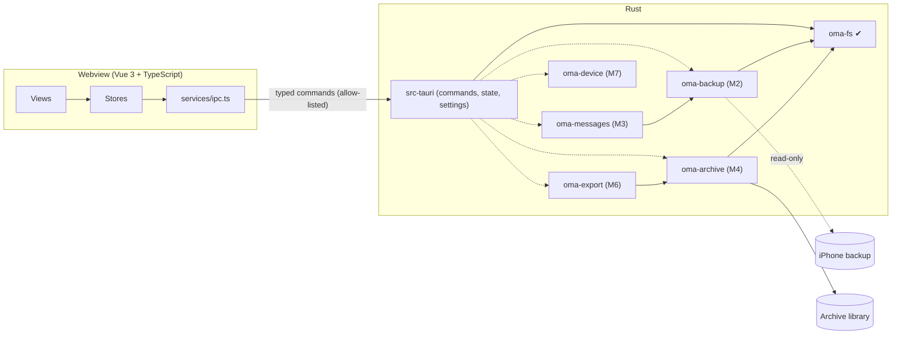

# Architecture

Status: Milestone 1 (foundation). Sections marked *planned* describe the
intended design for later milestones. They will be revised against evidence
as each milestone lands. Nothing in them is implemented yet.

## Invariants

Every design decision below serves these five rules. A change that weakens
one of them needs an explicit decision record, not a quiet exception.

1. **The source backup is immutable.** The application opens backups read-only
   and never writes inside one. Archive data cannot be stored inside a backup
   or inside the system's MobileSync store. This is enforced in
   `crates/oma-fs`, not by convention.
2. **Message data never leaves the machine unless the user exports it.** The
   application has no telemetry, no update check, and no HTTP client. The
   webview's CSP allows connections to the IPC channel only.
3. **Backups are hostile input.** Manifest paths, filenames, plists, SQLite
   files and attachments may be malformed or malicious. Every untrusted path
   goes through `oma_fs::resolve_within` or `oma_fs::sanitize_filename`, which
   reject anything they cannot prove safe.
4. **Do not fabricate.** A value missing from the source stays missing.
   Unknown schema versions are reported as unsupported; they are not
   approximated. A message state the source does not record (delivered, read)
   is never shown.
5. **The frontend is a presentation layer.** It holds no business logic and
   has no filesystem access. Paths come from native dialogs that Rust opens,
   or from settings that Rust has already validated.

## Components



| Unit | Responsibility | State |
|---|---|---|
| `src/` | Vue 3 UI: views, Pinia stores, the typed IPC client, the shortcut registry, and the capability roadmap | M1 |
| `src-tauri/` | Tauri shell. Holds IPC commands, application state, settings persistence and archive-location validation. Contains no domain logic. | M1 |
| `crates/oma-fs` | Filesystem safety: filename sanitization, contained path resolution, and guards for backups, MobileSync and cloud sync | M1 |
| `crates/oma-backup` | Discovers backups, parses Manifest.plist, Info.plist and Status.plist, reads Manifest.db, unwraps the keybag and decrypts files | planned, M2 |
| `crates/oma-messages` | Discovers the sms.db schema by capability, extracts messages, conversations, handles and attachments, and decodes typedstream | planned, M3 |
| `crates/oma-archive` | Owns the versioned archive schema and migrations, runs transactional and resumable imports, builds FTS5 indexes, verifies integrity | planned, M4 |
| `crates/oma-export` | Exports to TXT, CSV, JSON, HTML, PDF and XLSX | planned, M6 |
| `crates/oma-device` | Detects devices and creates backups behind a platform trait | planned, M7 |

Each library crate can be built and tested without Tauri. The shell only
converts between IPC types and library calls.

## The IPC boundary

- **Allow-listed commands.** `build.rs` declares every command, so
  `tauri-build` generates an `allow-<command>` permission for each one.
  `capabilities/default.json` grants exactly those permissions. The webview
  has no core window, filesystem, shell, HTTP, dialog or opener permissions.
  The dialog and opener plugins are driven from Rust.
- **Types defined once.** IPC types are Rust structs annotated with
  `#[derive(TS)]`. `cargo test` writes them to `src/types/generated/`, and
  CI fails if the committed copies are stale.
- **Inputs validated by deserialization.** Input types use
  `deny_unknown_fields`, and enums are closed. For example, `SettingsUpdate`
  has no `archiveDirectory` field, so the webview cannot set one.
- **Uniform errors.** Every failure crosses as `IpcError { code, message }`.
  `code` is a closed enum. `message` is a user-facing sentence. Errors never
  carry message content or secrets.
- **Planned (M2) progress and cancellation.** Long operations will return a
  job id immediately. They will emit `job://progress` events, accept a cancel
  command, and run on a blocking thread pool. That needs the
  `core:event:default` permission, which M1 does not grant.

## Settings

Settings are stored in `settings.json` in the platform config directory
(`app_config_dir()`). The file holds preferences and the archive library path,
nothing else. Loading never fails:

| Condition | Behaviour |
|---|---|
| File missing | Defaults are used. The file is written on the first change. |
| Unreadable (I/O) | Defaults are used and settings are read-only for the session. A notice is shown. |
| Malformed or wrongly typed | The file is renamed to `settings.json.corrupt-<unix-time>` with its bytes preserved. Defaults are used and a notice is shown. |
| `schemaVersion` newer than this build | Defaults are used. The file is never overwritten, and a notice is shown. |

Saves are atomic: write to a sibling `.tmp`, `fsync`, then rename. Memory
changes only after the save succeeds.

## Archive library location

The user chooses one *library* directory. Each archive gets a subdirectory
inside it (from M4). A location is checked every time it is chosen or
re-checked:

| Check | Level | Why |
|---|---|---|
| `unicode-path` | error | The path is stored as UTF-8 and is never silently mangled |
| `absolute` | error | A relative path cannot be validated |
| `exists` | error | The directory may be on an unplugged drive |
| `not-root` | error | A drive root is never an archive |
| `outside-backup` | error | **Invariant 1.** No ancestor may contain two or more backup marker files, and the path must not be inside `MobileSync/Backup`. |
| `writable` | error | A probe file is created, written, `fsync`ed and removed. This catches ACLs, read-only mounts and quota problems. |
| `local-only` | warning | The folder is inside a known sync client's folder (OneDrive, Dropbox, iCloud Drive and others). **Invariant 2**: the user must know the data will leave the machine. This is a name heuristic, so it warns and never blocks. |

### Archive layout (planned, M4)

```
<library>/
  <archive-id>/                 one per device or user-defined archive
    archive.sqlite              versioned schema; FTS5 tables; WAL mode
    attachments/ab/<sha256>     content-addressed original bytes
    thumbnails/ab/<sha256>.webp derived; deletable and rebuildable
    imports/<session-id>.json   provenance: source backup, versions, counts, errors
```

Attachments are content-addressed by SHA-256. Duplicate detection and
integrity verification therefore come from the storage layout itself. The
original filename is kept in the database and used only on export, after
`sanitize_filename`.

## Data flow (planned, M2–M5)

```
backup dir (read-only)
  → oma-backup: Manifest.plist → [keybag unwrap] → Manifest.db (decrypted to a temp copy)
  → oma-messages: sms.db + attachments located by fileID = SHA1(domain-relativePath)
      → PRAGMA table_info capability probe → typed rows (missing columns = None)
  → oma-archive: single write transaction per batch, keyed for idempotent re-import
      → FTS5 index updated incrementally
  → UI: paged queries (keyset pagination by timestamp+id), virtualized thread list,
        attachments loaded on demand through a scoped asset protocol
```

Decrypted intermediates are written only inside the archive's own staging
directory. They are removed when an import session completes or is
abandoned. The UI says so, and docs/privacy.md explains the limits of
deletion.

## Key decisions

| Decision | Choice | Reasoning and trade-off |
|---|---|---|
| Who touches the filesystem | Rust only | One place to enforce the invariants. The cost is that every capability needs an IPC command. |
| How the archive directory is chosen | The backend opens the native picker | The webview cannot inject a path, even after an XSS. The cost: no drag-and-drop of folders until a validated path is designed for it. |
| Bootstrap's JavaScript | Not loaded; CSS only | Bootstrap's JavaScript mutates the DOM behind Vue. Dialogs use native `<dialog>`, and overlays and toasts are Vue components. |
| IPC type sharing | ts-rs, generated from Rust | No hand-maintained duplicate types, and drift fails CI. |
| Device communication (M7) | Tentatively the `idevice` crate (MIT, pure Rust, includes mobilebackup2) rather than shelling out to `idevicebackup2` | Passwords stay in the process, never on a command line, with no LGPL binaries to ship. The crate is pre-1.0 and may break between releases, so pin it exactly. This must be confirmed on real hardware in M7. See [supported-formats.md](supported-formats.md). |
| Reference implementations | GPL and CC BY-SA projects (imessage-exporter, crabstep, crabapple, pymobiledevice3, the andrewdotn answer) are behavioural references only | The project must remain Apache-2.0. Clean-room code, or MIT/BSD sources with attribution. |
| sms.db parsing | Capability-based: probe columns by name and treat missing ones as absent | The schema changes with every major iOS release. Positional `SELECT *` breaks silently. |
| Node.js worker | None | Nothing so far needs one. Revisit only with a concrete requirement. |
| Single instance | Not enforced in M1 | Atomic settings writes keep two instances safe. The archive database (M4) will take an exclusive lock per archive. |

## Logging

`tracing` writes to stderr, filtered by `OMA_LOG` (default `info`). Log
events record kinds, states and counts. They never record message bodies,
contact details, attachment contents or passwords. M1 does not log the
archive path at info level. The persistent, redacted diagnostic log file
is planned for M2, when import jobs need it.
