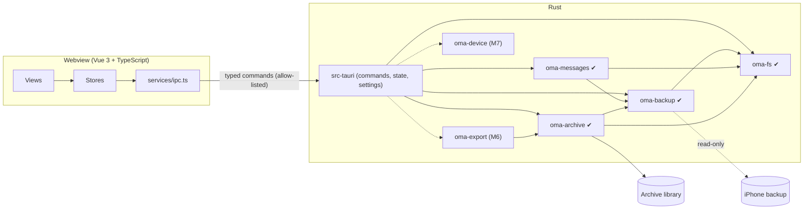

# Architecture

Status: Milestone 5 (the rich viewer) is implemented; its sign-off, like
that of milestones 2 to 4, is pending (see the README roadmap and the
manual checklists in `compatibility.md`). Sections marked *planned* describe the intended design for later
milestones. They will be revised against evidence as each milestone lands.
Nothing in them is implemented yet.

## Invariants

Every design decision below serves these five rules. A change that weakens
one of them needs an explicit decision record, not a quiet exception.

The app's [`AGENTS.md`](../AGENTS.md) lists seven invariants, numbered I1 to
I7, and the milestone 2 and 3 sections below cite that numbering. This document
numbers its five rules differently:

| This document | AGENTS.md | Rule |
|---|---|---|
| 1 | I1 | Source backups are read-only |
| 2 | I3 | No network |
| 3 | I2 | Paths from outside go through `oma-fs` (backups are hostile input) |
| 4 | I5 | Do not fabricate |
| 5 | I4 | The webview never supplies paths |
| — | I6 | Never log content or passwords |
| — | I7 | Render untrusted text as text |

1. **The source backup is immutable.** The application opens backups read-only
   and never writes inside one. Archive data cannot be stored inside a backup,
   inside the system's MobileSync store, or inside iMazing's default backup
   store. This is enforced in
   `crates/oma-fs`, not by convention.
2. **Message data never leaves the machine unless the user exports it.** The
   application has no telemetry, no update check, and no HTTP client. The
   webview's CSP allows connections to the IPC channel only.
3. **Backups are hostile input.** Manifest paths, filenames, plists, SQLite
   files and attachments may be malformed or malicious. Every untrusted path
   goes through `oma_fs::resolve_within` or `oma_fs::sanitize_filename`, which
   reject anything they cannot prove safe.
4. **Do not fabricate.** A value missing from the source stays missing.
   Unknown schema versions are reported as unsupported; they are not
   approximated. A message state the source does not record (delivered, read)
   is never shown.
5. **The frontend is a presentation layer.** It holds no business logic and
   has no filesystem access. Paths come from native dialogs that Rust opens,
   or from settings that Rust has already validated.

## Components



| Unit | Responsibility | State |
|---|---|---|
| `src/` | Vue 3 UI: views, Pinia stores, the typed IPC client, the shortcut registry, and the capability roadmap | M1, M2 (Backups page), M3 (extraction report), M4 slice 4m (Archive page), M5 slices 5g–5j (the viewer) |
| `src-tauri/` | Tauri shell. Holds IPC commands, application state, settings persistence, archive-location validation, the backup registry, job table and DTOs, (M3) the report mapping and the panic hook, (M4 slice 4l) the archive commands, the import gate and the import and verify jobs, and (M5 slices 5e, 5f) the viewer session and commands, the `oma-media` protocol handler, the decode helper host and the main window built in Rust. Contains no domain logic. | M1, M2, M3, M4 (slice 4l), M5 (slices 5e, 5f) |
| `crates/oma-fs` | Filesystem safety: filename sanitization, contained path resolution, and guards for backups, MobileSync, iMazing's default store and cloud sync. From M4: volume facts (`volume`: free space, network/virtualised/FAT detection), the Unix private-permission check (`perm::check_private`), and durable placement (`place`: `fsync_dir`, `create_dir_durable`, `place_noreplace`, `open_nofollow`). From slice 4d: `check_owned_unshared` (the library folder), `rename_dir_noreplace`, `create_new_private` and `total_space` | M1, M4 (slices 4a, 4d) |
| `crates/oma-backup` | Discovers backups, parses Manifest.plist, Info.plist and Status.plist under a budget, classifies them, unwraps the keybag, stages and validates Manifest.db, checks sms.db in place, and extracts single files. From M3 it also stages sms.db with its `-wal` (blob stamps, content digest, WAL facts), opens staged databases under a read-only authorizer and operation budgets, and probes attachment blobs without extracting them. From M4: `copy_file_to` streams one listed file's plaintext into a caller's writer, hashing it, under `Limits::attachment_bytes` and per-file stamps | ✔ M2, M3, M4 (slice 4b) |
| `crates/oma-messages` | Scans and probes the sms.db schema by capability, streams typed records (handles, chats, the joins, messages, attachments, Recently Deleted links) as `Col<T>` values, decodes `attributedBody` with a clean-room typedstream decoder, and produces the aggregate `ExtractionReport`. Persists nothing. From M4: stable `KnownColumn` codes, raw values of unreadable cells (`raw_issues`), `payload_data` on request, the raw association columns, key-only passes and the storage class of text cells | ✔ M3, M4 (slice 4c) |
| `crates/oma-archive` | Owns the versioned archive schema and migrations, runs transactional and resumable imports, builds FTS5 indexes, verifies integrity. Slice 4d ships the skeleton: create, list, open (read-only first), the lock, the one hardened opener, the lock-free reader, schema v1 with its codes and fingerprint, the migration framework, write-open recovery and the creation sweep; slices 4e–4j the import; slice 4k the report-only verifier and `open_blob`. Used by the shell since slice 4l. From M5: the viewer reads (`view/`, `sortkey.rs`, phased budgets), search (`search/`) and media sniffing, checks and rendering (`media/`, `blobs::open_range`) | ✔ M4 (slices 4d–4k), M5 (slices 5a–5d) |
| `crates/oma-export` | Exports to TXT, CSV, JSON, HTML, PDF and XLSX | planned, M6 |
| `crates/oma-device` | Detects devices and creates backups behind a platform trait | planned, M7 |

Each library crate can be built and tested without Tauri. The shell only
converts between IPC types and library calls.

## The IPC boundary

- **Allow-listed commands.** `build.rs` declares every command, so
  `tauri-build` generates an `allow-<command>` permission for each one.
  `capabilities/default.json` grants exactly those permissions. The webview
  has no core window, filesystem, shell, HTTP, dialog or opener permissions.
  The dialog and opener plugins are driven from Rust.
- **Types defined once.** IPC types are Rust structs annotated with
  `#[derive(TS)]`. `cargo test` writes them to `src/types/generated/`, and
  CI fails if the committed copies are stale.
- **Inputs validated by deserialization.** Input types use
  `deny_unknown_fields`, and enums are closed. For example, `SettingsUpdate`
  has no `archiveDirectory` field, so the webview cannot set one.
- **Free text and ids from the viewer (M5).** The two viewer commands that
  take free text (a conversation filter, a search query) parse the raw
  request in Rust, so a malformed body is `invalidInput` with a fixed
  sentence and is never echoed; viewer ids are checked in Rust to be
  integers in `1..=2^53 − 1` (slice 5e).
- **Uniform errors.** Every failure crosses as `IpcError { code, message }`.
  `code` is a closed enum. `message` is a user-facing sentence. Errors never
  carry message content or secrets.
- **Progress and cancellation (M2).** `open_backup` returns a job id at once
  and runs the job on a dedicated `std::thread` (`oma-job-<n>`). Progress
  and exactly one terminal event (`finished`, `failed` or `cancelled`, each
  carrying `stagingRemoved`) travel over a `tauri::ipc::Channel<JobEvent>`
  passed as a command argument. `cancel_job` sets a `CancelToken` that the
  crate checks inside every loop, and a per-connection SQLite interrupt
  watcher covers long statements. One job runs at a time (D7); a second
  request gets `busy`. Progress is throttled to phase changes and at most one
  event per 100 ms.
- **No `core:*` permission for channels.** Small channel payloads (under
  8 KiB) are delivered with `webview.eval`. Larger ones are fetched through
  `plugin:__TAURI_CHANNEL__|fetch`, which Tauri 2.12.4 exempts from the ACL
  check (`src/webview/mod.rs`, under `// TODO: Remove this special check in
  v3`). **Every Tauri upgrade must re-verify, by hand, that a `finished`
  event over 8 KiB arrives without a `core:*` grant.** A channel cannot be
  reattached after a page reload, so the UI polls `get_backup_details`
  every 2 s while a job it cannot hear is active. A failed delivery never
  cancels the job.
- **The extraction check (M3).** `check_extraction` takes the `backupId`
  hash and an optional password (`deny_unknown_fields`), and runs one job
  on the same model: open, validate, check, close (D21). Its terminal event
  is a new variant, `extractionFinished` (D34), which carries **only a
  summary**: the outcome, `sourceChanged`, `stagingRemoved` and
  `plaintextRemovedAfterRowPass` (D47). The full report is fetched with
  `get_backup_details` as `lastExtractionReport`, so the check never
  depends on the channel's ACL-exempt fetch path. A guard test keeps the
  summary under 1 KiB. The report DTO has no free-text strings, and a
  key-based structural test walks every reachable DTO type (I7). Counters
  that are not recorded cross as `null`, never as 0 (I5), and integers
  outside ±(2⁵³ − 1) are clamped with a `saturated` flag.
- **Archives (M4 slice 4l).** Six commands: `list_archives`,
  `create_archive`, `get_archive_details`, `start_import`,
  `confirm_import` and `verify_archive` (§"The archive commands and jobs"
  below). They take archive ids (`a<32hex>`), backup ids, booleans, a
  lineage number and an optional label; never a path. Two new job kinds,
  `import` and `verify`, use the same channel and job table; the new
  events are `importPreflight` (non-terminal), `importFinished` and
  `verifyFinished`, each under 1 KiB, with reports and the preflight
  fetched through `get_archive_details`.

## Settings

Settings are stored in `settings.json` in the platform config directory
(`app_config_dir()`). The file holds preferences, the archive library path
and, from M2, `backupFolders` (the folders the user added on the Backups
page, as `{ path, kind }`), nothing else. `backupFolders` is read leniently:
a malformed value or element is dropped with a notice, never treated as a
corrupt file. The webview cannot set it. Loading never fails:

| Condition | Behaviour |
|---|---|
| File missing | Defaults are used. The file is written on the first change. |
| Unreadable (I/O) | Defaults are used and settings are read-only for the session. A notice is shown. |
| Malformed or wrongly typed | The file is renamed to `settings.json.corrupt-<unix-time>` with its bytes preserved. Defaults are used and a notice is shown. |
| `schemaVersion` newer than this build | Defaults are used. The file is never overwritten, and a notice is shown. |

Saves are atomic: write to a sibling `.tmp`, `fsync`, then rename. Memory
changes only after the save succeeds.

## Archive library location

The user chooses one *library* directory. Each archive gets a subdirectory
inside it (from M4). A location is checked every time it is chosen or
re-checked:

| Check | Level | Why |
|---|---|---|
| `unicode-path` | error | The path is stored as UTF-8 and is never silently mangled |
| `absolute` | error | A relative path cannot be validated |
| `exists` | error | The directory may be on an unplugged drive |
| `not-root` | error | A drive root is never an archive |
| `outside-backup` | error | **Invariant 1.** No ancestor may contain two or more backup marker files, and the path must not be inside `MobileSync/Backup` or `iMazing/Backups` (iMazing's default store; both matched by component, case-insensitively). |
| `local-volume` | error or warning | From M4. The volume kind from `oma_fs::volume_kind`. **Network** (NFS, SMB/CIFS, AFS, Ceph, Coda on Linux; a UNC path, or one that `canonicalize` reveals as `\\?\UNC\…`, on Windows) is an error that stops the checks: SQLite's WAL "does not work over a network filesystem" (sqlite.org/wal.html), and staging needs file locks. **Virtualised** (FUSE, 9P, VirtualBox shared folders; Linux only) is a warning: backup checks keep working, but archives refuse such a folder (D54). **FAT/exFAT** (Linux only) is a warning: no hard links, and FAT's 4 GiB file limit. A recognised local file system is ok. An unknown kind adds no row: every drive letter on Windows, because detecting FAT or a mapped network drive there needs `unsafe` Win32 calls. **This changes behaviour:** a library already chosen on a network share is now refused. |
| `writable` | error | A probe file is created, written, `fsync`ed and removed. This catches ACLs, read-only mounts and quota problems. |
| `local-only` | warning | The folder is inside a known sync client's folder (OneDrive, Dropbox, iCloud Drive and others). **Invariant 2**: the user must know the data will leave the machine. This is a name heuristic, so it warns and never blocks. |

### Archive layout (M4)

```
<library>/
  .oma-staging/                   M2/M3 staging (unchanged)
  .oma-new-<32hex>/               an archive being created; swept when stale
  a<32hex>/                       one archive; 0700 on Unix
    archive.lock                  sidecar lock file; created once, never deleted
    archive.sqlite                schema v1, WAL, FTS5; 0600 on Unix
    archive.sqlite-wal, -shm      SQLite's own files; same mode as the database
    attachments/
      .incoming/                  <n>.partial while a copy is in flight
      <hh>/<64 hex>               content-addressed plaintext
    imports/
      session-<n>.json            content-free provenance (slice 4j)
```

### Threat model for archive files (M4, spec §4.5)

An `a<32hex>` directory may have been planted or altered by another program
or user. The goals: nothing is written outside the archive directory, no
code is loaded from it, listing and opening do bounded work, verification
is cancellable, and no import writes into an archive that failed a check.
The measures: id parsing; refusal of links and wrong types; owner and mode
on Unix; a hardened read-only first connection (`DEFENSIVE`,
`TRUSTED_SCHEMA` off, DQS off, no extensions, limits, an op budget for
`list` and `open`); the schema fingerprint before any table read; CHECK
constraints; `storage_name` parsed as `^[0-9a-f]{64}$`; no-follow opens;
bounded walks; size caps on `imports/*.json`; the label re-validated.
**Accepted:** SQLite's page parsing and the FTS5 integrity and merge code
run over archive pages whose content may be anything, because M5 must read
the index anyway, SQLite documents these settings for untrusted database
files, verification runs only on request and only reports, and `list`
never touches FTS. This is narrower than D44 for sms.db: the archive's FTS
table is our own, and the fingerprint has matched its schema text.

### Archive naming

The directory name is a random id (`a` and 32 lowercase hex characters);
the user's label lives only in the database (D52). There is no
`thumbnails/` directory in M4 (D72), nor in M5: image previews are kept in
memory only (D102). Attachments are content-addressed by
SHA-256, and a stored name is parsed against `^[0-9a-f]{64}$` before any
path is built from it. The original filename stays in the database and is
used only on export, after `sanitize_filename`.

## Data flow

Milestone 2 (implemented):

```
backup dir (read-only, never opened by SQLite)
  → oma-backup inspect: marker stats, two header reads, three budgeted plist reads
  → OpenBackup::open: [password → PBKDF2 ×2 → class keys → ManifestKey]
      → Manifest.db copied (or decrypted) into <library>/.oma-staging/s<16hex>/m/
  → validate: hardened read-only open, quick_check, schema, row pass, blob guards
      → sms.db checked in place: header (and first/last block when encrypted); no copy
  → close(): connection closed, keys zeroized, staging removed (bounded retry)
```

Milestone 3, the extraction check (implemented; one job, `check_extraction`):

```
  open → validate (M2) → if not importable: skippedNotImportable
  → oma_messages::check(&open_backup):
      a. extract_database_with(HomeDomain, Library/SMS/sms.db, WAL best effort)
         → <library>/.oma-staging/s<16hex>/db/<n>/sms.db[-wal]
           (source blobs stamped by length and mtime; staged content digested;
            WAL header and frames validated; Windows temporary attributes)
      b. hardened open of the staged copy: read-only authorizer, DQS off,
         triggers and views off, SMS_DB_LIMITS, operation budgets
      c. scan sqlite_schema (no virtual table is connected)
         → any CREATE VIRTUAL TABLE: Unsupported(VirtualTablePresent)
      d. PRAGMA quick_check(1) under an op budget
         → not "ok": Damaged(IntegrityProblems); over budget: Incomplete
      e. probe each known table with pragma_table_xinfo, rowid shape, count(*)
         → missing minimum, view instead of table, bad rowid: Unsupported
      f. record passes: handles, chats, chat_handle_join, chat_message_join,
         messages (bodies, summaries, associations, GUID sets),
         message_attachment_join, attachments (classify, look up, probe the blob),
         Recently Deleted links; each pass's row count must equal count(*)
      g. aggregates: integer SQL under op budgets; GUID checks in Rust
      h. assert query_only, no authorizer denials, total_changes() == 0
      i. connection dropped; staged sms.db removed straight after the row pass
  → unchanged_since_open() (now covers the sms.db and -wal blobs)
  → close(): keys zeroized, staging removed
  → exactly one terminal event: extractionFinished | failed | cancelled
```

Milestone 4, the import (implemented; one job, `start_import`, with the
gate answered by `confirm_import`):

```
  open → validate (M2) → if not importable: importFinished/notImportable
  → Archive::import(&open_backup, options, gate, ctx)   (oma-archive)
      preflight (reads only; nothing written to the archive):
        a. stage sms.db[-wal] as M3 does; schema scan, quick_check, probe
        b. P0: Recently Deleted scan; key scan (sorted 128-bit digests,
           4,194,304 cap) marks every duplicated key unkeyed (D83)
        c. resume plan (digest, framing, versions, options, lineage; D64),
           lineages and boolean device evidence, order facts, space estimate
        d. the gate: ImportGate::confirm → the shell publishes the preflight,
           sends importPreflight and waits ≤ 2 min for confirm_import (D65)
           → Decline / cancel / exit / timeout: nothing written
      after Proceed: begin_write(Recovery::Run), the session row, then passes,
        each in IMMEDIATE batches (1,000 rows / 32 MiB / 2 s) with the pass
        cursor in the same transaction and a savepoint per record (D63):
        P1 handles → P2 chats → P3 messages, bodies (FTS by triggers only),
        parts, edits, unsent parts → P4/P5 chat links → P6 attachment rows
        and files (write → sync_all → intent commit → no-replace rename →
        directory flush → row commit) → P7 attachment links → P8 Recently
        Deleted markers; space guards before every transaction and file
      → staged sms.db removed (D74)
      P9 finalize: statistics, session-local cleanup, completed, FTS merge,
        wal_checkpoint(TRUNCATE); imports/session-<n>.json (best effort)
  → close(): keys zeroized, staging removed
  → exactly one terminal event: importFinished | failed | cancelled
```

A verify (`verify_archive`) opens the writer without recovery, runs the
database, index and file checks of slice 4k, and records one `verify_run`
row; its terminal event is `verifyFinished`.

M5 (PR A implemented; the UI is PR B):

```
  → UI: paged queries through ArchiveReader (keyset pagination on
        (chat_id, sort_key, message_id)), virtualized thread list (PR B),
        attachments by session token through the oma-media scheme:
        images re-encoded in a decode helper process from the hashed
        file, audio and video streamed in ranges after the hash and
        structural checks (no asset protocol)
```

Decrypted intermediates are written only inside the archive library's
staging directory, never in the system temp folder. They are removed when
the job ends, and leftovers from a crash are removed by the sweep at the next
start with the same library. docs/privacy.md explains the limits of
deletion.

## Backups (milestone 2)

### Discovery

On Windows, `list_backups` scans `<home>\Apple\MobileSync\Backup`,
`<roaming>\Apple Computer\MobileSync\Backup` (both subfolders are
UNVERIFIED by Apple; see supported-formats.md) and iMazing's default
`<roaming>\iMazing\Backups` (observed in iMazing's settings on one Windows 11
machine; configurable in iMazing), plus every folder the user added. A root
scan never lists a child named `iMazing.Versions`, where iMazing keeps
archived snapshots in a layout that is UNVERIFIED. Linux has no standard location. Scanning happens only when the
Backups page opens or the user clicks Refresh, never at startup. A listing is
bounded by counts, not time: at most 512 candidates are inspected and 256 MiB
of plist bytes read per refresh, and at most 256 candidates come from one
root. The rest are listed as `notInspected`. `BackupId` and `LocationId` are
hashes of the canonical path, computed in Rust; the webview can only echo
them.

### Budgeted plist reader (D17)

Backup plists are never parsed with `plist::Value::from_reader`, because a
binary plist can reference one object many times and expand without bound.
`oma_backup::bplist::read_bounded` iterates `plist::stream::Reader` and caps
events (`4 × len + 1024`), cumulative string and data bytes (`2 × len`) and
depth while streaming. Size caps are 1 MiB for Status.plist, 32 MiB for
Manifest.plist and 64 MiB for Info.plist (Info.plist failures are never
fatal). The identifying root keys (`Unique Identifier`, serial number,
IMEI, ICCID, MEID, phone number and others) are skipped while streaming:
the stream reader still decodes their values, which are counted against the
budgets and discarded, and no output struct has a field for them (D14).
Skipping applies to root keys only; Manifest.plist's `Lockdown` dictionary
is built whole and four keys are kept from it.

### Staging (D5, D6)

```
<library>/.oma-staging/          real directory, 0700 on Unix
  s<16hex>/                      one per job; .lock held with File::try_lock
    m/Manifest.db[-wal]          the staged (decrypted) index
    x/<n>, db/<n>/<basename>     extraction outputs (M3 API)
```

`StagingRoot::new` refuses a staging directory that is a link, is not at
`<canonical library>/.oma-staging`, is owned by another user or readable by
others (Unix), or would sit inside the backup, inside any backup, inside
`MobileSync/Backup`, or inside `iMazing/Backups`. `OpenBackup::close()` deletes plaintext first, releases
the lock, then removes the session with up to five attempts (50–400 ms
between attempts, about 0.75 s in total). Every extraction writes through
`<dest>.partial`; on any error the partial file (and, for a database, a main
file whose `-wal` then failed) is removed at once, not left until close. The sweep runs at startup, before each job, and against the old
location after the archive location changes; it touches only `s<16hex>`
directories whose lock it can take, never follows links, and never creates a
lock. On Windows, staging inherits the library's permissions. On Linux, a
volume that does not keep POSIX modes (FAT, exFAT or NTFS without a private
umask, many network shares) reports group and other bits on the new 0700
directory, so `StagingRoot::new` refuses it (`LoosePermissions`), and
`inspect_location` marks such a folder unusable (the `private` check) so it
is not accepted as an archive location in the first place. The
`RunEvent::Exit` handler cancels running jobs and waits up to 5 s for their
cleanup; a kill or crash skips it, and the sweep covers that case. M4's archive enumeration must skip directories whose names start with
a dot.

### Hardened SQLite open

The staged Manifest.db is opened `SQLITE_OPEN_READ_ONLY | NO_MUTEX`. If
SQLite cannot open a staged WAL database read-only (`SQLITE_CANTOPEN`), it
reopens the **staged copy** (never the backup) `SQLITE_OPEN_READ_WRITE`, with
the same hardening including `query_only` (`OpenMode::ReadWriteQueryOnly`);
SQLite may then create a `-shm` inside staging. Either way the connection has
`SQLITE_DBCONFIG_DEFENSIVE` on, `TRUSTED_SCHEMA` off, `query_only`,
`cell_size_check`, `temp_store = MEMORY` (decrypted pages never spill to the
OS temp folder), `mmap_size = 0`, and tight `sqlite3_limit` values following
sqlite.org/security.html. Extensions are never enabled; queries use bound
parameters and name their columns. Databases extracted for M3 are opened
the same way through `StagedDatabase::open`, which returns a
`StagedConnection` that borrows the `OpenBackup` (so it is closed before
`close()` deletes the file) and uses wider, provisional limits for sms.db's
many columns and long values. The backup's own Manifest.db is never
opened by SQLite, because SQLite creates a `-shm` next to a WAL database it
opens. The backup's `-shm` is never copied. On Linux, a read-only connection
applies a staged `-wal` without a `-shm` (tested with the `plain-wal`
fixture).

## The extraction check (milestone 3)

The design is recorded in full in the Milestone 3 spec; this section states
what the code does and why.

### Staging sms.db (D22, superseding D11 for the check)

M2 checked sms.db in place and never copied it (D11). The extraction check
must read every row, so it stages a plaintext copy, decrypted for an
encrypted backup, through `extract_database_with` into
`<library>/.oma-staging/s<16hex>/db/<n>/`, with the `-wal` when one is
listed (`WalPolicy::BestEffort`, D23). The copy is removed straight after
the row pass (`StagedDatabase::remove`); `close()` is the backstop and the
sweep covers crashes. The staged connection borrows the `StagedDatabase`,
so it cannot outlive the file it reads. sms.db is refused above 32 GiB
(`Limits::sms_db_bytes`, D40). Before closing, `unchanged_since_open()`
compares the length and modification time of Status.plist, Manifest.db, and
now the sms.db and `-wal` blobs; a change is the qualifier `SourceChanged`
(D31). A `-wal` is reported as *staged*, never as *applied*.

### The read-only guard (D36)

`StagedConnection::conn()` is crate-private, so no caller outside
`oma-backup` holds a bare `rusqlite::Connection`. Every staged sms.db
connection has:

- **an authorizer** that allows only reads, a fixed list of functions and
  pragmas, and denies `recoverable_message_part.part_text` (deleted message
  content) outright;
- **double-quoted string literals off** (`DQS_DML`, `DQS_DDL`), so a
  misspelt identifier can never become a string;
- **triggers and views off** (S18);
- **operation budgets** through `sqlite3_progress_handler` on every
  statement whose cost grows with the data (`quick_check` and the
  aggregates), instead of wall-clock deadlines (D45);
- the M2 hardening (`query_only`, defensive mode, `trusted_schema` off,
  `temp_store = MEMORY`, `mmap_size = 0`) and wider but still bounded
  `SMS_DB_LIMITS`.

At the end of the row pass the check asserts `query_only`, zero authorizer
denials and `total_changes() == 0`. Those are checks, not proof; the
authorizer is the guard.

### Schema: scan, integrity, probe (D37, D44)

1. **Scan** `sqlite_schema` without touching any table. A virtual table is
   refused before `quick_check`, which would otherwise run FTS or R-tree
   integrity code on attacker data (D44). A `table` row is virtual when its
   rootpage is 0 or when its whole SQL, tokenised the way SQLite's schema
   loader reads it (comments and any whitespace skipped), starts `CREATE
   VIRTUAL`; a reserved `sqlite_` name does not exempt it. This replaces the
   design's 32-byte prefix test, which a commented or padded statement with
   a non-zero rootpage could bypass. `pragma_table_list` is not used: it
   connects every virtual table to count its columns. Names and SQL text are
   classified, never stored or logged.
2. **`PRAGMA quick_check(1)`**, under an op budget. Only `"ok"` is read;
   anything else is `Damaged(IntegrityProblems)` and no row is read.
3. **Probe** each known table by capability (`pragma_table_xinfo`, columns
   matched by exact name). A required column missing, a table that is a
   view, or an unsafe rowid shape (including `INTEGER PRIMARY KEY DESC`,
   which is not a rowid alias) is `Unsupported` with reasons.

### Values: `Col<T>` and redaction (D49)

Every source field is a `Col<T>`: the column is absent, the value is NULL,
the value is unreadable (wrong type, invalid UTF-8), the value was withheld
because it is over its byte cap, or the value. M4 can therefore tell "not
recorded" from "NULL" from "bad". Content and identifiers are
`Redacted<SqlText>` or `Redacted<RawBlob>`: their `Debug` prints only a
length, they have no `Display` or `Serialize`, and they are zeroized on
drop. Coded values keep the raw integer and are mapped only where a source
documents the meaning. Timestamps are classified per value (seconds,
nanoseconds, zero, negative, ambiguous), not per database (D27).

### Typedstream (D26)

`attributedBody` is decoded by a clean-room module in `oma-messages`
(`src/typedstream/`): a budgeted generic walk, then an interpretation of a
closed set of Foundation classes, with every length checked before use and
every reference bounds-checked. Run problems keep the text and mark the
runs; nothing is clamped silently. Neither body source is preferred: the
`text` column and the decoded body are both kept, and M4 decides.
Provenance is recorded file by file in `scripts/fixtures/PROVENANCE.md`.

### Attachments (D29, D30, D50)

`attachment.filename` is an untrusted lookup key, never a path. Only the
`~/Library/SMS/Attachments/` and `~/Library/SMS/StickerCache/` classes are
looked up, in `MediaDomain`, after an unusual-name gate built on
`oma_fs::resolve_within`. A hit is probed (metadata, and the file key
unwrapped in memory for an encrypted backup) without writing any plaintext.
A blob whose length differs from the Manifest's `Size` (padded to the next
16-byte block when encrypted, as validation compares it) is a size
mismatch, never "present"; this adds an outcome to the design's probe
set, so a truncated or empty blob is not reported as the file. Every other
class is counted only. Without an `attachment` table nothing is looked up,
and the shell sends no attachment section, so its counters read "not
recorded", never 0.

### The attachment copy for the archive (M4 slice 4b)

`OpenBackup::copy_file_to(entry, sink, ctx)` is how the archive import
(M4) will read attachment files. It shares one read-and-decrypt loop with
`extract_file` and `extract_database_with`; only the destination differs.

- **It never writes to the file system.** The plaintext goes to a
  `&mut dyn Write` the caller owns, so `oma-backup` keeps its rule of
  writing only inside staging, the archive's files never carry
  `FILE_ATTRIBUTE_TEMPORARY`, and buffering, `sync_all`, placement and
  cleanup stay with the caller. On any error the caller discards what the
  writer received.
- **SHA-256 of the plaintext is computed while it streams** and returned
  in `CopiedFile` with the plaintext length, the Manifest `Size` and
  whether they match (`None` when no `Size` is recorded). A mismatch is
  recorded, never corrected. `CopiedFile`'s `Debug` prints the digest as
  `<sha256>`, because the digest names the archived file.
- **`Limits::attachment_bytes` (8 GiB, fixed like D40)** is checked
  against the stored blob's length before a byte is read, and again
  against the open handle's length. For an encrypted backup that is the
  ciphertext, up to 16 bytes longer than the plaintext. A larger blob is
  `LimitExceeded { what: AttachmentBytes }`.
- **Per-file stamps.** The blob's length and modification time are taken
  before the copy and compared after it; a difference is `SourceChanged`.
  They are not added to the stamps `unchanged_since_open()` compares, so
  that check stays O(1) however many attachments are copied. A change that
  keeps both the length and the modification time is not detected; the
  full verifier re-hashes stored files.
- **Errors keep their side.** A failed write or flush of the caller's
  writer is `Io { side: Sink, .. }` with its `kind` and OS code, so the
  import can tell a full volume (`StorageFull`) or a per-file size limit
  (`FileTooLarge`, `EFBIG`, `ERROR_FILE_TOO_LARGE`) from a source problem.
- **Progress** is `Phase::Copying` in bytes of the stored blob (the shell
  maps it to `copyingAttachments`). Cancellation is checked before every
  1 MiB read, so a cancel inside a large file stops within one chunk.
- **Not done here:** `AttachmentKey` stays opaque and cannot be persisted,
  so the import must copy inside its attachment pass (M4 §9.1).

### The reader additions for the archive import (M4 slice 4c)

`oma-messages` gains what the archive import needs to store every source
value without a second read and without fabricating one (M4 spec §3.3).
All of it is additive; the extraction check's report is unchanged, because
every new read is off unless asked for.

- **Stable column codes.** `KnownColumn::code()` is a `u16` written beside
  each column in the static list: the table's `code_base()` (`message`
  100, `handle` 200, `chat` 300, the joins 400–600 and 800, `attachment`
  700, `_SqliteDatabaseProperties` 900) plus a per-column number.
  `KnownColumn::from_code` reverses it. Reordering the list cannot change
  a code; a compile-time check keeps codes in their table's range and
  unique, and a unit test pins every code. A removed column retires its
  code. The archive stores these codes (`value_issue.col`), so a code is
  never reused.
- **Raw values of unreadable cells (R2).** Every record has
  `raw_issues: Vec<RawIssue>`, where `RawIssue { column, raw: RawSql }`
  holds what SQLite returned for an `Unreadable` cell, in its storage
  class (`Integer`, `Real`, `Text` or `Blob`). It is filled only when
  asked: `MessageReadOptions::keep_raw_blobs` for messages, and
  `ProbeOptions::with_keep_raw_values` for the other passes. A text or
  blob value is kept up to the column's cap, or `CAP_RAW_UNREADABLE`
  (4 KiB) for an integer, boolean or time column; a larger one is not
  kept, and the `Col` still says "unreadable". Columns read for presence
  only (`chat.properties`) never materialise a value, so they have no raw
  value. A property list that does not parse is not a raw issue: its bytes
  are `raw_message_summary_info`. Issues are listed in column-code order.
  `RawSql`'s `Debug` prints only the class and a length, never a value,
  not even an integer.
- **`payload_data` on request (R3).** With `keep_raw_blobs`, the message
  pass uses a third form of its query that also selects
  `CASE WHEN octet_length("payload_data") <= 1048576 THEN "payload_data"
  END` and its length, so `MessageRecord::payload_data` is
  `Some(Col<Redacted<RawBlob>>)` and a larger value is `Oversized`.
  Without it the field is `None` and the bytes are never read, as in M3.
  The value's counts go to a scratch counter, so a pass's `ValueIssues`
  does not depend on the option. Its contents (polls, app and link
  payloads) are not decoded. Whether the import keeps it is D59, which
  the owner confirmed on 2026-10-18: the import always keeps the raw
  `attributedBody`, `message_summary_info` and `payload_data` bytes within
  the caps, and privacy.md discloses it.
- **Raw association columns (R4).** `MessageRecord::assoc_raw` holds the
  five `associated_message_*` columns exactly as read, for every row.
  `Association` maps `''` to NULL and returns `None` for several distinct
  states; `assoc_raw` keeps them apart, and `AssocRaw::association()`
  derives the same `Association` the record carries.
- **Key-only passes (R6).** `for_each_message_key`, `for_each_chat_key`
  and `for_each_attachment_key` yield `KeyRow { rowid, guid }`, and
  `for_each_handle_key` yields `HandleKeyRow { rowid, id, service }`
  (sms.db's own uniqueness). They select the key and those columns only,
  under the same caps, pages, cursors and cancellation as the record
  passes, so the import's duplicate-key scan never reads a body. They
  report the phase of the table's record pass (`ReadingMessages`,
  `ReadingChats`, `CheckingAttachments`, `ReadingHandles`), so the shell's
  phase mapping is unchanged. An absent optional `attachment` table gives
  an empty pass.
- **Storage class of text (R7).** `SqlText::class()` is `TextClass::Text`
  or `TextClass::Blob`, as SQLite reported the cell. Equality compares the
  class as well as the bytes, and `Debug` adds `, blob` for a BLOB cell.
  The archive stores text as BLOBs, so it records the class separately.
- **Statement limits.** `record_queries()` now lists every form (records,
  the raw message form and the four key forms); each still fits the
  `sql_length` and `vdbe_op` limits with a 2x margin.
- **Not done here:** `chat.properties` raw bytes (R5) are deferred
  (M4 §21.2); the property list is still read for presence and size only.

### The archive skeleton (M4 slice 4d)

`crates/oma-archive` is a library with no Tauri dependency. Slice 4d ships
everything an import needs before it writes a row (spec §4, §5, §6, §7):

- **`Library::new`** canonicalises the folder and refuses a file, a
  file-system root, anything inside a backup, `MobileSync/Backup` or
  `iMazing/Backups` (I1), a network or virtualised volume (D54), and on
  Unix a folder owned by someone else or writable by group or others.
- **`Library::create`** builds the archive in `.oma-new-<32hex>` under its
  own lock: the database is created empty with mode 0600, switched to WAL,
  and filled in one transaction (the v1 DDL, `application_id` "OMA1",
  `user_version`, the meta row, FTS `secure-delete`), then checkpointed.
  The store directories are created and flushed, the directory is flushed,
  every handle is closed, and it is renamed to `a<32hex>` without replacing
  anything (`renameat2(RENAME_NOREPLACE)` on Linux; a checked rename with
  retries on Windows), and the library is flushed. Creation needs 64 MiB
  free; unknown free space does not block it.
- **`Library::open` writes nothing** (§5.3). In order: the id is parsed;
  the directory must be real; on Unix the directory, database, `-wal`,
  `-shm`, lock and store directories must be private (links and wrong
  types are refused everywhere); the volume is checked; the lock is taken
  (five retries at 200 ms, then `Locked`) and self-tested (a second handle
  must be refused, otherwise `LockUnreliable`); a ReadOnly connection reads
  `application_id` and `user_version`, then the schema fingerprint, then
  `archive_meta`. A newer schema is `NewerSchema`; a newer
  `max_deriver_version` or `max_decoder_version` sets
  `ImportBlock::NewerRules` (read and verify only); an older schema opens
  with `needs_migration()` set. The only exception to "writes nothing" is a
  missing lock file, which is recreated.
- **`ArchiveReader`** (`Library::open_read`) takes no lock, so details can
  be read while an import holds the archive; in WAL mode it sees only
  committed state. It refuses an older schema with `NeedsMigration`. It
  reads the label (re-validated; an invalid one is `Unreadable`), stats,
  session counts and the newest unfinished session.
- **`Library::list`** reports every real `a<32hex>` directory as `Ready`,
  `InUse` (lock held; never waits), `NeedsMigration`, `NewerSchema`,
  `NotAnArchive`, `Damaged` or `Refused`, and never writes archive data.
- **`Library::sweep`** removes creation directories at least five minutes
  old that are unlocked and hold only what creation makes; anything else is
  counted and left alone.
- **`conn.rs` is the one opener** (§5.5), so M8 can add a key pragma in one
  place. Both profiles set `DEFENSIVE`, `TRUSTED_SCHEMA` off, DQS off, views
  off, `foreign_keys` on, `temp_store` MEMORY, `mmap_size` 0,
  `SQLITE_LIMIT_ATTACHED` 0 and length limits, and use the `win32-longpath`
  VFS with a verbatim path on Windows. ReadOnly adds `query_only`, triggers
  off and an op budget (progress handler; an exhausted budget is
  `Damaged(WorkBudget)`). ReadWrite adds `synchronous` FULL,
  `secure_delete`, `journal_size_limit` 64 MiB, and checks that the file is
  in WAL mode. The database path is reachable only through a key type that
  module alone can make, and clippy forbids `File::open`, `OpenOptions`,
  `fs::copy` and other connection openers in the crate.
- **The fingerprint** (§7.3) builds the expected objects in memory from
  `v1.sql` plus the migrations up to the file's version, and compares
  `(type, name, tbl_name, sql)` exactly; FTS5 shadow tables by name and
  type only; `sqlite_stat1`/`sqlite_stat4` are tolerated and reported.
  At most a few rows more than expected are read.
- **Codes** (`schema::codes`) are closed numeric codes for every value
  `v1.sql` constrains, pinned by tests, and the column-rule table of §8.7:
  each of the 81 source-value columns gets a stable code and its rule
  (key, raw, history, time, body raw). A test checks the table against
  `v1.sql` in both directions; the history columns are D82's closed list.
- **Migrations** run only through `Archive::migrate()` (D87): the current
  fingerprint is checked, free space must be at least three times the
  database plus the reserve (unknown space does not block), unfinished
  sessions are superseded, then each step runs with `foreign_keys` off in
  one `BEGIN IMMEDIATE` with a foreign-key check, the fingerprint of the
  target version and the FTS rank-1 integrity check before `user_version`,
  `archive_meta.schema_version` and a `schema_migration` row are written.
  Any failure rolls back and drops the write connection. M4 ships no real
  migration; a step not marked test-only is refused until the
  pre-migration copy exists (it ships with the first real migration).
- **`Archive::begin_write(Recovery::Run)`** is the first write: it sweeps
  `attachments/.incoming/<n>.partial` and `imports/session-<n>.json.tmp`,
  reconciles `blob_intent` (a placed file without a `blob` row is removed),
  and marks running sessions interrupted. `Recovery::Skip` opens the writer
  only. `Archive::close` checkpoints with TRUNCATE if a writer was opened.
- **Test hooks** (a failed lock self-test, test-only v2 schema plans, a
  skewed expected shadow DDL, a smaller op budget) exist only with the
  non-default `fault-injection` feature (D85), which only the crate's own
  tests enable.

**Owner decisions.** `v1.sql` and the codes implement D51 (the archive is
the de-duplication scope), D59 (`attributedBody`, `message_summary_info`
and `payload_data` are kept raw within caps), D60 (Recently Deleted
excluded by default) and D61 (text captured before an unsend is kept),
all four **owner-confirmed on 2026-10-18** (the M4 decision table below).
D69, D70, D71, D79 and D82 (the closed history-column list in
`schema::codes`) follow the spec's leans, which still await the owner's
confirmation.

**Not in this slice:** the import (4f–4j), `open_blob` and the verifier
(4k), the `StoreFs` trait, the `max_page_count` guard during a migration
step, provenance files, and any use from the shell.

### The import catalogue and its content model (M4 slice 4e)

`tests/fixtures/imports/` holds the synthetic backups the import is tested
on (spec §19.1), written by `scripts/fixtures/make_synthetic_imports.py`.
That generator imports the M2 and M3 generators as modules and leaves them
untouched, so the frozen catalogues cannot change by accident.

- **Twelve entries.** Device 1 as v1, as v2 (rowids shuffled, an edit, an
  unsend, a deleted message, new bytes for one attachment GUID, a lost blob,
  a dropped column, a later date), as v2 encrypted with the same sms.db
  bytes (equal rank), and as undated and out-of-range-date copies of v1's
  sms.db. Then a second device, hostile keys and values, attachment
  outcomes, Recently Deleted, full-text search text, and a `-wal` that is
  staged or missing.
- **Two pins.** `SHA256SUMS` covers the inputs and its own hash is pinned
  in `crates/oma-archive/tests/import_fixtures.rs`: the inputs are frozen.
  `EXPECTED.SHA256SUMS` covers `*.expected/` and `scenarios/`. Its own hash
  is pinned too (since slice 4f, with `import.json` and the scenario
  counts).
- **The content manifest** (`content.json`) is the generator's model of
  what an import must leave in the archive. It covers each row's key or
  unkeyed occurrence, a sample of `Col` states, history values,
  `display_text` or its none-reason, every body version, joins, the
  attachment order, the current blob and every blob read, Recently Deleted
  markers, "not in the latest import" per lineage, and the rows the
  Recently Deleted policy excluded. It also states each session's rank. It
  restates §6.2, §6.5, §8.7, §8.8, §9 and D58; it does not run the Rust
  code. There is one manifest per entry (imported alone) and ten
  `scenarios/` (sequences). Where a scenario lists two orders, the
  generator asserts that the model gives the same content for both.
- **What is checked now.** `import_fixtures.rs` checks both sum files. It
  also checks that every entry opens and that the M3 check reads it as
  readable (`WalSkipped` only for the missing `-wal`). Against the Rust
  readers it checks the model's keyed rows and row counts per entity (the
  R6 key passes), every content digest (staging), the order key, its
  source, the out-of-range qualifier and the 41-byte rank (the plist dates
  read by `oma-backup`), and every attachment hash (`copy_file_to`). The
  manifests themselves are asserted against archives from slice 4f on
  (handles and chats so far).
- **Readings the model makes,** for the import slices to confirm or change
  (they re-pin `EXPECTED.SHA256SUMS`, never the inputs):
  - an empty GUID or handle address is not a usable key, so such a row is
    unkeyed;
  - `current_blob_id` is the blob of the highest-ranked session that read
    bytes. A session that read none never moves it, which keeps the result
    order-independent when a newer backup has lost a file;
  - a Recently Deleted message already in the archive is re-observed for
    its lineage and its marker only;
  - under the default exclusion, importing v1 then the Recently Deleted
    backup differs from the reverse order in the markers, which §8.7 states.
    **It also differs in "not in the latest import"**: in the reverse order
    the deleted messages were never seen by the newer session, so they are
    labelled. §8.7's list of exceptions does not name this case yet;
  - the display none-reasons are named (`attributedBodyUnusable`,
    `textEmpty`, `noSource`); slice 4g fixed their codes as 1, 2 and 3
    (`DisplayNoneReason`).
- **Owner decisions.** The model applies D60 (Recently Deleted excluded
  by default, its attachments included when opted in), D61 (text from
  before an unsend stays as an earlier body version) and D59 (raw values
  kept within caps), all **owner-confirmed on 2026-10-18**, and D82 (the
  history columns), a lean that still awaits the owner's confirmation.

### The import core (M4 slice 4f)

`Archive::import` (`crates/oma-archive/src/import/`) is the import as
far as slice 4f builds it: staging and the probe, the session's facts, the
resume decision, the duplicate-key scan, the session bookkeeping, and the
first two passes, **P1 handles and P2 chats**, in batches. The shell does
not call it yet (slice 4l).

- **Facts first, reads only** (`session.rs`, spec §8.2). The content digest
  and its framing (`main_len`, the WAL outcome and length), the read
  profile (SHA-256 of every column cap and the row budget), the code
  versions, the options and the lineage form the **binding** a resume must
  match. The rank is 41 bytes, compared with memcmp: the order class, the
  Status.plist `Date` (else Info.plist `Last Backup Date`) biased by 2^63,
  then the digest; a date outside 2007-01-01 .. import start + 48 h is
  ignored and sets `backupDateOutOfRange` (D81). The qualifiers bitmask
  holds the WAL ones (which decide "full observation" later), the encoding,
  the size mismatch, unknown tables and columns, and "iOS version
  untested".
- **Resume or supersede** (§8.2 step 1). A session in state 0, 2, 4 or 6
  whose binding equals this import's is continued (`resumes + 1`, counts
  reloaded); every other unfinished session is superseded (state 5) and
  its map, occurrence and duplicate-key rows are deleted (D64). **A
  continued session writes at its stored rank** and keeps its
  `source_backup` row: the order key is not part of the binding, so a
  resume after the host clock moved, or from a later backup with
  byte-identical sms.db but a newer Status.plist date, would otherwise
  merge one session at two ranks (§8.7). The session-local rows of a
  session that ends for good (superseded here or by `migrate()`, or
  failed) are deleted in the transaction that records its state, through
  one helper (`session::supersede_sessions`, `drop_session_local`); each
  import also deletes any such rows a failed or superseded session still
  owns.
- **The key scan runs before the resume decision**, on every import,
  so the gate can show its evidence before the lineage is chosen; a continued session keeps its stored duplicate set (the same
  set, as the digest is bound). Staging reports its bytes as the
  `StagingMessagesDb` phase.
- **`source_backup`** holds the plist strings exactly as recorded
  (`oma_backup::RawText`: not sanitised, not truncated), never the display
  copies. A value of the wrong type or over 4,096 bytes is NULL with its
  bit set in `wrong_type_fields` or `oversized_fields`; NULL with neither
  bit is absent. `observed_key` hashes each field in its state.
- **Keys** (`keys.rs`, `preflight.rs`, §6.2, D56, D83). The tagged encoding
  (0 Absent, 1 Null, 2 Unreadable(kind), 3 Oversized(u64), 4 Value) is
  pinned byte for byte. A handle is keyed by the tagged (address, service),
  every other entity by its exact GUID bytes, when the identifying field is
  a readable, **non-empty** value and its 128-bit key digest is not in the
  session's duplicate set. The key scan sorts the digests of all four keyed
  tables (cap 4,194,304 rows each) and persists the duplicated ones in
  `import_dup_key`; a resume reuses them. Every other row is unkeyed: a
  SHA-256 fingerprint over every raw field (with the storage class of text
  and the raw value of an unreadable cell) and a durable occurrence number
  from `import_occurrence`.
- **Batches** (`batch.rs`, §8.5, D63). A pass reads records into a buffer
  with no archive transaction open, until 1,000 rows (16–8,192), 32 MiB
  (1–256 MiB) or 2 s on the context's clock (tests turn the time budget
  off). The buffer is then written in one `IMMEDIATE` transaction with one
  savepoint per record, the importer's own cursor (the last completed
  rowid), the counts JSON and the issue deltas. After any statement error
  the batch rolls back, and `ROLLBACK` is issued if SQLite left the
  transaction open; nothing commits after an error. `SQLITE_FULL` stops the
  session resumably (state 6); a constraint error is a bug (state 3,
  `Internal`). `rows_done` must equal the probe's `count(*)`. A pass's
  `read` takes `&self` (so P6 can hold its attachment locator), and
  `before_batch` lets a pass commit work of its own before its batch (P6's
  intents and placement, §9.1); handles and chats use neither.
- **Merge** (`merge.rs`, §8.7, D57, D82). Read the stored row and its
  `value_issue` rows, decide per cell, then `UPDATE` only the changed
  columns. A Value or Null observation replaces the stored cell at a rank
  at least `last_rank`, or when the stored cell is Absent, Oversized or
  Unreadable; those three never replace a Value or Null and are counted as
  "not applied". A history column keeps every other observed Value or Null
  in `value_history` (set semantics, hashed with the storage class). A
  changed cell's `value_issue` rows are rewritten. `first_rank` and
  `last_rank` move by min and max; an equal rank keeps the earlier
  session.
- **Cancel** (§8.6). The callback checks the token at the start of each
  record; the engine checks it every 128 rows. Either way the completed
  records are committed and the session becomes cancelled (2), resumable.
- **Until finalize existed** (slices 4f to 4i), a session whose passes
  all ran stayed running (state 0) and the tests stood in for finalize
  between steps. Since slice 4j finalize completes it (below), so an
  import of the same content after a completed one is a fresh session
  that re-observes it: the model's per-step counts and order independence
  are asserted for every scenario, including the four that repeat a
  digest.
- **Crash points** (`fault.rs`, D85). `fault::point(FaultPoint::…)` marks
  the record start, before and after each batch commit, after the session
  transaction and the terminal state, each recovery step of `begin_write`,
  and both sides of the creation rename. Without the `fault-injection`
  feature the call is empty. `tests/crash.rs` kills a re-executed child at
  every point in `FaultPoint::ALL` (the terminal commit through a child
  that cancels during the chat pass) and checks that the archive is
  consistent and that continuing gives the uninterrupted result. The
  checks after a kill run on a **copy** of the database, `-wal` and
  `-shm`, and the test asserts that the `-wal` the kill left is unchanged
  when the resume starts, so the resume opens a hot WAL and the dead
  child's `-shm`. Each child stages under a directory the parent removes.
  `tests/resume.rs` does the same in process with panics at random batch
  boundaries and with a cancel at every record.
- **`StoreFs`** (`store_fs.rs`). Creation makes its directory fsyncs and
  its no-replace rename through a `StoreFs` (`RealFs` in production), so a
  recording implementation can check the order: subdirectories durably
  made, the creation directory flushed, the rename, then the library
  directory flushed. Before the rename the creation directory gets the
  permission checks every open runs, so a drive that ignores modes (vfat
  or exFAT with the usual umask) fails creation instead of leaving an
  archive no open accepts. A failed library flush **after** the rename is
  a logged durability warning, and the id is returned. The intent
  reconcile flushes each `attachments/<hh>/` it removed a file from,
  through the same trait, before the intents' deletion commits. The
  attachment store (slice 4i) uses the same trait, which gained
  `remove_file` (a default method) for partial files and replaced orphans.
- **Store paths** (`blobs.rs`, `store_dir`). Before any file under
  `attachments/<hh>/` is touched, `attachments/` and `<hh>` must each be
  a real directory (no link, junction or reparse point) and, on Unix,
  private (`check_private`). The reconcile, P6's "already archived" check
  and its placement go through it, and so do the verifier and
  `open_blob` (slice 4k). A
  planted link at `<hh>` leaves the intent in place and counts the file as
  left.
- **Counts** (`counts.rs`). `ImportCounts` is numbers only; the handle and
  chat groups hold seen, inserted, already present, unkeyed, cells
  replaced, not applied, history added and value-issue cells.
  `import.json` (per entry) and `scenarios/*.counts.json` hold the model's
  counts, and `EXPECTED.SHA256SUMS` is now pinned.

**Readings this slice takes.** These are implementation readings of the
spec, not owner decisions. `owner-decisions.md` existed when this slice
was written and confirms D51, D59, D60 and D61 (owner-confirmed
2026-10-18; see the M4 decision table); D69, D70, D71, D79 and D82 remain
leans awaiting the owner's confirmation.

- an empty GUID or address is not a key (the catalogue model's reading,
  now implemented);
- **`value_history.first_rank` and `first_session_id` mean "no earlier
  than"**, not "the observation that first saw the value". A value that
  leaves the current slot is recorded at the row's `last_rank` and
  `last_session_id` before the replacing observation, and those move with
  any higher-ranked observation of the row, including one where this
  column was absent, oversized or unreadable. Example: S1 (rank r1)
  observes `chat.display_name` 'A', S2 (r2 > r1) lacks the column, S3
  (r3 > r2) observes 'B'; 'A' goes to history with first rank r2 and
  session S2, which never observed 'A'. Imported in the order S1, S3, S2,
  the same row records r1 and S1. Exact with two sessions; with three or
  more, the rank is an upper bound on the first observation, the session
  may not have observed the value, and the provenance depends on order.
  This is an exception to §8.7's order independence beyond the spec's
  list (which names column values, not history provenance); the value set
  in `value_history` itself is order independent. Exact per-value
  provenance needs a per-cell rank and is left for the v1 freeze review;
- a key's tagged encoding ignores the text storage class (two sessions
  that disagree only in class are one key), while fingerprints and history
  include it;
- the resume binding is the spec's list only: a second backup with the
  same sms.db bytes but other plist dates continues the first one's
  session, and the continued session keeps its stored rank and
  `source_backup` row (tested with a clock change between segments in
  `tests/resume.rs`);
- the unkeyed fingerprints are pinned byte for byte against digests
  computed outside the crate (`bind.rs`), because they are the identity
  of every unkeyed row across sessions.

### Messages, bodies and the FTS index (M4 slice 4g)

Slice 4g adds the preflight's Recently Deleted steps and **P3 messages**
(`import/preflight.rs`, `import/messages.rs`) to `Archive::import`.
The passes now run P1, P2, P3; a session whose passes ran still stays
running until finalize (slice 4j, below).

- **P0** (spec §8.2 step 2). `for_each_recoverable` gives the sorted,
  distinct message rowids of `chat_recoverable_message_join`; a join row
  whose `message_id` is not a readable integer names no message. It is
  re-run on every resume. `recoverable_message_part.part_text` is never
  read (the reader's authorizer denies it). **Over 4,194,304 join rows the
  backup is `NotImportable(OverRecentlyDeletedCap)`**: the spec says no
  Recently Deleted content is imported over the cap, and the only way to
  guarantee that without the set is to import nothing (a reading of §8.2
  and §23; nothing is written).
- **The Recently Deleted classification** runs inside the message key
  scan, on the reader connection under an op budget that grows with the
  set. With the default exclusion (D60), a Recently Deleted row whose GUID
  is a usable key, unique in this source and already a keyed message of
  the archive is **re-observed only**; every other one (an unkeyed or
  duplicated one included) is **excluded**. Only digests outlive a row.
  With the opt-in, nothing is classified and every row merges.
- **P3** reads `for_each_message` with decoding on and raw blobs kept
  (D59). Per record, in its savepoint:
  - an excluded row is skipped: no row, no map, no join later
    (`recentlyDeleted.excluded`);
  - a re-observed row is mapped and recorded in `lineage_seen` only: no
    column, body or rank changes (`recentlyDeleted.notUpdated`);
  - every other row is keyed or unkeyed as in slice 4f. The unkeyed
    fingerprint covers the 41 message cells and the body's `raw_hash`.
    Its raw cells merge by the column rules. **Derived columns are
    recomputed from the stored raw cells after the merge** (`service_class`,
    `item_kind`, the `assoc_*` parse through `oma_messages::AssocRaw`,
    `sort_key`, `first_src_rowid`), and only those that changed are
    written, with `derived_by`. `handle_ref` and `other_handle_ref`
    resolve the raw rowid through this session's map, and are set only by
    the observation that takes the `handle_rowid` cell (a rowid means
    something inside its session only); 0, a non-value and an unmapped
    rowid give NULL.
- **`sort_key`** (§6.5): `0x00 ‖ be64(date_utc_ns XOR 2^63)` when `date`
  is in seconds or nanoseconds, else `0x01 ‖ first_rank ‖
  be64(first_src_rowid XOR 2^63)` (50 bytes). `first_src_rowid` moves with
  `first_rank`.
- **Body versions** (`message_body`). The raw cells are `text`,
  `attributedBody` and `message_summary_info` (exact bytes or their
  states, with their `value_issue` rows as entity 5); `raw_hash` is
  SHA-256 of `oma-body-raw-v1` and the three cells' fingerprint
  encodings. One row per (message, `raw_hash`), inserted with `ON
  CONFLICT DO NOTHING`; first and last rank move by min and max.
  `current_body_id` moves to this observation's version when the record
  is new or its rank is at least the message's `last_rank`. An edited
  message gains a version; an unsent one gains an empty version and **its
  earlier text stays indexed and searchable** (D61). A stored version
  whose `decoder_version` differs from the build's is **re-derived in
  place** (derived columns updated, child rows deleted and re-inserted);
  the FTS update trigger re-indexes only when `display_text` changed. A
  re-observation at a rank at least the version's `last_rank` refreshes
  its edit label, which also reads `date_edited`, a message column.
- **Child rows**: `message_body_part` from the decoded parts (UTF-16 and
  UTF-8 spans, the first transfer GUID and mention, flags and present
  keys as bits in the order pinned by `ATTR_FLAG_BITS` and
  `ATTR_KEY_BITS`), `message_edit_entry` from `ec` (stored order; `at_kind`
  1 integer, 2 real, 3 plist date with `at_raw` NULL), and
  `message_unsent_part` from `rp`. Edit-entry bodies (`t`) are not decoded
  (§0.2); their bytes are inside the raw summary.
- **`display_text`** (D58, §10): the decoded `attributedBody` when it
  decoded to non-empty text (`display_source` 1); else `text` when it is
  non-empty valid UTF-8 (2); else `text` decoded lossily (3); else NULL with
  `display_none_reason` 1 `attributedBodyUnusable` (the column holds a
  value, or one over its cap or unreadable, that gave no text), 2
  `textEmpty` (`text` is `''`) or 3 `noSource`. `sources_differ` compares
  the decoded text with `text` when both are values, and is NULL
  otherwise. These codes, `ItemKindCode`, `AssocKindCode`,
  `EditLabelCode`, `TsErrorCode` and `SummaryTimeKind` are new closed
  codes in `schema/codes.rs`, pinned by a test.
- **FTS** (D62): the `message_fts` triggers from schema v1 index every
  version's `display_text`; nothing writes the index from Rust. The rank-1
  `integrity-check` runs after every catalogue import in the tests, and
  the tokenizer table of §10 is asserted on `imp-fts-plain`.
- **Counts**: `messages` (the entity group, without Recently Deleted
  skips), `bodies` (added, unchanged, re-derived, current moved, display
  sources and none-reasons, sources differ, decode failures, run issues)
  and `recentlyDeleted` (P0's messages, excluded, not updated, imported).
  The generator's `import.json` does not count messages yet; P3's counts
  are asserted by targeted tests (`tests/messages.rs`, `tests/resume.rs`).
- **Tests**: every catalogue entry and every scenario in every order is
  compared with the content model for messages (columns, history, handle
  reference, display text, every body version, sort order, exclusions);
  a second session of each entry changes nothing; edits, unsends, an older
  backup imported later, re-derivation, the tokenizer table, the Recently
  Deleted policy and D58 on synthetic bodies (with decoded vectors from the
  M3 typedstream catalogue) have their own tests; the cancel-at-every-record,
  random-crash and kill-at-signal tests now run through P3 (the synthetic
  source has messages, undecodable bodies and Recently Deleted rows).

### Links, attachment rows and Recently Deleted markers (M4 slice 4h)

Slice 4h adds the passes after P3 (`import/links.rs`, `import/rd.rs`,
`import/attachments.rs`, `import/recently_deleted.rs`). The passes now run
P1, P2, P3, P4, P5, P5b, P6, P7, P8; a session whose passes ran stayed
running until finalize (slice 4j, below).

- **P4 chat ↔ handle, P5 chat ↔ message, P7 message ↔ attachment.** Each
  join row's two source rowids are resolved through this session's
  `import_rowid_map`, so a link always joins two committed archive rows. A
  row whose side does not resolve (unreadable, NULL, or no imported row) is
  **counted, never inserted** (`unresolved`, by side). Links are a union:
  never removed. `last_rank`/`last_session_id` follow the highest rank that
  saw the link; `first_session_id` the lowest (an equal rank keeps the
  stored one), so the result does not depend on import order.
  `chat_message.join_date` follows the raw rule of §8.7 against the
  link's `last_rank`, and its `sort_key` is copied from the message (the
  `message_sort_au` trigger keeps it in step). `message_attachment.ord_rank`
  and `ord_rowid` are replaced when the rank is at least `ord_rank`: the
  attachments of a message are ordered by the highest-ranked backup that
  saw each link (§6.5). A join cell's `value_issue` detail is not kept,
  because the link tables have no single row id; its `_st` is.
- **The Recently Deleted decisions after P3** (`RdSkip`) are re-derived
  from durable state: of the rows the preflight classified, those P3 did
  not map in this session were left out and those it mapped were only
  re-observed. P5 and P7 **skip the joins of both** and count them as
  `skippedRecentlyDeleted`, not as unresolved: a re-observed message is not
  updated from its deleted state, links included (D60).
- **P5b and the preflight's step 4.** Two streams of
  `message_attachment_join`: the attachment rowids linked to a left-out
  message, minus those linked to any other message. What remains gets **no
  attachment row, no link and no file**; a join row
  with an unreadable side is ignored. The preflight runs the same scan on
  the preflight's excluded set and refuses a source whose candidates exceed
  4,194,304 distinct rowids (`NotImportable(OverRecentlyDeletedCap)`,
  nothing written); P5b re-runs it after P3 on every resume.
- **P6's attachment rows.** Keyed on the exact GUID bytes (unkeyed by
  fingerprint otherwise), merged by the column rules, mapped for P7 and
  recorded in `lineage_seen`. In slice 4h no file was read; the files,
  `blob`, `blob_intent`, `attachment_observation` and `current_blob_id`
  arrived with the store in slice 4i (below).
- **P8 markers.** One `message_recently_deleted` row per
  `chat_recoverable_message_join` row whose message is mapped in this
  session (imported with the opt-in, or re-observed by default), with the
  chat resolved when it can be and the raw chat rowid, delete-date quad and
  `ck_sync_state` kept. Two join rows for one message are two markers.
  Join rows of left-out messages are counted as `notMarked`.
- **The staged copy was only read.** After the last pass the import
  checks, as M3's check does, that the staged connection is `query_only`,
  that its authorizer refused nothing (`part_text` included) and that it
  changed no row; otherwise the session fails. None of these is the guard;
  the authorizer is.
- **Counts**: `chatHandles`, `chatMessages` and `messageAttachments`
  (`LinkCounts`: seen, inserted, already present, unresolved and by side,
  skipped for Recently Deleted), `attachments` (the entity group), and in
  `recentlyDeleted` `attachmentsExcluded`, `marked` and `notMarked`.
- **"Not in the latest import"** (§8.7) needs no new column: a lineage's
  newest full observation is read from `import_session`, and a row it
  labels is one whose `lineage_seen.last_rank` for that lineage is lower.
  The tests compute it that way; M5's reader computes it the same way
  for the "not in the newest complete import" label (`view/assemble.rs`,
  "Viewer reads: thread pages and the assembly layer" below).
- **Tests**: every entry and every scenario order now also match the
  model's chat handles, message chats, message attachments in the §6.5
  order, Recently Deleted markers, attachment rows and their columns and
  history, the excluded attachments, and "not in the latest import" per
  lineage (`tests/import_core.rs`); content snapshots, now with the
  attachment, link and marker tables, are equal in both orders.
  `tests/links.rs` covers the Recently Deleted attachments and markers,
  rank-following links in both orders, re-observation and hostile orphan
  joins; `tests/lineage.rs` the per-lineage labels and a cancelled or
  WAL-skipped latest session. The synthetic crash and resume source now
  has attachments and all three join tables (orphans, a NULL side, a
  repeated join, extreme join rowids, an attachment linked only to a
  Recently Deleted message), and the cancel test stops at every record of
  every pass.

### The attachment store and disk space (M4 slice 4i)

Slice 4i gives P6 its files (`import/attachments.rs`, `blobs.rs`) and the
import its space rules (`space.rs`).

- **Phase A, while the pass reads, with no archive transaction open.**
  Each record is classified: copying off (`notRequested`, and no lookup
  at all), Recently Deleted-only (no row, no file), no lookup attempted,
  not in the backup, blob or key unusable, or copyable. A copyable file is
  **already archived** when the attachment's current blob, found by exact
  GUID, has a store file that is a regular non-link file of `byte_len`
  and the backup's file has that plaintext length: it is not read
  (presence and length only, D66). Otherwise the space for it is checked,
  `attachments/.incoming/<n>.partial` is created new (0600), the plaintext
  streams into it through `OpenBackup::copy_file_to` and a 1 MiB
  `BufWriter` (`into_inner` surfaces the last flush), and it is synced and
  length-checked. A failed copy removes its partial file (five tries on
  Windows; one that stays is counted and swept at the next write open).
  `EFBIG`/`ERROR_FILE_TOO_LARGE` is counted per file and the pass goes on;
  a changed source, a cancel or no space ends the batch at the record
  before. A batch ends after 64 copied files, 256 MiB copied, or one file
  of 64 MiB or more.
- **Phase B** commits a `blob_intent` for each copied digest with no
  `blob` row. **Phase C** places each file (`Placer`): a no-replace
  rename when nothing is there; for a referenced name (or one placed
  earlier in the batch) the copy is dropped if the store file is regular
  with the right length (`deduplicated`), and otherwise left alone
  (`storeConflict`); an unreferenced file is re-hashed through
  `open_nofollow` and adopted if it matches its name, else removed (a
  link is removed itself, never its target; a directory is a conflict)
  and replaced (`orphanReplaced`). Each touched `<hh>` is flushed once
  after the renames. **Phase D**, in the batch transaction: the attachment
  merges, `blob` (`ON CONFLICT DO NOTHING`), one `attachment_observation`
  per row and session (path class, lookup and copy codes, the blob read,
  `size_matched_manifest`), `current_blob_id`, and the deletion of the
  batch's intents. The order per file is write → `sync_all` → intent
  commit → rename → directory flush → row commit; the crash tests kill at
  each step.
- **`current_blob_id`** is the blob of the highest-ranked session that
  read bytes for the attachment (rank compared as bytes, as everywhere); a
  session that read none never moves it. This is the catalogue model's
  reading, and it keeps the result order-independent when a newer backup
  lost a file.
- **An exception to §8.7's order independence: same GUID, same length,
  different bytes.** "Already archived" compares presence and length only
  (D66, §9.1, §9.2), so when two backups hold different bytes of the same
  length under one attachment GUID, whichever is imported first is
  stored and becomes `current_blob_id`; the second finds a file of that
  length, reads nothing, and its bytes are never stored. Imported in the
  other order, the other version is kept. This is the cost of not
  re-reading every archived attachment on every import; it is pinned by
  `store.rs` (`same_length_different_bytes_keep_the_first_imported_version`).
  Re-copying when a higher-ranked session meets a lower-ranked blob would
  close it, at the price of re-reading every attachment of every newer
  backup; that change is left for the v1 freeze review.
- **Partial files are never left to the next import.** A copied file
  whose record is not committed is removed at once and counted
  (`partialsLeft`) if it cannot be: when the intent transaction or the
  space guard before it fails (phase B), when the placement's `blob`
  lookup fails, and when a cancel lands after the copy but before its
  record was buffered. The counts kept outside the records (partial files
  left, directory flushes) stay pending until a batch commits, so a batch
  that rolls back into a resumable stop still records them. A `Partial`
  that is dropped unplaced (a panic) makes one uncounted removal attempt;
  the next write open's sweep remains the backstop for a process kill.
- **The preflight estimates** (§8.2 step 5, §12): every attachment is
  looked up and probed once more; the plaintext lengths of the files still
  to copy are summed (Recently Deleted-only and already-archived files left
  out), with the largest file, giving `SpaceEstimate`. Above the available
  space it only warns; below `reserve + wal_allowance` the import returns
  `ImportOutcome::InsufficientSpace` before the gate. Otherwise the
  estimate is shown at the gate (`Preflight::space`) and returned in
  `ImportSummary`.
- **The space guard** (`SpaceGuard`) runs before every write transaction
  of the passes (P6's intent transactions included): below the floor the
  session stops (state 6, `insufficient_space`); otherwise
  `max_page_count` is set to the page count plus the room above the floor
  and read back, and any value other than the one requested stops the
  session too (SQLite never sets it below the current size). Unknown free
  space lifts the limit; the limit is lifted again when the passes end.
  `SQLITE_FULL` and `ENOSPC` stop the session the same way; it resumes
  once space is freed.
- **The source** must be unchanged: a file whose stamp changes during its
  copy, or `unchanged_since_open()` false (or unreadable) after P8, stops
  the session with `source_changed` (state 6). The records before it are
  committed with their files.
- **Codes and counts.** New closed codes, pinned by a test:
  `PathClassCode`, `LookupCode` (lookup and probe outcomes) and
  `CopyCode`. `ImportCounts.attachmentFiles` counts every P6 row once in
  an outcome (copied, replaced, deduplicated, adopted, orphan replaced,
  already archived, store conflict, not requested, not looked up, not in
  the backup, blob unavailable, over the limit, too large for the volume,
  read failed, write failed), plus size mismatches, partial files left,
  bytes copied, flushes, new blobs and current-blob moves.
- **Fault points**: after a partial file is created, at the first write of
  a copy, after `sync_all`, after the intent commit, after a rename, and
  after the directory flushes; hooks fail a copy's first write with an OS
  error and give the space guard a fixed page room.

**Readings and deviations this slice takes** (implementation readings, not
owner decisions):

- **A Manifest `Size` mismatch is copied.** §9.1 step 1 names only
  `Present`, but §9.2 says a mismatch "is recorded, and the bytes are
  stored anyway"; the generator's model copies it too.
- **The plaintext length of an encrypted file** is its Manifest `Size`
  (the probe already checked it against the padded blob), through a new
  `AttachmentKey::declared_size()` in `oma-backup`. Without a usable
  `Size` the file is copied again rather than declared archived. The
  estimate then counts the stored length, an upper bound.
- **"Already archived" is looked up by exact GUID.** An unkeyed attachment
  is always copied again; the store deduplicates it.
- **A conflict with a referenced blob** still records that blob in the
  observation (the bytes read hash to it), so `current_blob_id` may name
  a blob whose file the verifier will report. A conflict where no `blob`
  row exists records none.
- **An I/O error placing one file** is counted (`writeFailed`) and the
  pass goes on; a failed directory flush fails the session, because the
  rows must not commit before their files' entries are durable.
- **Progress for `CopyingAttachments` is in rows**, not bytes (§8.12).
- **`EFBIG` on the database** is not mapped to `Stopped { VolumeFileLimit }`
  yet: SQLite reports it as an I/O error, which fails the session.
- **Counts outside a record** (a partial file that could not be removed,
  flushes) are added to the next committed batch; a pass that stops
  before buffering any record of a batch loses them (the partial file is
  still swept).
- **`K`** stays at the provisional 3.0 in code; the synthetic measurement
  is in `compatibility.md`.

### The gate, finalize and provenance (M4 slice 4j)

Slice 4j completes the import: `Archive::import(ob, opts, gate, ctx)`
(renamed from `import_core`) asks an `ImportGate` before the first write,
then runs finalize and writes the provenance file. Its outcome is
`ImportOutcome`: `Completed`, `Cancelled`, `Stopped`, `Declined`,
`NotImportable` or `InsufficientSpace`.

- **The gate** (`import/gate.rs`, spec §8.2 step 7, D65). After every
  preflight read, the import builds a `Preflight` and calls
  `ImportGate::confirm`; the answer is `Proceed { lineage }` or `Decline`.
  **Decline writes nothing**: no write connection has been opened, and a
  test hashes the database, its `-wal`, `attachments/` and `imports/`
  before and after. A cancel while the gate waits is the same. The shell's
  blocking gate with its 2-minute timeout came in slice 4l
  (`src-tauri/src/archives/gate.rs`); `ProceedWith` and
  `ProceedWithSuggestion` are the fixed gates tests and tools use.
- **What the preflight shows.** The resume plan: `Continue { session,
  lineage, from }` (the first pass not done, or `Finalize`) for an
  unfinished session whose binding matches except for the lineage, or
  `Fresh { supersedes, reason }`. Whether a completed session already
  imported the same content. Every lineage (at most 1,000) with its
  session and full-observation counts, the backup date of its newest full
  observation, and **booleans only** for whether the backup's product type
  and device name equal that session's (D51); the values are compared
  inside the crate and never leave it. The suggested lineage: the one the
  continuable session belongs to, else the one lineage whose model and
  name both match, else a new one (D80). The key tallies per keyed table
  (rows, keyable, distinct duplicated keys, rows to be imported unkeyed)
  and the message keys already archived (the overlap; zero with a
  non-empty archive is shown, not refused). The Recently Deleted counts,
  the space estimate, the order facts (dated, the date's source, out of
  range, older than the archive's highest-ranked completed session, a
  different date source than that session), the encrypted source, the
  cloud-sync folder and Windows ACL warnings, and the qualifiers. The
  message-key scan now looks up every unique message key in the archive
  (one indexed read each on the read-only connection), not only the
  Recently Deleted ones.
- **The lineage decides the resume.** The decision is made again with the
  chosen lineage: an unfinished session continues only when that lineage
  is its own; otherwise it is superseded. An `Existing` lineage that does
  not exist is refused before anything is written.
- **The staged sms.db is removed after P8,** before finalize (§8.11);
  `ImportSummary::staging_removed` says whether it was.
- **Finalize** (`import/finalize.rs`, §8.9), each step its own
  transaction with the space guard before it and a cancel honoured between
  steps: `chat_stats` (one row per chat, with the archive interrupt armed
  around its single statement), `archive_stats`, the session-local rows in
  chunks of 50,000, then the terminal state (completed, `ended_at_ns`,
  `full_observation`, the final counts), the FTS merge steps (`merge =
  500`, armed, until `total_changes()` grows by less than 2, at most
  10,000 steps) and `wal_checkpoint(TRUNCATE)`. `full_observation` is 1
  unless a WAL-related qualifier is set (§8.7). A cancel or error before
  the terminal state records the session cancelled, stopped or failed as
  after a pass (`Pass::Finalize`, code 9, in `import_issue`); a resume
  finds every pass done and runs finalize again. **The terminal state is
  best effort:** if it fails, nothing else is recorded, the session stays
  running, the next write open marks it interrupted, and the outcome is
  `Stopped { InsufficientSpace }` for `SQLITE_FULL` (an error otherwise).
  After it the session is completed whatever follows: a cancel only skips
  the remaining merge steps, and a failed merge step or checkpoint is
  reported in `FinalizeReport`, never an error.
- **The armed interrupt** (`conn::armed`, §8.6) is a progress handler on
  the write connection that interrupts the one statement it wraps once the
  cancel token is set. It is removed before the caller's `COMMIT`; batch
  statements, the terminal update and every commit run disarmed (a test
  cancels at a batch's commit point and the batch still commits).
- **Provenance** (`provenance.rs`, §8.10, D70): `imports/session-<n>.json`
  is written at every terminal state the import records (completed,
  cancelled, stopped, failed) and rewritten when a continued session ends
  again: `.tmp` created new (0600), written, synced, renamed, `imports/`
  flushed. It holds the format and version, the session, its state,
  versions, the import's own start and end times, resumes, the order class
  and date source (not the date), `fullObservation`, the lineage number,
  the product type and version and whether the backup was encrypted, the
  qualifier names, the WAL outcome, the options and the counts
  (re-serialised from `ImportCounts`). It holds no device name, GUID,
  digest, rank, message date, path or label. A failure is logged by kind,
  sets `provenance_written = false` and never changes the outcome. The
  reader accepts only `^session-[0-9]+\.json$`, at most 64 KiB, opened
  without following links, with a matching format, version and session.
- **New fault points** (D85): while the gate waits; after the statistics;
  after each cleanup chunk; after each merge step; before the checkpoint;
  after the provenance `.tmp` is created and before its rename; inside a
  migration step and before its commit. `tests/crash.rs` kills at every
  one (a test fails if a point in `FaultPoint::ALL` has no kill): before
  completion the session continues to the uninterrupted result; after it
  the session is completed and consistent, the next write open sweeps the
  `.tmp`, and the archive equals the uninterrupted one; a killed migration
  step leaves version 1 and migrates afterwards. The observer hook
  (`hooks::observe`) receives every fault point and, through rusqlite's
  commit hook on write connections, every commit, for `tests/ordering.rs`.
- **`tests/ordering.rs`** records every `StoreFs` call with the observed
  points and commits in one sequence and asserts, for every placed file,
  write → `sync_all` → intent commit → rename → directory flush → row
  commit, and for creation, database commit and `.oma-new-*` flush before
  the rename and the library flush after it.
- **`tests/query_plans.rs`** pins `EXPLAIN QUERY PLAN` for every
  index-dependent import statement, taken from the crate as it prepares
  them (`hooks::plan_statements`: the merge reads by GUID, natural key and
  fingerprint, the value-issue read, the body-version read, the overlap
  lookup, the current-blob read, the map resolution, the occurrence
  counter and the finalize `GROUP BY`), and for the M5 shapes of §6.5 (the
  timeline keyset, FTS to the current body, a message's attachments in
  order). No import statement scans a table except the statistics' one
  pass over `chat`, and none sorts.
- **The golden archive** `tests/fixtures/archives/golden-v1/` (§7.3,
  §19.2) was made by `cargo run -p oma-archive --example make_golden` from
  `imp-dev1-v1-plain` then `imp-dev1-v2-plain` (one lineage, fixed clock),
  with its `SHA256SUMS` and `logical_snapshot.json`. `tests/golden.rs`
  checks the sums, opens a copy read-write (`begin_write` with recovery),
  runs the integrity, foreign-key, FTS and store checks, and compares the
  snapshot. It is regenerated only until schema v1 freezes at the M4
  release tag. Since slice 4k it also passes quick and full verify.

**Readings and deviations this slice takes** (implementation readings, not
owner decisions):

- **The preflight has no M3 extraction status.** The import computes no
  `ExtractionReport`; the qualifiers it records are shown instead. The
  shell already has the M3 check.
- **"Latest" for `sortsBeforeLatest`** is the archive's highest-ranked
  completed session in any lineage, because the lineage is not chosen yet
  when the gate is shown.
- **A cancel after the terminal state is `Completed`**, with
  `fts_merge_complete = false`: the session is complete and resumable work
  is not needed.
- **A failed terminal update leaves no provenance file** (the session is
  still running); the file appears when the continued session ends.
- **Superseded and interrupted sessions get no provenance file**: they are
  set by another import or by the next write open, not at their own end.
- **The `-wal` and `-shm` are left** after `Archive::close`, because the
  read-only connection closes last; the golden generator removes the empty
  `-wal` and the `-shm` from the fixture.

### The integrity verifier and the blob reader (M4 slice 4k)

`Archive::verify(depth, ctx)` (`verify.rs`, spec §11, D69) is
**report-only**: it repairs, sweeps and reconciles nothing, so it reports
what a crash left instead of cleaning it up. It runs under the archive's
lock. Its reads use the ReadOnly connection in a **cancellable** mode (the
progress handler stops the statement once the cancel token is set; there
is no op budget, because a verify runs only on the user's request). It
opens the writer with `begin_write(Recovery::Skip)` and writes only its
results: a `verify_run` row (inserted with no outcome when the verify
starts, so a crash leaves a visible unfinished run, and completed with the
outcome and the counts as JSON at the end), and in a full verify each
blob's `verify_state` and `verified_at_ns`. Recording is best effort: if
it fails, the report still comes back, with `run: None`.

| Check | Quick | Full | Reported as |
|---|---|---|---|
| Header, fingerprint and `archive_meta` (the open-time `inspect`, run again) | ✓ | ✓ | `SchemaCheck`; on anything but `Ok` nothing else runs and nothing is written |
| Sessions whose deriver or decoder version is above `archive_meta`'s high-water mark | ✓ | ✓ | count |
| `sqlite_stat1`/`sqlite_stat4`; newer rules | ✓ | ✓ | booleans, not problems |
| `message_fts_config` holds `secure-delete = 1` | ✓ | ✓ | check state |
| `PRAGMA quick_check(100)` / `PRAGMA integrity_check(100)` | quick | full | check state and the rows other than `ok` (a corruption error counts as one) |
| `PRAGMA foreign_key_check` | ✓ | ✓ | total, and by child table (`v1.sql` names only) |
| FTS rank-1 `integrity-check`, on the writer under the armed interrupt | ✓ | ✓ | check state (`Failed` is drift or corruption) |
| `value_issue` and `value_history` rows whose entity row is missing or whose entity code is unknown (entities 6 and 7 have no single row and are skipped) | ✓ | ✓ | counts |
| The label re-validated | ✓ | ✓ | boolean |
| Sessions in state 0, `blob_intent` rows | ✓ | ✓ | counts (crash leftovers) |
| Each `blob`: `storage_name` parses and spells `sha256`; a regular non-link file of `byte_len` | ✓ | ✓ | bad name, missing, not regular, length mismatch |
| Each `blob`: re-hashed to the end through `open_checked`, progress in bytes | — | ✓ | hash mismatch, unreadable; `verify_state` set for every row |
| `attachments/` walk: two levels, no link followed, at most `blobs + 10,000` entries | ✓ | ✓ | entries, unexpected names (and directories below `<hh>/`, never entered), orphans, links, partial files, truncated |
| `imports/`: every entry read through `provenance::read` (name, at most 64 KiB, no link, format, version and session), at most `sessions + 1,000` entries | ✓ | ✓ | readable files, unreadable entries, `.tmp` leftovers, truncated |
| Owner and mode of every archive file and directory (`check_private`; on Windows only links and types) | — | ✓ | count |

The outcome is `Cancelled` if a cancel stopped it, else `Problems` if any
problem was found, else `Incomplete` if a check could not run (an
unlistable directory, a read error, no write connection for the FTS
check), else `Ok`. `VerifyCounts::has_problems` names which fields are
problems; the totals, `stat_tables` and `newer_rules` are not. A cancel is
recorded as cancelled (outcome 2) and the checks that ran keep their
results. An archive that needs a migration is refused with
`NeedsMigration`; one written by newer rules verifies normally.
`ArchiveReader::last_verify` reads the newest run back as a
`VerifySummary`, dropping any table name in the stored counts that is not
one of `v1.sql`'s. Progress is `ArchiveEvent::Verify` with
`VerifyPhase::{CheckingDatabase, CheckingIndex, CheckingFiles}`. The full
verify's recompute of derived columns is deferred (§21.2).

**`open_blob`** (`ArchiveReader::open_blob` and `Archive::open_blob`,
`blobs::open_checked`, spec §4.3, §9.5) is the one way attachment bytes
are read back, by M5, M6 and the verifier: the row's `storage_name` must
parse and spell its `sha256` (`BlobProblem::BadName` otherwise);
`attachments/` and `<hh>/` must be private real directories, and the file
is opened with `open_nofollow` and must be a regular file of `byte_len`
bytes (`Missing`, `NotRegular`, `LengthMismatch`, `Io`). The returned
`BlobReader` yields at most `byte_len` bytes, hashes them as they stream,
and fails its final read with `InvalidData` (and every read after it) when
the length or the digest differs, so a caller that reads to the end gets
only the archived bytes. It is lock-free (a reader works while an import
holds the lock; placed files are never replaced). `BlobId` is an
archive-local row number.

**Readings and deviations this slice takes** (implementation readings, not
owner decisions):

- **FTS drift is caught only by the rank-1 check.** Observed on the
  bundled SQLite 3.53.2 (`tests/verify.rs`): `quick_check` and
  `integrity_check` pass on an external-content index whose content was
  changed with the triggers off. Dropping a trigger, the spec's example,
  changes the schema and is refused by the fingerprint at open, so the
  test drifts the content instead.
- **A failed schema check stops the verify** without writing anything
  (five checks are counted as not run), because nothing else may read
  tables whose schema is not ours (§4.5).
- **The `imports/` scan has its own bound** (`sessions + 1,000` entries);
  the spec bounds only the `attachments/` walk.
- **Leftovers count as problems** (running sessions, intents, partial and
  `.tmp` files): they are what a crash left, and only the next import's
  write open cleans them up.
- **A quick verify writes no blob state;** only the full one sets
  `verify_state` (also for missing, short and badly named files).
- **The verify writes are not under the space guard.** They are one row
  and one small update per 512 blobs; a failure leaves `run: None`.

### The archive commands and jobs (M4 slice 4l)

The shell side of M4 (spec §15) lives in `src-tauri/src/archives/`
(Tauri-free: listing, details, the gate, the workers, DTOs, sentences) and
`src-tauri/src/commands/archives.rs` (the six commands, each wired through
`generate_handler!`, `COMMANDS`, an `allow-<kebab>` grant and a wrapper in
`src/services/ipc.ts`).

| Command | Input (`deny_unknown_fields`) | Returns |
|---|---|---|
| `list_archives` | — | `ArchiveListingDto { entries, libraryState, libraryError }` |
| `create_archive` | `{ label? }` (≤ 200 UTF-8 bytes, no control or bidi characters; empty means none), else `invalidInput` | `ArchiveSummaryDto` |
| `get_archive_details` | `{ archiveId }` | `ArchiveDetailsDto`: summary, sessions, last import (state, stop reason, counts), last verify, active job, the preflight while the job waits, `resumable`, `matchingBackupIds`, `resumeOptions` (the unfinished session's two options) |
| `start_import` | `{ backupId, archiveId, password?, options: { includeRecentlyDeleted, copyAttachments } }` and the channel | `JobStarted` |
| `confirm_import` | `{ jobId, proceed, lineage?: { kind: "existing", lineageId } \| { kind: "new" } }` | `()`; `jobNotWaiting` when the job is not at the gate, `invalidInput` without a lineage or with one the preflight does not list |
| `verify_archive` | `{ archiveId, depth: "quick" \| "full" }` and the channel | `JobStarted` |

- **Jobs by subject (D73).** `ActiveJob` holds a `JobSubject` (a backup,
  an archive, or both for an import). `reserve` answers `busy` when an
  active job shares either, then applies the one slot (D7). An import's
  reservation carries its `Gate`. Changing the archive location is refused
  while any job runs or a viewer session is open (D114; an archive is open
  only inside a job or a viewer session).
- **The gate (D65).** `archives::gate::Gate` is a `Mutex` + `Condvar`;
  its deadline comes from a `GateClock` (two minutes; tests inject a
  clock and advance it), and the wait re-reads the clock and the cancel
  token at least every 250 ms. The worker's `ImportGate` opens the gate,
  publishes the preflight in the job table, sends `importPreflight` and
  waits. `confirm_import`, `cancel_job` and the exit handler (which
  cancels and wakes every gate, then waits up to 5 s) end the wait; every
  ending but Proceed declines, and the crate writes nothing on Decline.
- **The import job** (`archives::worker::run_import`): `prepare_job`'s
  steps (re-inspect, the password, the location, the reservation,
  `confirm_library_unchanged`) after a read-only look at the archive;
  then the staging sweep, `Library::open` (read-only first, under the
  lock), `OpenBackup::open` and validation, `Archive::import` with the
  shell's gate, the backup's `close` (which removes the staging folder)
  and the archive's `close`. Exactly one terminal event:
  `importFinished` (`completed`, `stopped` with its reason, the
  `cancelledAtGate` endings `declined`, `cancelled` and `timedOut`, and
  `notImportable` with its reason and sentence), `cancelled` for a cancel
  before the gate or during the passes, or `failed`.
- **The verify job** (`run_verify`): `Library::open`, `Archive::verify`,
  `close`; `verifyFinished { outcome, recorded }`.
- **Phases.** `JobPhase` gains one phase per `ImportPhase` and three
  verify phases (`verifyingDatabase`, `verifyingIndex`,
  `verifyingFiles`, distinct from the validation phases). Both crate
  enums are non-exhaustive: a phase this build does not know is not
  forwarded, and a test pins every known one.
- **The list** merges `ArchiveEntry::InUse` with the job table: an archive
  this app is importing into or verifying shows `importing` or
  `verifying`.
- **DTOs** (`archives/dto.rs`) clamp every counter (with `saturated`),
  send dates as Unix milliseconds, device facts as `modelDiffers`,
  `nameDiffers` and `deviceMatches`, and have one free-text field,
  `ArchiveSummaryDto.label`. A structural guard over the generated
  declarations (shared with the Backups guard through
  `src-tauri/src/ts_guard.rs`) fails on any other `string` field and on
  keys such as `guid`, `digest`, `rank`, `rowid`, `cursor` or `path`.
- **Error codes.** Sixteen new `ErrorCode`s, each with one fixed sentence
  (`archives::messages`), mirrored in `services/ipc.ts`'s `ERROR_CODES`
  (enforced by `src/types/error-codes-exhaustive.ts`); a test maps every
  `ArchiveError` variant and every import outcome.
- **The library additions.** `ArchiveReader::last_import` (the newest
  session: state, lineage, counts, stop reason, provisional) and
  `ArchiveReader::resume_matches`, which compares listed backups' Info.plist
  device name, model and backup date (to the second) with the newest
  unfinished session's source inside the crate, for
  `matchingBackupIds`.

**Readings and deviations this slice takes** (implementation readings, not
owner decisions):

- **`importPreflight` carries only the job id.** The preflight (up to
  1,000 lineages) cannot be guaranteed under 1 KiB, so, as for the
  extraction report (D47), it is fetched with `get_archive_details`,
  which also re-shows it after a reload.
- **The archive jobs run in `archives::worker`**, started through
  `worker::spawn_with`, not inside `worker::run`; they keep its
  guarantees (slot freed before the event, exactly one terminal event).
- **`importFinished` carries more than §15.3 lists:** the gate ending,
  the session number, the not-importable reason, and a `notice`
  (`{ code, message }`) with the sentence for `stopped` and
  `notImportable`. `plaintextRemoved` is `null` when no session ran.
- **A refusal for space before the gate** (`ImportOutcome::InsufficientSpace`)
  ends with `failed` and `insufficientSpace`; a validation that is not
  importable ends with `importFinished` `notImportable`
  (`backupNotImportable`).
- **A verify cancelled before it starts** ends with `cancelled`; one
  cancelled while it runs ends with `verifyFinished` `cancelled` (its run
  is recorded).
- **The verify's per-table foreign-key counts stay in the archive;** only
  the total crosses, so no table name is a DTO string.
- **An import job stores no validation report** in the backup's last
  outcome (only its cleanup), so the Backups page keeps its own last
  report.
- **`matchingBackupIds` is a pre-selection** by device name, model and
  Info.plist date; whether a session continues is still decided by the
  crate's resume rules (content digest and framing).

### The Archive page (M4 slice 4m)

The UI of spec §16, over the six archive commands. Counts, states and the
label only; no message content, address, chat name or file name.

- **`src/stores/archives.ts`** mirrors `stores/backups.ts`: the listing,
  per-archive details and errors, one heard job (import or verify), the
  import results from `importFinished` and `verifyFinished`, and the
  dialogs' state. It polls `get_archive_details` every 2 s while a job runs
  on an archive (heard or not), which gives the phase of a job the page
  cannot hear and the gate after a reload. The import password passes
  through `submitPassword` into `startImport` and is stored nowhere.
- **The gate** (`ImportPreflightDialog.vue`) is shown from the store's
  `gate`: the heard job once `importPreflight` arrived and the details carry
  its preflight, else any archive whose details say an import waits there.
  Gates answered from this page are remembered, so a stale poll cannot
  re-show one. Each fact is its own sentence (`services/importText.ts`);
  the suggested lineage is pre-selected; Cancel, Escape and the backdrop
  decline. The dialogs are mounted once in `App.vue`
  (`ArchiveDialogs.vue`), so the gate appears on whatever page is open.
- **Pages.** The Archive page lists the archives with their status
  badges and shows the selected one: actions (Import from a backup…,
  Continue importing… when `resumable` (its import dialog starts from the
  unfinished session's `resumeOptions`, because a continue must use the
  same options, D64; a preflight with other options says
  `optionsDiffer`, not that the backup or the app changed), quick and
  full verify, Cancel
  through the progress card), the last import (`ImportSummary.vue`), the
  last verify (`VerifySummary.vue`, one sentence per finding kind), the
  archive's counts and its sessions. The Backups page's **Import
  messages…** opens the import dialog with that backup selected, enabled
  under the same rule as Validate; the dialog offers **Create archive
  first…** when there is none. `roadmap.ts` marks `archive-database`
  available and rewords `hardening` (D69).
- **Progress.** `JobProgress.vue` takes any `ProgressJob`
  (`src/types/progress.ts`). Counted phases are rows; the staging copy, and
  `verifyingFiles` in a full verify, count bytes. A job the page cannot
  hear shows its phase without a count.

**Readings and deviations this slice takes** (implementation readings, not
owner decisions):

- **`CopyingAttachments` counts attachment rows, not bytes** (spec §8.12
  says bytes): the crate reports rows (slice 4j), and the label says so.
- **The import dialog's button is "Prepare import"**, since the import
  first stops at the gate; the password dialog says "Unlock and prepare
  import" (its `submitLabel` prop).
- **Labels are checked in the webview too** (200 UTF-8 bytes, no C0/C1
  controls or bidirectional formatting characters), before IPC; the
  backend's `Label::parse` remains the rule.
- **"Older than the newest backup" and the zero-overlap sentence** follow
  the preflight's flags; zero overlap is stated only when the archive
  already has an import set.
- **The temporary copy line** ("was deleted: yes/no") is shown only for
  the session the page heard finish, from `stagingRemoved`; after a
  reload it is not known and not shown.
- **Backdrop clicks decline the gate**, like Escape. Declining writes
  nothing.

### Viewer reads: budgets and the conversation list (M5 slice 5b1)

The first M5 reads, in `crates/oma-archive` (`sortkey.rs`, `conn.rs`,
`view/`). Nothing here changes the schema or writes a file.

- **One `sort_key` encoder** (`sortkey.rs`): `0x00 ‖ be64(ns XOR 2^63)`
  for a dated message, `0x01 ‖ first_rank ‖ be64(first_src_rowid XOR
  2^63)` for an undated one. The import, the test-only bulk generator
  and the viewer share it. Every undated key sorts after every dated key,
  so each read that means "recent", "newest" or "on or after a date" is
  bounded with `sort_key < X'01'`. Sort keys never leave the crate.
- **Viewer phases** (`ReadConn::viewing`, M5 D90): one phase runs under
  an op budget (`ViewBudget`: `List` 5 M, `Scan` 2 M, `Assembly` 4 M,
  `Month` 2 M, `Detail` 4 M, `Search` 30 M, `Hits` 6 M, `ScanBatch` 2 M,
  `Lookup` 100 k VM operations), an optional cancel token and a
  deadline, all checked by the progress handler every 1,000 operations.
  Over budget or past the deadline is `ArchiveError::QueryTooBroad`; a
  cancel, or an interrupt through `ReadConn::interrupt_handle`, is
  `Cancelled`. Neither is ever `Damaged`: `budgeted()` and
  `Damaged(WorkBudget)` keep their M4 meaning for `info`, `list`, `open`
  and the other M4 reads. Each phase resets the budget and every stop
  flag, so a trip in one phase does not interrupt the next. SQLite counts
  operations per statement, so a phase made of many short statements
  calls `Phase::checkpoint` between them; work inside one opcode cannot be
  stopped and is bounded by construction. Every viewer call wraps its
  phases in one `BEGIN DEFERRED … COMMIT` (`ReadConn::snapshot`): one
  snapshot per call, and no read transaction outlives a call, so an
  import's `wal_checkpoint(TRUNCATE)` is never held back.
- **Content text** (`view/text.rs`): every content string leaves as an
  `OptContent`: a `ContentText` (`Redacted<String>`, cut at a char
  boundary to its cap with `truncated` and `full_utf16`, `lossy` when a
  BLOB was decoded with replacement characters, `stored_as_blob` from
  `value_issue` kind 3, and the `bidi_controls` and `invisible` facts of
  the whole value), or `Missing(ValueState)` for NULL, absent, too large
  or unreadable. URL runs (`http://`/`https://` to the next whitespace,
  `hidden` when a bidi control or invisible character is inside) and
  masking (`mask_utf16`, which widens over a split surrogate pair) are
  ready for the thread pages.
- **The conversation list** (`view/conversations.rs`):
  `conversation_index(sort, filter)` returns at most 100,000 chat ids,
  computed per call because v1 has no recency index and `chat_stats` is
  stale while an import runs. `Recent` orders by each chat's newest
  **dated** key (reactions and events included), chats with none last by
  id; `Name` by the label's text, case-insensitively; `Count` by
  `chat_stats.message_count`. A `NameFilter` (at most 128 bytes, no
  control characters) matches the name, the identifier and every
  participant's address in Rust. `conversations(ids)` (at most 200)
  returns, per chat: the label by §8.4's precedence (a name recorded but
  unreadable never falls through), the service, the `chat_handle` count
  (`group` when more than one; `chat.style` is never read), `chat_stats`
  with `stats_stale` when the newest session is not a completed one, and
  live facts from the timeline index: the newest dated instant, the first
  dated row of 2007 or later and the number before it, the undated count,
  "empty", and a preview. The preview is the newest dated row that is not
  a folded reaction, within 50 rows; a reaction folds only when its
  target resolves through `message_guid` (`key_kind = 1`) to a timeline
  item of the same chat. One-time-code parts are withheld (D115): by their
  ranges when the formatting was decoded cleanly (`display_source = 1`,
  no `run_issue`), otherwise the whole text. List previews never reveal.
- **Tests.** `tests/viewer_conversations.rs` checks the order and every
  row's facts against the viewer catalogue's Python model for every entry
  and scenario, the undated rules against an oracle over
  `message.date_utc_ns` on a bulk archive, the orders and the filter,
  masking, `QueryTooBroad`, reads while an import holds the lock, stale
  statistics and "reading writes nothing". `tests/query_plans.rs` pins
  every viewer statement (`hooks::viewer_statements`) and checks that only
  the conversation list scans `chat` or sorts.

### Viewer reads: thread pages and the assembly layer (M5 slice 5b2)

Keyset thread pages, the reply thread and the one assembly layer, in
`crates/oma-archive` (`view/thread.rs`, `view/assemble.rs`). Nothing here
changes the schema or writes a file.

- **Keyset pages** (`thread_page(chat, anchor, dir, want, hint, reveal)`,
  D91): rows come from `chat_message_timeline` with a row-value bound
  `(sort_key, message_id) < (?, ?)` (or `>`), in batches of `2 × want`,
  bounded to **one range**: dated (`sort_key < X'01'`) or undated
  (`sort_key >= X'01'`). `Anchor::Newest` and `Oldest` read the dated
  range; the undated section is reachable only through `Anchor::Undated`.
  A page stops at `want` visible items (at most 100), at `8 × want` rows
  scanned, or at the `Scan` budget; a scan that trips after an item
  returns `partial`, before one `QueryTooBroad`. Items come oldest first;
  `older_anchor` and `newer_anchor` are the outermost rows scanned (valid
  anchors even when folded), with `has_older` and `has_newer`. Dated pages
  carry the chat's undated row count to offer the undated section.
- **Remembered keys.** Anchors are message ids; sort keys never leave the
  crate. A page returns the keys it served for its anchors and focus as
  opaque `SortKeyHint`s (no `Debug` content, no serialisation). Passed
  back with the anchor, paging continues from the remembered key, so when
  a higher-ranked import moved the anchor (the `message_sort_au` trigger),
  no row between its old and new positions is skipped, and `anchor_moved`
  tells the UI to reload around it. `Around` centres on the anchor (focus
  `anchor`), on a folded reaction's target (`reactionTarget`), or on the
  next visible item (`nextVisible`). An anchor that is not in the chat is
  `ArchiveError::AnchorNotFound`.
- **Folding** (D93): only reactions (`assoc_kind` 10–17, 20–27,
  `assoc_present = 1`) whose target resolves through `message_guid`
  (`key_kind = 1`) to a timeline item of the same chat. Every other row
  stays an item with an `AssocVisibility` code: undeterminable, no kind,
  not a reaction (legacy sticker, poll vote, unknown), target unreadable,
  target not unique, or target in another chat.
- **Assembly** (`view/assemble.rs`, §3.11) turns one message id into an
  `AssembledMessage` under `Caps` (the page caps: 8,192 UTF-16 units per
  body, 2,000 segments, 200 reaction rows, 50 chips, 100 attachments,
  replies counted to 1,000; M6 will run the same layer without them). It
  runs as a second phase (`Assembly`) in the same read transaction,
  nearest items first: `base` (direction, sender reason, service, the date
  quad, item and group event, association, body, edits, labels,
  Recently Deleted markers, attachments) then `extras` (chips, the reply
  reference with a masked two-line quote, the reply count). A trip keeps
  the items assembled so far, marks `extras_incomplete`, and moves the far
  anchor to the last kept item. The page also stops before a running
  upper bound of its serialised size (6 bytes per UTF-16 unit plus a
  fixed cost per field, handles included) passes 1 MiB.
- **Facts, never fabricated** (§3.6): the sender is a closed
  `SenderReason` and is never taken from a chat's participants; the
  direction names the backup set when more than one lineage recorded the
  message; chips are grouped per (kind or emoji, sender) and their state
  is derived from the recorded rows (latest by key wins; undated or tied
  rows give "cannot be determined"; an undeterminable sender stands
  alone; an emoji removal without an emoji is unpaired); replies resolve
  through `key_kind = 1` only, and counts exclude association rows.
  Labels: undated, before 2007, unkeyed, `schedule_type`, app content,
  effect, "not in the newest complete import" per lineage (against each
  lineage's newest full observation), and provisional (the scalars' or
  the current body's session ran an untested iOS version). Recently
  Deleted markers list later completed sessions of the same lineage that
  no longer list the message.
- **Bodies.** Formatting ranges apply only when `display_source = 1` and
  there is no `run_issue`; the text is split into segments (styles,
  mention, transcription, URL runs with their `hidden` fact, inline
  emoji, attachments placed by GUID, unmatched placeholders). Over 2,000
  segments the body is plain text with a note.
- **Masking and retraction (D115; owner-confirmed, Q3b).** One-time codes
  are `Withheld` segments, by range when the formatting applies and the
  whole body otherwise, unless the request carries
  `Reveal::one_time_code`. Earlier text is `Withheld` (with its reason:
  unsent, an earlier version for edit code 6, or no current text) unless
  the request carries `Reveal::earlier_text`; a reply quote never
  reveals. The setting that reveals earlier text by default is the
  shell's (5e) and is off by default.
- **The reply thread** (`reply_thread`): the originator, then at most 500
  replies across conversations in timeline order; an unkeyed originator
  has none.
- **Tests.** `tests/viewer_threads.rs` pages every chat of every
  catalogue entry and scenario from both ends and through the undated
  section, and checks the order and every item's facts against the
  Python model; it checks that no masked string reaches a page unless
  revealed and that `Debug` prints no content; pages a bulk archive
  against an SQL oracle (every visible row once, `Around` from many
  anchors); moves an anchor under the reader (every row between its
  positions exactly once, `anchor_moved` set); reads during an import's
  write transaction (the committed snapshot, never `Locked`); truncates
  the WAL once a call has returned; and trips the budgets
  (`QueryTooBroad`, `extras_incomplete`). The plans of every new
  statement are pinned; only the conversation list and a message's
  attachments sort in a temporary B-tree, and only the conversation list
  and the session table are scanned.

### Viewer reads: details, dates, attachments and masking (M5 slice 5b3)

The details panel, the reaction history, text chunks, date navigation and
the attachment facts with their card, in `crates/oma-archive`
(`view/detail.rs`, `view/calendar.rs`) and `oma-messages`
(`summary::edit_texts`). Nothing here changes the schema, stores
anything or writes a file.

- **Edit history decoded at read time (D105; owner-confirmed, Q3a).**
  `oma_messages::edit_texts(raw, budget)` re-reads a body version's stored
  `summary_raw` (kept under D59) with the budgeted plist reader, and
  decodes each `ec[part][*].t` with the clean-room typedstream decoder; it
  reports the runs flagged as one-time codes. `message_detail` calls it
  only for body versions with an edit entry that records a text. Entries
  are matched to `message_edit_entry` rows by `(part, ordinal)` in stored
  order ("oldest first" stays **UNVERIFIED**); on any mismatch every
  entry reads "edit text could not be matched", and a summary that no
  longer reads gives `SummaryUnreadable`. A failed `t` carries its
  `TsErrorCode`. Nothing is stored, `DECODER_VERSION` is unchanged and the
  text is not indexed, so search covers captured versions only. This adds
  a caller of the typedstream decoder, whose clean-room review is still
  pending; that review's scope grows by this function.
- **Body versions are not edits.** `message_detail` lists every stored
  version by `first_rank` with its first and last session, its text (or
  its `NoText` reason) and its edit entries; a version whose displayed
  text equals the one before it is marked `text_unchanged` ("Stored data
  changed; text unchanged"). At most 50 versions and 200 entries per
  version are listed, with counts beyond.
- **Masking and retraction (D115; owner-confirmed, Q3b), on every path.**
  Earlier versions and decoded edit texts are withheld, with the reason
  the thread page gives (unsent, an earlier version for code 6, no
  current text), unless the request carries `Reveal::earlier_text`;
  one-time codes are withheld by range (only when the formatting was read
  cleanly, otherwise the whole text) unless it carries
  `Reveal::one_time_code`. `message_text(body, from, reveal)` applies the
  same rules to a chunk: 32,768 UTF-16 units from an offset clamped to
  the body and moved back off a low surrogate.
- **Detail facts** (§7.3): the message as a page shows it (UI caps,
  extras loaded); the raw `date`, `date_edited` and `date_retracted`
  quads only (D94); `destination_caller_id` ("Account, meaning
  unverified") and the subject; value history of the history columns the
  viewer shows (subject, group title, account, chat name, file name,
  Genmoji description), each with the session that first recorded it,
  ordered by rank; and for each conversation the message is in, the raw
  `style`, `is_filtered` and `is_archived` with no meaning claimed.
- **The unkeyed identifier probe.** For a reply whose originator, or a
  reaction whose target, is not uniquely identified, the detail counts
  unkeyed messages with that GUID (`LIMIT 2`, over the `message_unkeyed`
  partial index) in its own `Detail` phase: `NotInArchive`,
  `SharedByUnkeyed`, or `NotChecked` when it trips. It never fails the
  detail.
- **The reaction history** (`reaction_history(target, page)`): every add
  and remove row on a keyed target, with its sender, recorded time and
  `assoc_target_part`, ordered by date (undated last) then id, 200 per
  page; at most 10,000 rows are read and the total says when there were
  more. An unkeyed target has none.
- **Attachment facts and the card (§3.9, §5.9).** `attachment(id)` (the
  `Lookup` phase) returns the declared type, UTI, name, size and flags
  (raw `hide_attachment`), the Genmoji description, the current blob
  (stored size and the session whose bytes it holds), every observation
  as codes ordered by session rank, and its value history. The card is
  decided from the highest-ranked observation's `LookupCode` first, then
  its `CopyCode`: not copied, not in the backup, not found where looked
  (StickerCache), class not looked up, location unusable, not decrypted,
  could not be read, too large, or "not available" with both codes. A
  present blob always shows the file; when the newest observation found
  no file, the card names the older backup that holds it
  (`current_blob_id` does not move, by design). A non-zero `verify_state`
  is reported as historical, and "may be out of date" when a later
  observation is `Replaced`. What a present file is (a rendition, Play, a
  file card, "Unrecognised content") is the sniff's, slice 5d.
- **Date navigation** (`view/calendar.rs`): `seek_date(chat, utc_ns,
  OnOrAfter | Before)` reads the dated keyset from the instant's key (the
  import's encoder) in batches of 64 and returns the first visible item,
  skipping folded reactions; undated rows are never returned.
  `day_counts(chat, bounds)` takes 2 to 43 strictly increasing UTC
  instants (a six-week calendar built in the webview, D104) and counts
  visible items per interval in one statement each, dated only, with the
  folding rule stated in SQL (a NULL `assoc_kind` is not a reaction).
- **Errors.** An unknown message, body or attachment id is
  `AnchorNotFound`; bad day bounds are `Internal`; budget trips are
  `QueryTooBroad`, never `Damaged`.
- **Tests.** `tests/viewer_details.rs` reads the detail of every message
  of every catalogue entry and scenario and checks its stored versions
  and their grouping, the `ec` texts, the withheld or shown earlier text
  and its reason, the value history and the reply probe against the
  Python model and the M4 manifest; every attachment's observations,
  sizes, flags and card against the model; that no one-time code or
  earlier text reaches any command's output (previews, pages, reply
  threads, details, text chunks, reaction histories) unless revealed, and
  that all do when revealed; that text chunks rebuild every body,
  including a 1 MiB one, and clamp their offsets; that the reaction
  history pages every row once in date order; seek and day counts against
  the model and against an independent oracle on a bulk archive; the
  card states an import cannot produce (no observation, keys that do not
  unwrap, too large, unknown codes, a stale verify report); and budget
  trips and bad inputs. `oma-messages`' `tests/summary.rs` covers
  `edit_texts` (decoded `t`, one-time-code runs, stored positions, a bad
  `ec`, an unreadable or over-budget plist, a bad or over-budget
  typedstream). The plans of the new statements are pinned; the unkeyed
  probe is the only new scan (of the unkeyed partial index), and a
  message's attachment ids the only new temporary B-tree.

### Viewer search (M5 slice 5c)

Full-text and exact-text search in `crates/oma-archive` (`search/`):
`ArchiveReader::search`, `search_hits`, `unsearchable_count` and
`search_interrupt`. No schema change (D92), nothing is stored and there
is no search history (owner-confirmed, Q1c).

- **Grammar (`search/query.rs`, §4.1).** User text never reaches
  `MATCH`: terms (words or `"quoted phrases"`; an unterminated quote runs
  to the end) are re-quoted with `"` doubled and joined with ` AND `; only
  the last unquoted term whose last token has 3 or more characters gets
  ` *`; terms without a letter, number or private-use character are
  dropped. Refused as `InvalidQuery(QueryProblem)`: over 512 bytes, 16
  terms or 128 bytes per term, any NUL or C0 control, nothing left, or an
  exact needle over 64 code points. `OR`, `NOT`, `NEAR`, `^`, `*`, `-`,
  `+` and `x:` column filters are all quoted text (table-tested).
- **Modes (§4.2).** A query with an emoji or a CJK, kana, Hangul, Thai,
  Lao, Khmer, Myanmar or Tibetan character (our own approximate table)
  runs as **exact text**, as does any query when the caller asks; the
  needle is the whole trimmed query. Otherwise **words** through FTS5.
- **Words, global plan.** One statement: FTS5 newest body rowid first
  (no sort), each match joined to its body and message by primary key,
  filters in SQL, at most 10,001 rows. Rowid order is import order, so a
  capped global set reports `newest_kept: false` ("not necessarily the
  newest 10,000").
- **Words, scoped plan (deviation: threshold 5,000, not 50,000).** With a
  conversation filter, a chat of at most `SCOPED_CHAT_ROWS` = 5,000
  timeline rows is walked newest first in keyset batches of 500, each
  kept message's bodies checked with a rowid-constrained `MATCH`. A query
  with a **prefix term always uses the global plan**: FTS5 rebuilds a
  prefix's merged doclist on every `MATCH` it starts, so one call per body
  costs 2–15 ms instead of 0.03 ms (measured below; the spec's inference
  is now observed). The threshold follows the measurement: the walk costs
  about 30–80 µs per message, the global plan with the chat filter about
  0.2 s for a word in a fifth of 500,000 messages, so the plans cross at
  a few thousand rows.
- **Exact text (`search/scan.rs`, §4.4).** Keyset batches of 5,000 keys,
  newest first (dated range, then undated), on `message_sort` with each
  message's current body joined and **streamed** (never a batch of texts
  in memory), or on `chat_message_timeline` for one conversation. Filters
  run in Rust, so a batch bounds rows *examined*. Matching is
  `str::contains` (case-, accent- and normalisation-sensitive). Each batch
  is its own `ScanBatch` phase within one 20 s deadline; the cancel token
  and the deadline are checked every 64 rows. Limits: 2,000,000 examined,
  10,000 matches. A cancel is `Cancelled`; any other stop returns what
  was found with `ScanCoverage { examined, complete, stop }`
  (`ExaminedLimit`, `MatchCap` or `TooBroad`). Progress is pushed after
  every batch.
- **Result sets.** Ids only (`SetEntry { message, body, current, dated
  }`), one entry per message (its current body when that matched, else
  the highest body id), dated by `(sort_key DESC, id DESC)` then undated
  (`dated` says where "Undated" begins), at most 10,000. Defaults:
  current bodies of message items only; `include_events` adds reactions
  and system rows; `include_earlier` is the explicit reveal for search
  (D115, Q3b), and its hits say `Earlier` or `Unsent` (an earlier body of
  a message with an unsent part). Filters: one conversation, a UTC range
  (always dated: undated rows leave the set), `message_attachment` rows
  (never the cache flag), and the sender on `is_from_me` as recorded (an
  unrecorded direction matches neither "me" nor "others").
- **Hits and highlighting (`search/highlight.rs`, §4.5).** At most 50 per
  call. Facts load under `Assembly`: the lowest chat id and "also in N
  other conversations" (capped at 100), the dated instant, the direction,
  the item and association codes and the version. Words hits run
  `highlight()` with U+FDD0/U+FDD1 bound as markers, on the base table,
  for the page only, in a `Hits` phase with a **2 s** deadline; a body
  holding a marker or NUL is never highlighted, and the output is used
  only when the markers pair up and the stripped text equals the stored
  text. Exact hits use the scan's substring search. One-time codes are
  then withheld by range (or the whole text when the formatting did not
  read cleanly); a match only inside withheld text is `matched_hidden`.
  The snippet is at most 200 characters, starting 60 before the first
  visible match, with `cut_start`/`cut_end` and no inserted ellipsis.
  Fallbacks are closed codes (`MarkerInText`, `Mismatch`, `Budget`,
  `NotFound`).
- **Budgets, cancel and errors.** Words collection: one `Search` phase
  (30 M ops, 5 s, the cancel token). `SearchInterrupt::interrupt` (kept
  by the shell outside the reader's mutex) stops a running statement as
  `Cancelled`. **The op budget cannot see work inside one FTS5 call**
  (`xFilter`, `highlight()`), which is a single VM opcode: a `Hits`
  budget of zero ops does not stop a highlight, so the `Hits` phase is
  bounded by its deadline, and words collection by its deadline, the
  cancel and the interrupt (§3.2's granularity limit, now observed). Any
  other SQLite error from an FTS statement is `SearchUnavailable`
  (browsing still works; Verify reports the damage; repair is M8).
- **Unsearchable count (deviation: budget).** Message items whose current
  body is missing or has no `display_text`, one pass over `message` under
  the `Search` budget and 5 s (the spec named `Detail`; the pass measured
  about 0.3 s at 500,000 messages). Computed once per viewer session.
- **Measurements (synthetic, one host, not real data, no CI assertion).**
  `tests/perf_search.rs` (`#[ignore]`) on a 500,000-message bulk archive
  (410 MiB, 300 chats: one of 201,336 messages, the others about 1,000),
  dev profile with `oma-archive` and SQLite at `opt-level = 3`, a 4-core
  2.1 GHz Xeon VM, medians of warm runs:

  | Operation | Measured | §11 target |
  |---|---|---|
  | Words, common word (global, capped) | 25 ms | ≤ 150 ms |
  | Words, common word scoped to a 1,101-message chat | 31–32 ms | ≤ 50 ms |
  | The same through the global plan with the filter | 206–235 ms | — |
  | Words, common word in the 201,336-message chat (global) | 70–81 ms | — |
  | Words, prefix `lor*` / `synthbulk1*` | 26–27 ms | ≤ 2.5 s |
  | Words, prefix `syn*` (500,000 distinct terms sharing it) | 66–72 ms | — |
  | Exact text, whole archive, rare needle | 0.79–0.81 s | ≤ 400 ms (**not met**) |
  | Exact text, common needle (stops at 10,000) | 76–93 ms | — |
  | `search_hits` 50, common word | 5–7 ms | ≤ 30 ms |
  | `search_hits` 50, prefix `lor*` / `synthbulk1*` | 0.16–0.19 s / 0.59–0.74 s | within `Hits` (2 s) |
  | Rowid-constrained `MATCH` per body: word / `lor*` / `synthbulk1*` | 0.03 / 2.3 / 10–15 ms | — |
  | Unsearchable count | 0.25–0.32 s | — |
  | Cancel during `syn*`: token / `SearchInterrupt` | returns 2–15 ms / 0.07–0.12 ms after | measured only |

  The whole-archive scan misses its target: its date-ordered reads alone
  (a plain connection walking `message_sort` with each current body)
  took 0.5–0.9 s on this host, against 0.15 s for `instr` over
  `message_body` in rowid order (the scratch figure's shape), which is not
  newest first. The hostile-index row used 5 × 10^5 terms, not the spec's
  10^6. Slice 5k measured the other §11 rows (`perf_viewer.rs`,
  `compatibility.md`); these search rows were not re-run.
- **Plans.** Fifteen statements are pinned in `tests/query_plans.rs`.
  FTS5 is reached only through its `MATCH` index (`192:M1` for the global
  collection, rowid descending with no sort; `0:=M1` for the probe and
  `highlight()`); the only new scan is the unsearchable count's pass over
  `message`. On `message_sort` the row-value keyset seeks on `sort_key`
  only (SQLite does not seek on the rowid alias `id` there), so messages
  that share one `sort_key` are re-read by each batch; a crafted archive
  of many ties is stopped by the batch budget, never mis-read.
- **Tests.** `tests/viewer_search.rs`: for every catalogue entry and
  scenario, about 1,900 searches (words, quoted words, exact needles
  including non-ASCII, and the model's withheld strings) under every
  filter, compared with an oracle built from plain rows (`str::contains`,
  or a plain FTS5 `MATCH` with filters in Rust), every hit's facts and
  snippet checked, no one-time code or withheld earlier text in any
  snippet unless `include_earlier`, and the scoped plan equal to the
  global one; capping and order; scan batches, progress, coverage and the
  examined limit; case sensitivity; a 2-character CJK query that FTS5
  misses and the scan finds; deterministic cancels (before the call,
  between batches, at the n-th progress tick) and `SearchInterrupt` from
  another thread; budget trips (`QueryTooBroad`, partial coverage,
  unhighlighted hits); a corrupted FTS shadow table
  (`SearchUnavailable`, browsing works); refused queries; the
  unsearchable count; and that searches write nothing. Unit tests cover
  the grammar, the mode table, marker parsing and reconstruction, masking
  inside snippets, a hit inside an RLO run and the ordering.
- **Not verified here.** Nothing has run on Windows. Spike 5s (playback
  and the virtualiser) cannot run in this environment; its results stay
  **UNVERIFIED** and the designed behaviour stays behind feature
  detection.

### Viewer media in the crate (M5 slice 5d)

`crates/oma-archive/src/media/` and `blobs.rs`: what an attachment's
bytes are, whether a container may be streamed, and how an image becomes a
rendition. No schema change; nothing is written.

- **Sniffing (`media/sniff.rs`, §5.2).** The stored `mime_type`, `uti` and
  `transfer_name` decide nothing. A clean-room table of the WHATWG MIME
  Sniffing facts (image §6.1, audio and video §6.2) plus ISO-BMFF `ftyp`
  brands (major first, then compatible in order: `qt  `, `M4A `, `M4V `,
  the HEIF brands, any `mp4*`), then CAF, PDF, XML (so SVG is never an
  image), HTML tags, vCard and UTF-8 text without binary control bytes;
  anything else, empty files included, is `Unknown` ("Unrecognised
  content"). At most 4 KiB are read. `SniffedKind::class()` is what the
  viewer offers: `Image` (PNG, JPEG, GIF, WebP), `Playable` (MP4, M4V,
  MOV, M4A and WAV with a structural check; MP3, Ogg and WebM magic only),
  `File` (a card that names the type) or `Unrecognised`. The table is
  also stated in the catalogue's Python model and `tests/viewer_media.rs`
  compares them on every catalogue attachment. **Deviations:** an MP3
  without an `ID3` tag is not recognised (the WHATWG frame walk is not
  implemented); a text window cut inside a UTF-8 sequence of a longer file
  is still text (the model, which only has short files, would say
  unknown). The sniff does not choose the engine's demuxer (GStreamer
  typefinds on its own; **UNVERIFIED**, `supported-formats.md` question
  35).
- **Structural check (`media/container.rs`, §5.3).** Over the verified
  file through `open_range`, reading box and chunk headers only (a 3 GiB
  file is checked from a fake source in a few dozen reads), bounded to
  10,000 boxes or chunks, depth 16 and 2 s, and stopped by the cancel
  token. ISO-BMFF/QuickTime: every box inside its parent and the file,
  64-bit sizes checked for overflow, `size 0` at the top level only;
  reference-movie atoms (`rmra`, `rmda`, `rdrf`, `rmdr`) and `dref`
  entries (`url `, `urn `, `alis`, `rsrc`) without the self-contained flag
  are refused anywhere, and a file without a top-level `moov` is refused.
  WAV: chunks inside the RIFF size and the file, `fmt ` before `data`.
  Verdicts are `Ok`, `NotChecked` (MP3, Ogg, WebM) or `Refused` with a
  closed reason named as in the model. The atom names and the flag's
  meaning come from the M5 spec's summary of Apple's QuickTime File Format
  Specification, which was not re-read: **UNVERIFIED**
  (`supported-formats.md` question 36). It is not a safety guarantee.
- **Blob readers (`blobs.rs`, `media/mod.rs`, §5.4).** `blobs.rs` stays
  the only module that opens store files (`tests/source_rules.rs`):
  `open_checked` (whole files, hashed) and `open_range` share one
  `open_store_file` check (the parsed name, the private directories,
  `open_nofollow`, a regular file of `byte_len` bytes).
  `ArchiveReader::inspect_blob` sniffs the first 4 KiB, the one read of an
  unverified file. `verify_blob` hashes the whole file in 1 MiB reads,
  checking the cancel token between them, and returns a `BlobIdentity`
  (on Unix `(dev, ino, len, mtime)`, on Windows `(len, mtime)`, D113 and
  §20 item 1), refusing a file whose identity changed while it was read.
  `check_container` and `open_range` need that identity: another blob's is
  `NotVerified`, a changed file is `Changed` (a changed length is caught
  first, as `LengthMismatch`). `RangeReader::read_at` refuses an offset at
  or past the end. `read_blob_verified(id, max)` reads to the end through
  the hashing reader and returns the bytes only when they match
  (`DigestMismatch` otherwise; `OverLimit` above `max`, before reading);
  images are decoded only from that buffer. The blob row is read in its
  own `Lookup` phase and snapshot, so no read transaction is held while a
  file is hashed. **Integrity, not safety:** a file crafted by its sender
  passes. The remaining time-of-check gap (a same-size rewrite keeping
  the mtime on Windows; an in-place rewrite keeping inode, size and mtime
  on Unix) is documented, not closed.
- **Cards.** `attachment()` still returns `CardState::File` for a present
  file; `inspect_blob`'s `MediaClass` says which kind of card it is. The
  shell (slice 5e) combines them; a digest mismatch while reading now and
  a structural refusal are card states built from these errors and
  verdicts.
- **Renditions (`media/render.rs`, §5.5, D98, D113).** `render(bytes,
  rendition, limits)` is a pure function, unit-tested in the crate and run
  by the shell **only inside the decode helper process** (slice 5f). In
  order, before decoding: input ≤ 64 MiB; only the sniffed PNG, JPEG, GIF
  and WebP (HEIF with the `heic` feature); each side ≤ 16384; `width ×
  height × bytes per pixel` of the decoder's colour type ≤ 128 MiB; then
  `image::Limits` with the same sides and a 160 MiB allocation limit. It
  **downscales, then orients** (the EXIF orientation from
  `ImageDecoder::orientation`, applied to the 640 or 2048 px image), and
  encodes a JPEG at quality 85, or a PNG when the colour type has alpha,
  with no metadata. A GIF gives its first frame, and `animated` is set
  from a block walk that counts image descriptors without decoding (WebP
  from the `VP8X` animation flag). Errors are six closed codes, which the
  helper protocol returns as its status (`RenderError::code`). `image`
  moves from a dev-dependency to a dependency of `oma-archive`; only
  `media/render.rs` may name it.
- **HEIC (D101; owner-confirmed 2026-10-18, Q2, differing from the
  spec's lean).** An optional `heic` Cargo feature of `oma-archive`, **off
  by default and never enabled in official or CI release builds**, decodes
  HEIF with `heic-rs =0.1.4` (pure Rust, `forbid(unsafe_code)`, MIT OR
  Apache-2.0, no dependencies with its default `parallel` feature off),
  inside `render` only, under the same input, side and (halved)
  decoded-size limits; `heic-rs` offers no allocation limit (its
  `DecodeOptions` has none), so unlike the `image` decoders it runs
  without `DECODER_ALLOC` and its internal buffers are bounded only by its
  own code and the helper process. Its decoder applies
  `clap`, `irot` and `imir` at full size, so the decoded image and its
  transformed copy are each held to half of the 128 MiB cap. Without the
  feature (the default) HEIF is a file card. HEVC is pooled-patent
  technology and the crate's own NOTICE grants no patent licence; the risk
  is the self-builder's (`privacy.md`, `dependencies.md`). CI runs clippy
  and `cargo deny` with the feature on Linux so it does not rot;
  `tests/source_rules.rs` checks that it is not a default and that the
  app's manifest never names it. The decode path itself is **untested**:
  no synthetic HEIC image can be made without an encoder, so only the
  header-only fixture (refused as `Malformed`) runs through it.
- **Measured (synthetic, one host, no CI assertion).** A 4032 × 3024
  noise JPEG (21.7 MiB, a worst case), `perf_render_a_large_photo`
  (`#[ignore]`), on the 4-core VM of slice 5c: under the release profile's
  `opt-level = "s"` (without LTO), 0.84 s for `thumb` and 1.33 s for
  `display`; at `opt-level = 3`, 0.46 s and 0.69 s. The spec's scratch
  figure (342 ms) was at `opt-level = 3`. Whether the decoders should be
  built at `opt-level = 3` in release, and the helper's pipe overhead, are
  for slice 5f.
- **Tests.** Unit tests: every magic number and `ftyp` brand, truncated
  headers, empty and one-byte files, polyglots (GIF then HTML is a GIF,
  only ever re-encoded; HTML is a card; SVG with a script is XML), the
  4 KiB window; valid MP4, MOV, M4A, M4V and WAV, every reference atom and
  external `dref` type, sizes past the end, 64-bit overflow, `size 0`
  nested, depth and box-count limits, RIFF chunk errors, a 3 GiB fake
  source, cancel, the deadline and short reads; EXIF orientations 1–8
  after downscaling (dimensions and where the stored top-left lands), no
  EXIF in the output, alpha to PNG and opaque to JPEG, the limits refused
  before decoding, other kinds refused, GIF frame counting, the error
  codes. `tests/viewer_media.rs`: for every catalogue entry and scenario
  with stored files, every attachment's sniffed kind and card match the
  model, every playable file's `verify_blob` and `check_container` give
  the model's verdict and reason, every image is rendered from
  `read_blob_verified` (valid ones without metadata, the bomb, 16-bit and
  oversized-IHDR PNGs refused before decoding), and reading writes
  nothing; and on a copy, `open_range` refusing another blob's identity, a
  changed mtime, length and (Unix) inode, a link and a directory,
  `read_at` past the end, a digest mismatch (no bytes returned; the sniff
  window still reads), cancel, the size limit and unknown ids.
  `tests/media_corpus.rs`: `render` on every media fixture at the app's
  limits, and on 200 seeded mutations of each of the six valid images
  (PNG CRCs repaired on half of them) under an 8 MiB decoded cap, each
  within a per-input wall-time cap: no panic, only the closed error codes,
  and every rendition re-decodes at its stated size. One statement is
  pinned in `tests/query_plans.rs`; `log_hygiene.rs` covers the new reads.
- **Not verified here.** Nothing has run on Windows (the `(len, mtime)`
  identity and the store checks under `win32-longpath` are CI's).
  Spike 5s (playback and the virtualiser) cannot run in this environment;
  its results stay **UNVERIFIED** and the designed behaviour stays behind
  feature detection (`canPlayType`, slice 5h3).

### The shell viewer: session, commands and DTOs (M5 slice 5e)

`src-tauri/src/viewer/` (no Tauri types, like `archives/`) and
`src-tauri/src/commands/viewer.rs`: the viewer session, the 14 viewer
commands (a 15th, `hide_viewer`, came with slice 5j, D120), their DTOs and guards, the viewer settings and their window
effects. No UI yet (PR B); the media protocol, the decode helper and the
window built in Rust are slice 5f.

- **One session (§7.1, D89).** `ViewerHost` (in `AppState`) holds at most
  one `ViewerSession` with a generation number; every request names it,
  and a stale one is `viewerClosed`. `open_viewer` closes any open session
  first, then opens three `ArchiveReader`s through `Library::open_read`
  (each repeats the M4 checks: permissions, volume, header, fingerprint,
  meta; `NeedsMigration`, `NewerSchema`, `Damaged` and `Refused` map to
  their M4 codes): `pages` (list, pages, details, text, dates, attachment
  facts and sniffing), `search` (search only; its `SearchInterrupt` is
  kept outside the mutex) and `verify` (hashing and the structural check
  for playback). Each reader call is one snapshot; nothing is held across
  calls. The stream and decode readers come with slice 5f. The session
  keeps the attachments it surfaced (`inspect_attachment` refuses any
  other with `attachmentUnavailable`), the sort keys served for page
  anchors (at most 20,000, evicted oldest first; keys never cross IPC),
  one search slot (the running search's token and the last finished set
  with its `Redacted` request), and the identities of files that passed
  both playback checks (for slice 5f's streaming). An answer of
  `archiveNotFound` (the archive's directory went away) closes the session
  and becomes `viewerClosed`. The exit handler closes the session.
- **D114.** A session counts as an open archive: changing or clearing the
  archive location is refused with `busy` and "Close the viewer to change
  the archive location" (`refuse_during_job` now checks the viewer too).
- **Commands (§7.2).** `open_viewer`, `close_viewer`,
  `list_conversations`, `get_conversations`, `get_thread_page`,
  `get_reply_thread`, `get_message_detail`, `get_message_text`,
  `get_day_counts`, `seek_date`, `search_messages`, `get_search_results`,
  `cancel_search` and `inspect_attachment`, each through the five steps
  (a test reads `lib.rs`, `build.rs`, the capability and `ipc.ts`). Reads
  run on the blocking pool. Inputs refuse unknown fields; ids are any JSON
  number checked in Rust to be an integer in `1..=2^53 − 1` (a fraction,
  0, a negative or 2^53 is `invalidInput`, never rounded); instants are
  UTC milliseconds whose nanosecond product fits. The two commands with
  free text (`list_conversations`'s filter, `search_messages`'s query)
  take the raw `tauri::ipc::Request` and parse its `request` member in
  Rust: any failure is `invalidInput` with one fixed sentence that echoes
  nothing; their `ipc.ts` wrappers use `callRedacted`. `search_messages`
  also takes a progress `Channel<ScanProgressDto>` (no `core:*`
  permission, as for the jobs).
- **Search (§7.1).** `search_messages` validates the query, then sets the
  running search's token and calls `SearchInterrupt::interrupt` **before**
  it waits for the search reader; a search whose token was set ends as
  `searchSuperseded` (as does `get_search_results` for any id but the
  live one), which the UI drops. `cancel_search` sets the token, then
  interrupts. Hits are read with the request the set was made with.
- **DTOs and guards (§7.3, §7.4, D95).** Content crosses only as
  `UntrustedText` (`string & { readonly __untrusted: unique symbol }`)
  inside `ContentTextDto`/`OptContentDto`; raw source integers as
  `DecimalString`; ids as `SafeId` (`number & { readonly __id: unique
  symbol }`); input ids are declared `SafeId` too, so the frontend can only
  send ids it was given. Each brand has one Rust newtype with a validating
  constructor. A row whose id is out of range is skipped and counted in
  `skippedRows`. Closed schema codes are mirrored by a macro with an
  exhaustive match. The viewer guard walks every viewer output and input
  type: no `bigint`, no `string` field but the three inputs (the archive
  id, the filter, the query), every id field `SafeId`, and none of the
  banned keys (`guid`, `rank`, `sortKey`, `path`, `sha256`, … and every
  read, delivery or sent key, D94); `M5_VIEWER_TYPES` must equal the walk.
  The archive guard now rejects any field type naming a brand or a viewer
  type (with a negative test on a content-carrying archive-shaped type),
  and the two walks are disjoint.
- **Size bound (§7.3).** The crate bounds a page's estimated size; the
  shell checks the real serialised size of every page and detail against
  1 MiB and, over it, drops the items farthest from where the page was
  read (moving that anchor, setting `hasOlder`/`hasNewer` and
  `cutForSize`), or a detail's oldest non-current versions (counted in
  `moreVersions`). Every page and detail built from the catalogue,
  `view-hostile-text-plain` included, is under the bound.
- **Masking (D115).** The DTOs carry exactly what the crate assembled:
  one-time codes and earlier text cross only when the request's `reveal`
  asks. A test runs every read command over four catalogue entries
  without `reveal` and finds none of the model's `masked` strings in any
  output, then finds every one with `reveal`.
- **Playback in Rust (owner Q4).** `inspect_attachment` sniffs the stored
  file; with `forPlayback` it refuses when `mediaPlayback` is `off`,
  otherwise (for a playable kind only) it hashes the whole file on the
  `verify` reader (integrity only, cancelled when the session closes),
  runs the structural check, and remembers the file's identity only when
  both pass. The confirmation dialog of `confirm` is the UI's (slice 5h3).
- **Errors (§7.5).** `ErrorCode` gains `viewerClosed`, `queryTooBroad`,
  `invalidQuery`, `searchUnavailable`, `searchSuperseded`,
  `messageNotFound`, `anchorNotFound` and `attachmentUnavailable`, each
  with a fixed sentence (`viewer/messages.rs`) and listed in `ipc.ts`.
  `AnchorNotFound` from the crate is `anchorNotFound` for a page anchor
  and `messageNotFound` for a message, body or attachment id.
- **Settings (§7.6).** `Settings.viewer: ViewerPreferences` and
  `SettingsUpdate.viewer` (whole-object replace, unknown fields refused;
  `uiZoom` 100–400 in steps of 10 and `idleHideMinutes` 0, 1, 5, 15 or 30
  checked by `try_from`). `SETTINGS_SCHEMA_VERSION` stays 1: an old file
  loads with the defaults, and a malformed `viewer` object falls back to
  the defaults instead of setting the whole file aside.
  `mediaPlayback` defaults to `confirm` (**owner-confirmed 2026-10-18,
  Q4**) and `revealEarlierText` to off (Q3b). `uiZoom` is applied with
  `Webview::set_zoom` and `captureProtection` (Windows only) with
  `WebviewWindow::set_content_protected`, at startup and whenever an
  update carries `viewer` (D116); no webview permission is granted.
  `listPreviews` off makes `get_conversations` send `hidden` instead of
  preview text.
- **Logging (§7.7).** `info`: viewer open and close (outcome kind) and
  each search (mode, plan, match-count bucket, capped, elapsed ms).
  `debug`: page and hit buckets, partial and size flags, the conversation
  index bucket. Never query or filter text, ids, labels, addresses, names,
  text or exact byte counts. `src-tauri/tests/log_hygiene.rs` imports
  three viewer catalogue entries and runs every viewer operation,
  refusals included, with a filter and a query that carry sentinels, and
  checks every log line for the catalogue's sentinels, the filter and
  query sentinels and the archive ids.
- **Deviations.** `searchId` is a number, not an allowlisted string.
  `get_day_counts` returns the visible counts only (the crate has no
  `basis` or undated count; the conversation row has the undated count).
  `ViewerSessionDto` carries the import sessions (id, state, start and
  end) instead of lineages, and no `mediaBase` (slice 5f, with the
  protocol). The details panel's UTC ISO string is not built in Rust: the
  DTO carries the floored milliseconds, the raw value as digits and its
  unit. Message DTOs carry no media token yet (slice 5f). `skippedRows`
  has no test with a real out-of-range id (the catalogue has none); the
  conversion is unit-tested.
- **Not verified here.** Nothing has run on Windows (`set_content_protected`
  and the zoom included), and no command has been invoked from a webview:
  that a command taking both the raw `Request` and a `Channel` receives
  both from Tauri 2.12.4 is checked by the compiler only, and stays
  **UNVERIFIED** at run time until the UI (PR B) calls it. Spike 5s
  (playback and the virtualiser) cannot run in this environment; its
  results stay **UNVERIFIED**, and the designed behaviour stays behind
  feature detection (slice 5h3).

### The media protocol, the decode helper and the main window (M5 slice 5f)

`src-tauri/src/viewer/media/` (Tauri-free: `mod.rs` the request rules and
responses, `range.rs`, `tokens.rs`, `cache.rs`, `exec.rs`, `engine.rs`,
`helper.rs`), the scheme registration in `lib.rs`, the decode helper's
entry in `main.rs`, and `src-tauri/src/window.rs` (the main window built
in Rust). No UI yet: `services/media.ts` and the media elements are PR B.

- **Why a custom scheme (§6.1, D97).** Tauri's `asset:` protocol makes the
  URL a filesystem path (I4), falls back to `text/html`, logs the path and
  opens files without the store checks; it stays off (`protocol-asset` is
  not a feature of `tauri`, checked through `cargo metadata` by a test).
  IPC with `blob:` URLs cannot serve ranges for video.
- **Registration (§6.2).** `register_asynchronous_uri_scheme_protocol("oma-media", …)`.
  The adapter in `lib.rs` turns Tauri's request into a `MediaRequest`
  (webview label, method, path and query, every `Range` and `Origin`
  value, whether `mediaPlayback` is not `off`) and the responder into a
  `Reply`; `viewer::media::dispatch` does the rest. URLs are
  `oma-media://localhost/v1/<token>/<rendition>` on Linux and
  `http://oma-media.localhost/v1/…` on Windows; Rust sends the base as
  `ViewerSessionDto.mediaBase` (a `MediaBase` brand), so the frontend never
  guesses the platform. The hyphenated scheme name is valid (RFC 3986
  §3.1); in a headless smoke test WebKitGTK 2.52.6 routed `` and
  `<video>` requests for it to the handler with `incognito` on
  (`compatibility.md`); a desktop run and WebView2 are spike 5s
  (**UNVERIFIED**; the fallback name is `omamedia`).
- **The handler never blocks.** `dispatch` parses, authorises, answers
  refusals, `416`s and rendition cache hits at once, and hands everything
  else to the session's executors. A `Reply` answers exactly once; one
  dropped unanswered (a closed queue, a stopped worker) answers `503`
  itself, so no request hangs. A test proves `dispatch` returned before a
  worker (held at a gate by the test) answered; no timing is asserted.
- **Authorisation (§6.4 rule 1).** Custom schemes bypass the capability
  ACL, so every request is checked here, and anything not exactly right is
  `404` with an empty body and no reason: a webview other than `main`; a
  method other than `GET` or `HEAD`; a target that is not exactly
  `/v1/<32 lowercase hex>/<thumb|display|stream>` (no query, fragment,
  escape or trailing slash); more than one `Origin`, or one that is not
  the app's page origin (`tauri://localhost` on Linux,
  `http://tauri.localhost` on Windows, plus the dev server's in a dev
  build); more than one `Range`, or one that is not a single strict spec;
  an unknown, stale or evicted token; a token whose file has not been
  inspected; a rendition the sniffed kind does not allow (`thumb` and
  `display` for images only, `stream` for audio and video only); `stream`
  before both the full hash and the structural check passed in this
  session, or with playback off; `stream` without `Range` for a file over
  8 MiB.
- **Tokens (§6.3).** One random 128-bit token (`getrandom`) per
  `(session, attachment)`, minted by `get_thread_page`, `get_reply_thread`
  and `get_message_detail` for every listed attachment with a stored file
  (`AttachmentDto.token`, a `MediaToken` brand) and by
  `inspect_attachment` (`AttachmentInspectionDto.token`). The table lives
  in the session (at most 50,000 entries, evicting the one least recently
  minted or requested), so tokens die with it: `close_viewer`, an archive
  switch, a reopen after a reload, the exit handler. `inspect_attachment`
  records the sniffed kind on the token; until then no rendition is
  served. Tokens keep row ids out of URLs and limit serving to files the
  session surfaced; they are defence in depth, not a boundary against a
  compromised page, which could read any message through IPC anyway.
- **Executors (§6.2, D89).** Per session: **decode**, 2 workers, each with
  its own reader and helper process, a queue of 64 taken newest first (a
  full queue drops its oldest entry with `503`); **stream**, 2 workers,
  each with its own reader, a FIFO queue of 16 (full is `503`); **verify**,
  the session's `verify` reader behind a gate of one running and four
  waiting checks (`inspect_attachment { forPlayback }` beyond that is
  `busy`). Readers open on a worker's first job (each repeats the M4 open
  checks); helpers start on a decode worker's first cache miss. Closing a
  session closes both queues (waiting requests answer `503`); the workers
  stop after the job each holds, dropping their readers and helpers.
- **Renditions (§5.5, §5.8, D98, D102, D113).** A decode worker reads the
  whole file through `read_blob_verified` (the hashing reader; over
  64 MiB or a digest mismatch is a remembered failure) and hands the
  verified bytes to its helper. The result is cached in memory (an LRU of
  96 MiB of encoded renditions keyed by blob and rendition, cleared when
  the session closes; nothing on disk) and answered `200` with
  `image/jpeg` or `image/png`. Every failure (a refusal, a crash, a bad
  hash) is remembered per `(blob, rendition)`, so a hostile image is
  decoded at most once per session. The original's size the helper
  reports is returned by `inspect_attachment` as `originalSize` once a
  rendition exists. After 5 helper crashes in a session previews are off
  (`previewsOff`) and every rendition request is refused.
- **The decode helper (§5.5, D113).** The app's own binary started with
  `--oma-decode-helper` (exactly that one argument; `main` checks it before
  Tauri, logging or settings run), through `std::process::Command` with
  piped stdin and stdout, stderr discarded and, on Windows,
  `CREATE_NO_WINDOW` (`CommandExt::creation_flags`); no `unsafe`. Frames
  are length-prefixed: the request is a fixed 42-byte header (magic,
  version, rendition, the four limits, the length) plus the verified
  bytes; the reply a fixed 31-byte header (status, format, alpha and
  animation flags, the rendition's and the original's size, the length)
  plus the encoded image. No path, id or name crosses (a test rebuilds the
  header from those fields alone). The helper clamps the limits to the
  app's own, calls only `oma_archive::media::render::render`, and exits on
  any malformed frame. The host treats a closed pipe, a malformed reply or
  no reply within 20 s (a watchdog thread kills the helper) as a crash,
  and starts a new helper for the next request. It is **not an OS
  sandbox**: the helper runs as the same user. Debug builds accept one
  extra rendition code that makes the helper exit without replying, for
  the restart test.
- **Streams (§6.4 rule 3).** Exactly one `bytes=a-b`, `bytes=a-` or
  `bytes=-n` (ASCII digits, values that fit in `u64`, no spaces, no list,
  `bytes=` in lower case) is honoured: `206` with `Content-Range: bytes
  a-b/len`, `Content-Length` and `Accept-Ranges: bytes`, each chunk at most
  2 MiB, read through `open_range` with the identity `verify_blob`
  recorded (a changed file is refused). `a > b`, `bytes=-0` and a start at
  or past the end are `416` with `bytes */len`; a suffix longer than the
  file is served from byte 0. Without `Range`, a file of at most 8 MiB is
  `200` with the whole body (never `206`); a larger one is refused, so if an
  engine ever requests media without `Range`, files over 8 MiB cannot play
  on it (whether either engine does is spike 5s, **UNVERIFIED**).
  `inspect_attachment { forPlayback }` now hashes a file once per session
  and enables `stream` only when the structural check also passed.
- **Headers (§6.4 rule 4).** Every response: `X-Content-Type-Options:
  nosniff`, `Cache-Control: no-store`, `Content-Security-Policy:
  default-src 'none'; sandbox`; every `2xx` also the `Content-Type`
  decided in Rust (the rendition's, or the sniffed kind's for a stream)
  and `Content-Length`. No `Content-Disposition`, and no CORP header
  (whether either engine treats the app origin and the scheme as same-site
  is **UNVERIFIED**). `HEAD` gets the headers only.
- **CSP per platform (§6.5).** `tauri.linux.conf.json` adds `oma-media:`
  and `tauri.windows.conf.json` adds `http://oma-media.localhost` to
  `img-src` (after `'self' data:`) and as the whole of `media-src`, in
  both `csp` and `devCsp`; Tauri merges them over `tauri.conf.json` (JSON
  Merge Patch). Nothing else changes: `connect-src` stays IPC only. On
  Linux `http://oma-media.localhost` would be a real loopback origin, so
  each platform names only the form its engine serves. A test merges each
  platform file the way tauri-utils does and compares both maps exactly,
  and checks that neither names the other platform's form. The `ipc`
  form on Linux is a follow-up (§19), not changed here.
- **The window built in Rust (§6.6, §6.7, D106).** `main` has
  `"create": false` and `"incognito": true` (no persistent HTTP cache or
  web storage; WebView2 needs runtime 101.0.1210.39 or later). `setup`
  builds it with `WebviewWindowBuilder::from_config` and four hooks:
  navigation only to the app's page origin (plus the dev server's in a dev
  build), new windows denied, downloads refused, permission requests
  denied. The policies are plain functions with tests; the hooks
  themselves run only in a real window (**UNVERIFIED** here, as is the
  scheme under incognito on WebKitGTK, spike 5s). Zoom hotkeys stay off
  (D116); the title is never a chat name (D112).
- **Logs (§6.4 rule 5).** One `debug` line per request: a closed outcome
  kind (`refused`, `cached`, `decoded`, `decodeFailed`, `helperCrashed`,
  `streamed`, `unsatisfiable`, `unreadable`, `dropped`), the status, a size
  bucket (< 64 KiB, < 1 MiB, < 16 MiB, ≥ 16 MiB) and the elapsed time; a
  `warn` per helper crash with the session's crash count. Never the token,
  the blob, the range, the URI or an exact size.
  `src-tauri/tests/log_hygiene.rs` drives the handler for every token of
  three catalogue archives through the real helper.
- **Tests.** In `viewer/media/tests.rs` (on the `view-media-plain`
  archive, with a fake decode backend; reads, hashes, structural checks and
  ranges are real): every refusal of §13.6, answered before `dispatch`
  returns; tokens and helpers ending with the session and a reopen;
  renditions decoded once and then served from memory without a queue;
  remembered failures; five crashes turning previews off; the full decode
  queue dropping its oldest entry with `503`; verification never holding
  a decode or stream worker, and its bounded gate; the range rules on a
  real stream; the arithmetic for an injected 3 GiB length and the 8 MiB
  rule. Unit tests for the range parser and planner, the token table, the
  cache and the queues. `tests/decode_helper.rs` starts the real binary
  (`CARGO_BIN_EXE_openmessage-archive`): images round-trip through one
  long-lived helper, refusals are codes, a helper that dies mid-request is
  restarted, and (Unix) a hung helper is killed after the timeout.
  `window/tests.rs`: the merged configurations, the media base, the
  feature check and the window policies.
- **Deviations.** `get_search_results` mints no token: its hits list no
  attachments. The original's size is kept beside the rendition cache
  (per blob), not in the token table. A failed preview is `404` (a queue
  overflow is `503`). The verify executor is the session's existing
  `verify` reader with a five-place gate, not a thread of its own. An
  evicted token is tested on the table, not through the protocol (the
  bound is 50,000).
- **Not verified here.** Apart from one headless smoke test (WebKitGTK
  2.52.6 under `xvfb-run`, a dev build and a scratch page: the window was
  built, the scheme reached the handler under incognito, and a scripted
  navigation away was not followed; `compatibility.md`), nothing has run
  in a window, and nothing on Windows: that either engine loads images from
  the scheme under the merged production CSP, sends
  `Range`, seeks, honours `no-store`, or reaches the hooks is spike 5s and
  the manual checklist (**UNVERIFIED**). The Windows-only code
  (`CREATE_NO_WINDOW`, the `http://oma-media.localhost` base) is compiled
  and tested only by CI on `windows-2022`, not here.

### M5 PR A review fixes

The review of PR A changed these rules; each has a regression test
(`compatibility.md`, "Milestone 5 PR A review fixes").

- **Masking decides trust on the whole body.** `message_text` withholds
  every chunk of a body whose one-time-code ranges are untrusted
  (`display_source` ≠ 1 or a `run_issue`), whatever `fromUtf16` is; only
  trusted ranges are moved to the chunk. An earlier edit text whose runs
  were cut short (`runs_complete` false) is withheld whole, code seen or
  not (`EditBody::Text`'s contract). "Show earlier text" no longer reveals
  codes: `EarlierText::Revealed` carries `Vec<TextPiece>` masked by the
  preview rule unless `reveal.oneTimeCode` (the DTO's `pieces`).
- **Search reads a hit's version when it is served.** `search_hits`
  compares the set's body with `current_body_id` at read time; a body that
  stopped being current sends no text unless the request has
  `includeEarlier`. The words cap counts distinct messages in both plans
  (the global plan reads until `SEARCH_MATCH_CAP + 1` messages; with
  `includeEarlier` it probes an admitted message's current body when the
  cut fell before it, so the hit is not mislabelled "earlier").
- **Folding is resolved at depth one.** A reaction folds only when its
  target does not fold itself (`view::folds_into`, the day count's SQL);
  a reaction to a folding reaction, or a cycle, stays visible with
  `AssocVisibility::TargetFolds`.
- **The sender needs a recorded direction.** With `is_from_me` NULL,
  unreadable or out of range the sender is `DirectionNotRecorded`: the
  row may be the owner's, whose `handle_id` is the other party.
- **Parts are never guessed.** The part set of an unsend comes from the
  decoded runs and the summary's `otr` entry count (§3.6's source); with
  neither, `partCount` is `null` and there is no whole-bubble label.
- **Ordering and paging.** The reply thread reads every reply under the
  `Scan` budget and keeps the first 500 by `(sort_key, id)` in a bounded
  heap. The reaction history pages by a keyset: the crate returns an
  opaque `ReactionCursor`, the shell remembers it by (target, last row)
  and the UI asks for `reactionPage: { after: <last row id> }`; an
  unknown `after` is refused. `fit_page` remembers the key of an anchor it
  moves (`ThreadPage::key_of`).
- **Deadlines.** A page call's `Assembly` phase gets at least 500 ms
  after its `Scan` (`ASSEMBLY_MIN`), so a `Scan` that used up the 2 s
  deadline still returns its items; such a call can take up to 2.5 s.
  An interrupt that lands on a snapshot's `BEGIN` or `COMMIT` is
  `Cancelled`.
- **Shell.** Viewer preferences are read field by field: a field that
  parses keeps its value, an unreadable one takes its most private value
  (playback off, no list previews, capture protection and blur on, no
  earlier text), unknown fields are ignored, and the settings notice says
  so. A search interrupts the previous one while it holds the search slot,
  so a late interrupt can never reach a newer search; the interrupt handle
  is counted for the order test. The surfaced set evicts least recently
  surfaced (200,000).
- **Media.** A `(blob, rendition)` being decoded is decoded by one worker;
  other requests for it wait for that answer. A helper that exited
  between requests, or whose request header cannot be written, is
  replaced and the request retried once without counting a crash; a
  helper the watchdog killed is never reused.

### The conversation list and the thread (M5 slices 5h0, 5h1)

The viewer page (`views/ViewerView.vue`, routes `archive/:archiveId/viewer`
and `…/viewer/c/:chatId`) opens a viewer session for the archive and shows
the conversation list beside the thread. Leaving those routes closes the
session (`router/index.ts`, `closeViewerOnLeave`, D114); the window title
stays "Viewer" (D112); a chat id from the URL is parsed with the `SafeId`
rule (`services/ids.ts`), and message ids never enter a URL. Since slice
5h3 the Archive page's "Browse conversations" opens it.

- **`VirtualFeed`** (D109, revised) renders only the rows near the
  viewport (at most 200) and the rows in `keepMounted`; gaps sized from
  the prefix sums of the rows' heights stand for the rest
  (`services/feedModel.ts`). Heights come from a `ResizeObserver` on each
  `display: flow-root` row, and from an estimate until then. The feed
  keeps an anchor, the row at the top of the viewport and its offset (or,
  after "jump to newest", the last row's bottom edge), and after every
  patch and every height change it sets `scrollTop` from that anchor
  before the frame is painted. A prepend, an eviction at either end or a
  re-measured row therefore never moves what is on screen, including at
  scrollTop 0, where virtua failed. `overflow-anchor: none` keeps
  Chromium's own anchoring out of it.
- **`ConversationList`** is a `listbox` over the id snapshot of
  `list_conversations`, with the active option named by
  `aria-activedescendant` and kept mounted, `aria-posinset` and
  `aria-setsize`, and keyboard movement (arrows, Page Up/Down, Home, End;
  Enter or Space opens). It asks `get_conversations` for the visible
  window plus 20 rows each side. Labels follow the precedence of spec §8.4
  (`ConversationLabel`), previews obey `listPreviews`, and the name filter
  is debounced 250 ms and sent to Rust as the request's filter.
- **`ThreadView`** shows the recorded facts of the conversation (addresses,
  service, items recorded, first and last dates), opens at the newest dated
  item, and offers "Jump to first", "Jump to newest" and "Undated items
  (N)" (read forwards in source order). Its feed is the APG feed pattern:
  articles labelled by sender and time and described by their text,
  `aria-setsize="-1"`, no `aria-posinset`, `aria-busy` while loading. Older
  and newer pages load within 800 px of an end, never before the open has
  been aligned and never after a failed page until Retry. Each item is
  a `ThreadItem` (slice 5h2, below); local-day separators come from
  `dayKey` in the chosen zone.

### Message bubbles and system rows (M5 slice 5h2)

Each thread item is an `article` (`ThreadItem`) whose content is a
`MessageBubble` or a centred `SystemRow`, chosen by `itemShape` in
`services/messageView.ts`: an association row that stays a timeline item
(a legacy sticker, a poll vote, or a reaction whose target is in another
conversation, unreadable, not unique or itself a reaction) and every
`item_kind` other than 1 are system rows; an `item_kind` this build does
not know reads "Item of a kind this version does not recognise". The rules
are spec §3.6's, applied to the DTOs' closed codes:

- **Direction and sender.** Bubbles are aligned by direction ("You" right,
  received left, "Direction not recorded" full width with a dashed
  border), never by colour alone. A sender label shows above each run of
  bubbles (a new sender, a system row or a new local day starts a run)
  when the conversation has more than one recorded address; otherwise the
  sender stays in the article's accessible name. A sender reason (no
  sender, column absent, unreadable, not found) always shows. A direction
  value whose message was seen by more than one backup set says which set
  it follows.
- **Body.** Rust's segments render through `SafeText`, with styles,
  mentions, transcription and URL marks from the segments' closed flags;
  nothing is a link. One-time codes arrive masked. A body without text
  lists its recorded reasons (display reason, attributed-body outcome or
  decode error, the plain column's state). Lossy decoding, differing
  sources and unreadable formatting are noted once per body. A body over
  1,500 UTF-16 units starts collapsed behind "Show more"; one cut at the
  page cap offers "Show the full text", read with `get_message_text`
  chunk by chunk, still masked.
- **Edits and unsends, per part** (`editView`). "Edited" names the parts
  with recorded edit entries; "N of M parts unsent by the sender" when
  the part count is known, and "Unsent by the sender" for the whole bubble
  only when `unsentWhole`. A label without listed parts says "An edit (or
  unsend) is recorded; which parts is not recorded". Codes 6 and 7 read
  "An edit date is recorded; no edit history in this version" and are
  never called unsent; codes 0, 2 and 9 read "Edit state could not be
  determined"; codes 1 and 8 put nothing on the bubble (the details panel
  of slice 5h3 lists them). "N stored versions" shows whenever more than
  one body row is stored.
- **Reveals (D115, owner Q3b).** Withheld earlier text shows its reason
  and "Show earlier text"; a masked code shows "Show code". Either
  re-reads that one message with `get_message_detail` and the reveal flag
  (`stores/viewer.ts`, `revealMessage`) and keeps the result as an overlay
  over the page's copy, which stays masked; "Hide" drops the overlay. The
  `revealEarlierText` setting (off by default) instead sends the flag with
  every page request. Revealed earlier text names the import that first
  kept it.
- **Reactions** (`reactionsView`). Chips read as text: "Loved by A,
  recorded (derived)", "cannot be determined", or one chip per row for a
  sender that is not recorded. A removal hides its chip, and hidden chips
  are counted ("1 removed later (derived)"). Unpaired emoji removals, chips
  over the cap and rows over the cap each have a sentence. In this slice a
  chip is not a control: the rows behind it are listed by the details
  panel (slice 5h3).
- **Replies.** A quote chip (two lines, built and masked in Rust) with a
  button that opens a page around the originator and focuses it; for an
  originator in another conversation, the view opens that conversation
  and the store hands it the originator (`focusOnOpen`), so the message id
  never enters the URL. An unresolved reference is a sentence, not a
  control. "N replies across conversations" is shown as a count (since
  slice 5h3 it is a button that opens the reply thread in the right panel).
- **System rows.** Events read from closed sentences and list the
  addresses recorded with them; **no actor or target role is asserted**,
  so the row's own sender is not shown. A renamed conversation shows the
  recorded name as isolated text, in identifier mode. An unrecognised item
  names its raw `item_type` and `group_action_type`, followed by any text.
  Text recorded with a reaction row (an SMS fallback) is shown as recorded
  and never parsed.
- **Labels and dividers.** Message labels and Recently Deleted lines (with
  the date of the import that read each backup) are text badges and
  sentences; a divider marks each place where the service changes between
  loaded items. Attachments were counted until slice 5h3 drew them
  (below).

### Attachments, the details panel and the media viewer (M5 slice 5h3)

The viewer opens from the Archive page ("Browse conversations", enabled
for an archive that is ready, importing or verifying; Rust refuses the
rest), and the roadmap's `viewer` capability is `available`. Search (5i)
and the privacy screen (5j, a new roadmap entry `privacy-screen`) were
still planned at this slice, their controls disabled with their badges;
search has since shipped (slice 5i, below). The
pure rules are in `services/attachmentView.ts`; the words in
`services/viewerText.ts` (`ATTACHMENT_TEXT`, `DETAILS_TEXT`,
`PLAY_CONFIRM_TEXT`).

- **Cards** (`AttachmentList`, `AttachmentView`, spec §5.9). A card is
  decided from Rust's card state first (the lookup and copy codes of the
  highest-ranked observation), then from the stored file's sniffed
  content, never from the declared type. Each card asks
  `inspect_attachment` when it first comes into view
  (`IntersectionObserver` where the engine has it; otherwise a mounted
  card counts as in view, since the feed mounts only rows near the
  viewport); the store runs at most four inspections at once and caches
  each answer for the session. An image shows the `thumb` rendition in a
  fixed 320 × 240 box (160 for stickers), with `alt=""` and the caption
  ("Image, <file name>", or the recorded emoji description) as its
  accessible name; its `src` comes only from `mediaUrl` with the token of
  that inspection, is set only while the card is in view, and a failed
  load is retried in view after 0.5 s, 1 s and 2 s before "Preview could
  not be loaded" with Retry. GIFs are marked "first frame only". HEIC,
  PDF, vCard and other kinds are file cards with their sniffed kind and
  "Type recorded: X; content: Y"; a missing, unreadable or mismatched file
  is a sentence. Every card shows the stored size beside the declared
  one. An attachment placed in the text is named there by its number
  ("Attachment 2 (shown below)") and drawn in the list below the text;
  drawing it inside the text run is not done.
- **Play** (§5.6, owner Q4, D118). A Play card appears only when
  `mediaPlayback` is not `off` and `canPlayType` does not answer `""` for
  the sniffed container ("This format can't be played in the app"
  otherwise). Play first runs `inspect_attachment { forPlayback }`
  ("Checking the file…": the structural check and the full hash, in
  Rust); a refusal is shown on the card. Under `confirm` the first Play
  of each file in a viewer session then opens `PlayConfirmDialog` with
  the §5.6 sentence and "Play", "Cancel" and "Always play without asking"
  (which sets `clickToPlay`); `clickToPlay` skips it. Only then does the
  media viewer create the `<video>` or `<audio>` element, with native
  controls, `preload="metadata"`, no `autoplay`, `controlslist="nodownload
  noremoteplayback"`, `disablepictureinpicture` and
  `disableremoteplayback`; under `off` no element is ever created. While
  anything plays, the media session's title is "OpenMessage Archive",
  where the engine has `MediaMetadata`. Confirmations are forgotten when
  the session closes.
- **The media viewer** (`MediaViewer`, a `ModalDialog` mounted once in
  the viewer page) shows the `display` rendition, labelled "Preview,
  re-encoded, at most 2048 px; original W×H; N stored (M declared)";
  the original size is asked from Rust once the preview has loaded. It has
  no download, open or share action. Closing it unmounts the element,
  which stops playback.
- **The details panel** (`MessageDetails`, "As recorded", in the right
  panel; each item has a "Details" button). It reads `get_message_detail`
  and lists the values under their source column names: direction,
  sender, service and item kind; the raw values of `date`, `date_edited`
  and `date_retracted` with their unit and a UTC ISO form at the unit's
  precision; the account (`destination_caller_id`, meaning unverified) and
  `subject`; the versions this archive captured, each with the import
  that first kept it, and per version the edit entries recorded on the
  phone in stored order, with their time as recorded (unit assumed) and
  their text decoded at read time (owner Q3a); values other backups
  recorded; the conversations' raw `style`, `is_filtered` and
  `is_archived` (meaning unverified); each attachment's declared facts,
  stored file, card, full-verify result and observations by backup rank
  (lookup, copy and location codes with their raw values); the identifier
  checks; and the reaction rows, paged by 200 on request ("Show the
  recorded reaction rows" on a bubble opens the panel with the first
  page), with the rule that derives the chips. Earlier text stays
  withheld until "Show earlier text", which re-reads through the store's
  reveal overlay as the bubble does (D115); the details then repeat that
  reveal, and only that one.
- **The reply thread** (`ReplyThread`) lists `get_reply_thread`'s replies
  as `ThreadItem`s with their own id prefix (`oma-r-`), so ids stay
  unique beside the thread; the originator's quote is left out.
- **Settings.** The viewer's preferences are enabled now that the viewer
  ships. "Always reduce motion" applies the same reset as the system's
  reduced-motion preference (`oma-reduce-motion` on `<html>`).

### Search and date navigation (M5 slice 5i)

The roadmap's `search` capability is `available`: the viewer has a search
panel and a "Jump to a date" dialog, and the Archive page's "Search
messages" opens the viewer with the panel showing. The privacy screen
(5j) is still planned. The words are in `services/viewerText.ts`
(`SEARCH_TEXT`, `SENDER_FILTER_TEXT`, `DATE_JUMP_TEXT`); the date
arithmetic is in `services/calendar.ts`.

- **The search panel** (`SearchPanel`, in the right panel; "Search" in
  the toolbar, "Search this conversation" in the thread header, Ctrl+F
  and Ctrl+Shift+F). The query field and the date fields have
  `spellcheck="false"`, `autocomplete="off"` and `autocapitalize="off"`.
  Typing is debounced 250 ms; filter changes search at once. The request
  carries the query as typed, the mode (`auto`, which Rust turns into
  exact text for CJK, Thai and emoji, or `exact`), the scope (this
  conversation or all), a local date range, "has an attachment", the
  sender as recorded, "include earlier versions and unsent text" (the
  explicit reveal for search, D115, off by default) and "include reactions
  and system events". The date range is two typed `YYYY-MM-DD` days, both
  inclusive, turned into the half-open UTC range `[start of from, start of
  the day after to)` by the same injected `DayBoundaryBuilder` as the
  calendar (D104); a malformed or reversed range is refused in the panel
  and nothing is searched. The form stays in the store until the viewer
  closes and is never persisted (D110).
- **What the panel says.** The count is a `role="status"` region, never
  repeating the query: "N matches", or, when capped, "More than N matches.
  Showing N of them, newest first. These are not necessarily the newest N
  in the archive; add words or filters to see all" (or "Showing the
  newest N" when Rust kept the newest). It names the mode that ran, the
  exact-text caveat (case-, accent- and normalisation-sensitive), a scan's
  coverage when it stopped early, and "N messages have no searchable text"
  from the session. No matches shows three hints (3-character prefixes,
  exact text for scripts and emoji, filters). `queryTooBroad` reads "Too
  many matches to search quickly; add a word or a filter";
  `searchSuperseded` is dropped silently.
- **Progress and Cancel.** An exact-text scan pushes `{ searchId,
  examined, matched }` after each batch; the panel shows it with Cancel,
  which calls `cancel_search` with that id (D119; `ScanProgressDto` gained
  `searchId`). A late answer from a cancelled search is dropped.
- **Results** (`SearchHit`), 50 per page with "Show more results": the
  time (or "Undated", with undated results listed apart under their own
  heading), the direction, the conversation's label (rows are loaded for
  the conversations named), "also in N other conversations", the item or
  association kind when it is not a plain message, the version matched
  ("Earlier version", "Text from before it was unsent"), and Rust's
  snippet. `SafeText` gained a `hits` mode: the snippet's pieces sit in
  **one** `<bdi>`, each match in `<mark>`, a masked code as its sentence,
  and the UI draws the ellipses for `cutStart` and `cutEnd`. A hit inside
  a masked code says "Matched hidden text (one-time code)"; an
  unhighlighted hit names why. "Open in conversation" remembers the
  message in the store (`focusOnOpen`) and opens the conversation; the
  thread opens a page around it (`include: true`, `around`) and focuses
  it, so the message id never enters the URL.
- **The date dialog** (`DateJumpDialog`, "Jump to date…" in the thread
  header and Ctrl+G; mounted by the thread). The APG date-picker dialog
  grid, Monday first: one 6-week month at a time, whose 43 local-day
  boundaries go to `get_day_counts` (visible items; folded reactions and
  undated rows never count). Days with items carry a dot, an outline and
  the words "N items" for assistive technology, never colour alone; a
  failed count leaves the grid usable and unmarked. Arrow keys move by day
  and week, Home and End to the week's ends, Page Up and Page Down by
  month (with Shift, by year), with one tab stop in the grid. A typed
  `YYYY-MM-DD` field (1900–2200) sits beside it, since `<input
  type="date">` popups on WebKitGTK are **UNVERIFIED**. Picking a day
  counts that day again; with items, `seek_date(onOrAfter, start)` finds
  its first visible item and the thread opens around it without animation
  and focuses it. Without, it says "No messages on this day" and offers
  the nearest earlier (`seek_date(before, start)`) and later
  (`seek_date(onOrAfter, end)`) items. The dialog starts on the focused
  item's day, else the window's newest dated item's, else the
  conversation's last.
- **Shortcuts** (`services/shortcuts.ts`): Ctrl+F (this conversation, or
  all outside one), Ctrl+Shift+F, Ctrl+G, Ctrl+Home and Ctrl+End (open the
  first or newest page and focus its end item), Ctrl+= (or Ctrl++),
  Ctrl+- and Ctrl+0 (`uiZoom` along a ladder of values Rust accepts,
  D116). Enter and R on a focused message open its details and its reply
  thread; they are declared with `scope: 'message'` and matched only by
  the thread, on the article itself, so they never steal Enter from a
  button and R is never a global single-key shortcut (WCAG 2.1.4). The
  viewer's shortcuts act only on the viewer page with a session, and
  never in text fields. The global handler reaches the thread through the
  store (`dateJumpOpen`, `threadCommand`). Ctrl+Shift+H (the privacy
  screen) is slice 5j's.

### Privacy controls and accessibility (M5 slice 5j)

The roadmap's `privacy-screen` capability is `available`, and the
Settings page's privacy-screen preferences are enabled. Every sentence
about it says what it is: **it hides the screen; it is not a lock**
(D108). The words are in `services/viewerText.ts` (`PRIVACY_TEXT`,
`COPY_ACTION_TEXT`). None of this was run on WebKitGTK or WebView2, with a
screen reader, in forced colours or at 400 % zoom; it is tested in jsdom
only (`docs/compatibility.md`).

- **The privacy screen** (`stores/privacy.ts`, `components/PrivacyCurtain.vue`;
  "Hide screen" in the viewer's toolbar, or Ctrl+Shift+H, which also works
  in text fields). Hiding pauses every `<audio>`/`<video>` and removes its
  source, leaves fullscreen, closes every viewer dialog (the media viewer,
  the play confirmation, the date dialog, the message menu and the link
  confirmation), **unmounts** the viewer page's content (`v-if` in
  `ViewerView`), calls `hide_viewer` so Rust drops its cached renditions
  (D120), and then opens the curtain: an opaque modal `<dialog>` whose
  backdrop is opaque too (never a CSS blur, which can be partly reversed),
  opened after the other dialogs closed, so nothing sits above it in the
  top layer. Focus moves to "Show". Escape does not dismiss it (`cancel`
  is prevented, and an engine that closes it anyway gets it reopened), and
  while it is up the global shortcuts do nothing. "Show" remounts the
  viewer at the same place: the thread reports, through
  `setPlaceProvider`, the focused message (focus returns to it) or the
  first message in view (shown, not focused), and the conversation opens
  around it. The window title does not change.
- **Blur on focus loss** (`blurOnFocusLoss`, off by default): the window's
  `blur`, or the document becoming hidden, hides the screen. The curtain
  adds "Window previews may capture a frame before the screen is hidden."
- **Hide on idle** (`idleHideMinutes`: off, 1, 5, 15 or 30): with no key,
  pointer or wheel event for that long (checked every 5 s), the screen is
  hidden **and the viewer session is closed** (readers, tokens, renditions,
  search, helpers); the store forgets everything. "Show" opens the archive
  again and returns to the same conversation and message. The user chose
  it and loses nothing, so WCAG 2.2.1 is not engaged.
- **Capture protection** (Windows only, off by default): applied by Rust
  with `set_content_protected` since slice 5e. The setting is now shown
  only on Windows (tao has no Linux implementation), and says that
  Microsoft calls display affinity not a security feature, that it blanks
  the window in screen sharing and remote help, and that its effect,
  including on Recall, has not been tested.
- **The message menu** (`components/viewer/MessageMenu.vue`, rules in
  `services/copyText.ts`, D107). A right click, the context-menu key or
  Shift+F10 on a message (a `scope: 'message'` shortcut) opens the app's
  own menu instead of the engine's, which would offer "Save image as" and
  "Copy link". It is an APG menu in a small modal `<dialog>` at the
  pointer, kept inside the window: Up, Down, Home and End move, Escape and
  Tab close, and focus returns to the message. Its items:
  - "Copy text": the current body as shown. A masked one-time code is
    copied as "[one-time code hidden]" unless that message was revealed;
    withheld earlier or unsent text is never copied, since only the
    current body is; a body cut at the page's cap ends with "[the rest of
    this text was not loaded]"; the full text is used once it was read.
  - "Copy text without invisible characters": the same without bidi
    controls, invisible and control characters (D121). **It is the first,
    default item when the body has `bidiControls` or `invisible`.**
  - "Copy with sender and time": a first line with the sender as recorded
    (or why there is none), the time and the zone it is shown in ("times
    in UTC+01:00, this computer's zone", or "times in UTC"); then the
    bubble's qualifiers in brackets ("Direction not recorded", "Unsent by
    the sender", "Edited", the labels, "… (derived)"); then the text.
  - "Copy link…" (one item per URL run, "Copy link N of M" when there are
    several): a run with hidden characters (Rust's `urlHidden`, or any
    character `SafeText` would show as a code) is **refused** ("This link
    contains hidden characters and can't be copied as a link; use Copy
    text"), and so is one with a masked or cut part. Otherwise the exact
    string is shown first in identifier mode (hidden characters as visible
    codes), with Copy and Cancel.
  - "Details".

  Copy uses `navigator.clipboard.writeText`, or `execCommand('copy')`
  where it is missing (`services/features.ts`), only on a choice. The toast
  says "Copied to the clipboard." or "The text could not be copied.",
  never what. There is no automatic copy and no clearing timer.
- **The page guards** (`services/guards.ts`, installed by `ViewerView`
  while it is mounted; D106). Ctrl+P, Ctrl+S, F5 and Ctrl+R (with or
  without Shift) get `preventDefault` in the capture phase, in text fields
  too. The engine's context menu and any drag out of the viewer are
  prevented except in text fields; articles, images and video are
  `draggable="false"` with `-webkit-user-drag: none`. Whether the engines
  let the page see Ctrl+P and F5 first is **UNVERIFIED**, so the print
  style sheet shows only "Printing is not available in the conversation
  viewer." while `<html>` has `oma-viewer-open`.
- **Accessibility pass.** The feed (`aria-setsize="-1"`, no
  `aria-posinset`, `aria-busy`) and the listbox (`aria-activedescendant`,
  `aria-setsize`, `aria-posinset`, the active option kept mounted) are as
  slice 5h1 built them, and the curtain and the menu move focus as above.
  `ModalDialog` now gives focus back to what had it when it closes, on
  engines that do not do it themselves (showModal already focuses its
  first control). Motion: the system's `prefers-reduced-motion` and the
  "Always reduce motion" setting apply the same reset, nothing scrolls
  smoothly (`scroll-behavior: auto` on the feed and the list; jumps call
  no smooth scroll), and GIFs stay first-frame renditions. Forced colours
  keep bubble, chip, card, badge, code-token, menu and notice borders in
  `CanvasText`, focus rings in `Highlight`, and search marks in
  `Highlight`/`HighlightText`. Buttons in bubbles and menu items are at
  least 24 × 24 CSS px. The day separators are not sticky, so focus is
  never hidden under them. For 400 % zoom (`uiZoom`, D116), the side
  panels already turn into overlays below 768 CSS px; the thread's tool
  rows wrap and the menu keeps inside the window. `tests/frontend/accessibility.spec.ts`
  checks the style sheets; the rest needs the manual checklist.

### The viewer in a real window, and the documents (M5 slice 5k)

Slice 5k ran the viewer for the first time in a real window (a headless
smoke test of the release binary on WebKitGTK 2.52.6 in a Linux container;
`compatibility.md` records exactly what was seen), measured the spec's §11
reads (`crates/oma-archive/tests/perf_viewer.rs`, ignored; numbers in
`compatibility.md`, "Synthetic performance (M5)") and wrote the M5 manual
checklist. Nothing in the crate or the shell changed.

- **A library for smoke tests.** `tests/smoke_library.rs` (ignored) imports
  three viewer catalogue entries into one archive below `OMA_SMOKE_LIB`,
  with the test's fake space probe; it reads the committed fixtures in
  place and writes nothing else.
- **Fixes from the smoke test**, each re-observed after a rebuild:
  explicit `{{ ' ' }}` where Vue's whitespace condensing had dropped the
  space at an element's edge (the list's label and preview, system rows);
  the three-panel grid's single `minmax(0, 1fr)` row and flex-column right
  panels, so a tall panel scrolls inside itself instead of scrolling the
  page; the conversation list's tools wrap so the sort choice shows whole,
  and the search mode reads "Words" with a sentence under it; details and
  replies close when another conversation opens (D122); the media viewer
  scales a tiny image up to at least 16 rem and its label says "at most
  2048 px"; the lossy-text source note no longer repeats the badge.
- **Engine floors (§8.10)** are not established: they are to be the oldest
  WebKitGTK and WebView2 on which the manual checklist passes. Feature
  detection keeps the designed degraded paths (`overflow: hidden` for
  `overflow: clip`, `<bdi>` alone, fixed formatting without the `Intl`
  options, `execCommand('copy')`, `canPlayType` before any Play), and spike
  5s(2) (playback on a desktop with audio, and on Windows) is still
  **UNVERIFIED**: in the container, `canPlayType` offered Play for
  QuickTime and WAV only, and the one file played through the scheme got
  one `206` response and then failed for lack of an audio device.

### Export caps and raw codes (M6 slice 6a)

Slice 6a prepares the assembly layer for exports (M6 spec §3.1, §3.3,
§3.9). Nothing an export writes exists yet, and the viewer is unchanged.

- **Every cap is a `Caps` field.** The four caps that were hard-coded
  (`IDENTIFIER_UTF16` for type, name, UTI, group title, address, account
  and most history values; `BODY_PAGE_UTF16` for versions and decoded edit
  text; `PREVIEW_UTF16` for the subject, its history and the Genmoji
  description; `EMOJI_BYTES` for `assoc_emoji`) are now
  `identifier_utf16`, `version_utf16`, `subject_utf16` and `emoji_bytes`,
  threaded through `attachments()`, `event()`, `handle()`,
  `emoji_content` and the details (`detail_row`, `versions`,
  `edit_entries`, `history`, `attachment_facts`). `Caps::PAGE` keeps M5's
  values. `Caps::EXPORT` sets every field to its type's maximum. The
  conversation list's caps (chat names, previews) and the reply quote
  (`QUOTE_UTF16`) are not part of the assembly an export uses and stay as
  they were; the export's conversation reads are slice 6b's.
- **`Caps::PAGE` is pinned.** `tests/export_caps.rs` dumps every viewer
  read the caps reach (conversation rows, thread pages of both ranges,
  reply threads, details and reaction histories, with no reveal and with
  both) over every viewer catalogue entry and scenario, as `Debug` plus the
  exposed texts, and compares each dump's SHA-256 with the digest the M5
  code produced at `9883217` before this slice.
- **A missed cap is never silent.** `AssembledMessage::cap_miss` returns
  the first `truncated`, `capped` or `more` marker (body, segments, earlier
  text, attachment values, "N more" attachments, event title, emoji,
  reaction rows, chips, reply count), or `ExtrasNotLoaded`. It is ordinary
  code, so it runs in release builds. The reply quote is not checked: it is
  the viewer's excerpt, and an export references the originator instead.
- **Raw codes and states** (`view/raw.rs`) are read from the same rows as
  the view types and returned beside them as `RawCodes`: the item kind,
  service, edit label and units as `Coded<T> = Result<T, i64>`; `_st`
  states coded the same way; `is_from_me` as `RawDirection` (`FromMe`,
  `Received`, `NotRecorded { state }`, `UnknownValue { raw }`);
  `app_content` and `effect` as `StateBool` (an absent or unreadable
  column is never `false`); `schedule_type`, `item_type`,
  `group_action_type`, `total_bytes` and `is_sticker` as `RawInt`; the
  date as `RawTime`; the association's and the current body's codes; the
  stored size per attachment. `base()` is now a wrapper over `base_coded()`,
  which returns them; the viewer drops them.
- **`ExportItem`** (`view/uncapped.rs`) is one message under `Caps::EXPORT`
  with its extras loaded and its `RawCodes`. Until slice 6b adds the export
  snapshot, its only callers are the `fault-injection` hooks
  (`export_item`, `export_detail`, `export_handle`, with `LowerCaps` to
  lower a cap in a test). They run in one read transaction under
  `ReadConn::cancellable` (no op budget), and `export_item` refuses a missed
  cap with `Internal("value truncated under export caps")` or
  `Internal("export extras not loaded")`.

Not done in 6a: content `_st` codes this build does not know still read
`Unreadable` inside `OptContent`, and `RawValue` in the details does the
same. The detail lists keep their M5 limits (`DETAIL_VERSIONS`,
`DETAIL_EDIT_ENTRIES`, `REACTION_HISTORY_LIMIT`); slice 6b streams them.

### Export reads (M6 slice 6b1)

Slice 6b1 adds `crates/oma-archive/src/export/`, the only way an export
reads an archive (M6 spec §3.2, §3.4, §3.5, D124). `oma-export` (slice 6d
on) never reaches SQLite.

- **The lock.** `Library::hold_for_export(id)` runs `Library::open`'s
  checks and takes the same `ArchiveLock::acquire`, and returns an
  `ExportHold` that the job keeps. While it lives, `Library::open` (an
  import or a verify, in this process or another instance) gets `Locked`,
  a second hold gets `Locked`, and `Library::list` reports the archive as
  in use. Viewer readers take no lock and keep reading. Tested on Linux
  only (`tests/export_reads.rs`); the lock is the M4 one, which CI
  exercises on Windows.
- **One snapshot per job.** `ArchiveReader::with_export_snapshot(hold,
  cancel, f)` refuses a hold of another archive, then runs `f` inside
  **one** `BEGIN DEFERRED … COMMIT` read transaction in a new
  `ReadConn::exporting` mode: no op budget and no deadline, stopped only
  by the cancel token (in the progress handler every 1,000 VM operations,
  and by `checkpoint()` between statements); a stop is `Cancelled`, never
  `Damaged`. The transaction ends when `f` returns, so `conn.rs`'s "no read
  transaction outlives a call" holds with the call being the job. The mode
  is fixed for the whole closure: `budgeted`, `cancellable`, `viewing` and
  a nested `exporting` on the same reader refuse with `Internal`, so no
  nested call can toggle the shared `Budget` under a statement that is
  still stepping (§3.1 item 6). A test deletes timeline rows and inserts a
  session from a raw connection inside a snapshot and sees neither until
  the snapshot ends.
- **Cursors** (`export/cursor.rs`). `timeline(chat, range)` pages
  `chat_message_timeline` by keyset over `(sort_key, message_id)`, first
  the dated range (`sort_key < X'01'`, plus the half-open bounds of a
  `TimeRange::Dated { from_ns, until_ns }`, the keyset starting at the
  lower bound so the first batch seeks), then, for `TimeRange::All` only,
  the undated range (`sort_key >= X'01'`). `unassigned(range)` does the same
  over `message_sort` for messages with no `chat_message` row (probing
  `chat_message_by_message`). `by_ids(ids)` walks a given list. Each
  `next_batch()` reads its rows to the end and puts the statement back
  (reset) before the fold checks and the pre-measure run, so no statement
  steps while another runs on the connection (a `fault-injection` hook,
  `statements_stepping`, checks `sqlite3_stmt_busy` after each call). In a
  conversation, a reaction row that folds into a timeline item of the same
  conversation (M5 §3.5 step 3) is returned in `folded` with its target,
  never as an item. `rewind()` starts over within the same snapshot.
- **Byte-sized batches** (`export/measure.rs`). Each candidate is measured
  from stored lengths only (`octet_length` of the current body's
  `display_text` and `attributed_raw`, plus every version's `display_text`
  and `summary_raw` at `ExportDepth::WithHistory`). A batch takes at most
  `BatchLimits::max_ids` (256) messages and at most `max_bytes` (32 MiB)
  measured; a larger message is a batch of its own. The keyset moves only
  past what the batch returned. One short statement per candidate, because
  the archive has no id-list table without a temporary table.
- **Assembly** (`ExportSnapshot::assemble(ids, reveal, depth)`) runs the
  viewer's assembly layer under `Caps::EXPORT` outside any conversation
  (the intrinsic part is the same in every conversation file), with the
  raw codes, then slice 6a's check (a missed cap or missing extras is
  refused as `Internal`, never exported). It adds, uncapped:
  `DetailColumns` (raw `date_edited` and `date_retracted`, the account, the
  subject, the Recently Deleted listings with raw `delete_*` and
  `ck_sync_state`), every `ChatMembership` with its raw `join_date`, every
  `ReactionRow` targeting the message (no `REACTION_HISTORY_LIMIT`), the
  closed value-history set, `HistoryState` (version and phone-entry counts)
  and `Derivation` (`derived_by`, the current body's `decoder_version`).
  `attachment_facts`, `chat_columns` and `handle_columns` read the
  attachment (`is_outgoing`, `transfer_state`, raw `created_*` and
  `start_*`), conversation (name, identifier, raw service, flags, every
  `chat_handle` participant, name history) and handle (address, raw
  service, `country`) columns, uncapped. GUIDs, `uncanonicalized_id`,
  `person_centric_id` and session-local rowids are not read (the D141
  opt-in is slice 6d's); read, delivery and sent state never are (D94).
- **History** streams one version at a time (`history(m, reveal)`, a
  `HistoryCursor`): only the version list (ids and ranks) is held, each
  version's row is read when asked for, every phone edit entry is read (no
  `DETAIL_VERSIONS` or `DETAIL_EDIT_ENTRIES`), and "text unchanged"
  compares SHA-256 digests, so one version's text is in memory at a time.
  Masking is the details' (D115), shared through `detail::version_view`.
- **Masking.** One-time codes and earlier text follow the export's
  `Reveal` exactly as the viewer's details do. A subject history value of
  a message with an unsent part is `ValueHistoryEntry::Withheld` unless
  earlier content is revealed (§3.8); the other columns are not withheld.
  The rest of the §3.8 widening (attachments of unsent parts, the
  plain-column alternative text), the exact preview counts, the dated span,
  `search_ids` with membership classification, the masking oracle and the
  hostile-history RSS test are slice 6b2's (next section).
- **The generation** (`archive_generation()`, `ExportSnapshot::generation`)
  is the newest session (id, state, resume count), the newest completed
  session and the highest row id of `message`, `message_body`,
  `attachment` and `blob`: rows are never deleted (D57), so every import
  insert moves one, and each is one primary-key seek. It is opaque:
  compared only, and its `Debug` prints nothing.
- **Statement reuse.** rusqlite's `prepare_cached` needs its `cache`
  feature, which pulls in `hashlink`, a crate the workspace does not have;
  PR A adds no dependency but `csv`. So `src/stmt.rs` is a small
  statement cache (`StmtCache`, 64 idle statements, the longest idle
  finalized first): a statement is taken out while used, so a nested use
  of the same SQL prepares a second one, and put back when its guard
  drops, after rusqlite has reset it. The assembly layer and the details
  now take a `&StmtCache` (which derefs to the connection; its own
  `prepare(&'static str)` shadows `Connection::prepare`). An export
  snapshot keeps one cache for the whole job; the viewer passes a new one
  per call site, so it reuses a statement only within that one call, and
  its results are unchanged (`Caps::PAGE` stays byte-identical,
  `tests/export_caps.rs`). Measured in the container
  (debug test build, SQLite at `opt-level = 3`), assembling every timeline
  item of a 20,000-message bulk archive through a snapshot took 358 µs per
  message without the cache and 141 µs with it.
- **Plans.** Every new statement is in `export::plan_statements` and
  pinned in `tests/query_plans.rs`; `export_statements_stay_on_their_indexes`
  checks that the timeline batches stay on `chat_message_timeline`, the
  unassigned batches walk `message_sort` and probe
  `chat_message_by_message`, nothing sorts in a temporary B-tree, and only
  the chat id list (`SCAN chat`) and the newest session scan.

### Export previews, search scopes and masking (M6 slice 6b2)

Slice 6b2 completes the export reads in `crates/oma-archive/src/export/`
(M6 spec §3.6, §3.7, §3.8; D125, D137, D147). Nothing outside
`oma-archive` changed, so no IPC type changed; the shell's export job is
slice 6h.

- **Scopes as ids** (`export/scope.rs`). `ExportScopeIds` is
  `Conversation { chat, range }`, `Archive { range }` (every conversation
  in id order, then the messages in no conversation) or `Messages(groups)`
  (a search scope: each `ScopeGroup` names the conversation its messages
  are written under, `None` for no conversation). One walk visits every
  timeline row of a scope (each conversation's rows in range, items and
  folded reactions, and each message in no conversation) through the
  cursors' unmeasured row batches (4,096 rows, read and reset before the
  caller sees them). The preview, the job's pre-count and the scope index
  all use it, so their numbers agree by construction. `Debug` of a scope
  prints its kind and sizes only.
- **Exact previews** (`export/preview.rs`). `ArchiveReader::export_preview
  (scope, opts, cancel, progress)` runs that walk in one read transaction
  in the export mode (no op budget, no deadline, `Cancelled` on the
  token), needs no hold, and posts `PreviewProgress { rows }` every 1,024
  rows and at the end. `ExportSnapshot::precount` runs the same code in
  the job's snapshot. `ExportPreview` holds counts and sizes only:
  conversations with a row, timeline rows, distinct messages (a message in
  two exported conversations once), folded rows, messages in no
  conversation, undated rows a dated range leaves out, attachment records
  (one per message link), the records whose file would be copied and those
  withheld as attachments of unsent parts, distinct blobs with their total
  and largest size, the two reveal counts, `text_bytes` after masking (an
  estimate's input: shown current text, revealed earlier text, and with
  history every version that would be written; decoded edit text and the
  alternative text are not counted), `image_previews` (declared image
  types with a file, for the estimate only), the dated span and the
  generation. Per distinct message the walk runs a few primary-key
  statements, never the assembly.
- **The reveal counts are never understated** (D147). A message counts for
  one-time codes when **any** of its body versions has a flagged part, and
  for earlier content when its current body lists an unsent part, or when
  its current body has no text and another version holds text or a phone
  edit entry holds edit text (D115's other withheld cases). The job's
  pre-count recomputes both under the lock; comparing them with the
  confirmed N is slice 6h's.
- **The dated span** is four index seeks (first and last `sort_key <
  X'01'` in range, on `chat_message_timeline` for a conversation and on
  `message_sort` for the archive), or the walk's own minimum and maximum
  for given messages; reported in Unix milliseconds, the first rounded
  down and the last up.
- **The scope index** (`ExportSnapshot::scope_index`) is every message id
  that is a timeline row of the scope, sorted and distinct;
  `ScopeIndex::ordinal(id)` is its rank from 1 (§4.9), so ordinals have no
  gaps. Its `Debug` prints the length only.
- **Search scopes** (`export/search.rs`). `ExportSnapshot::search_ids(req,
  cap, progress)` runs a request again inside the snapshot with a cap of
  up to `EXPORT_SEARCH_CAP` (1,000,000): the viewer's words plans and
  exact-text scan, refactored so that their work runs in a phase the
  caller sets up (`words::collect_in`, `scan::run_in`); the viewer still
  wraps them in its budgeted phases, unchanged. The exact scan keeps its
  2,000,000-messages-examined bound; a set still over the cap says
  `capped`. `search_scope(req, set, opts)` classifies the live set or the
  re-run's set:
  - a hit is kept only when the request matches text the export writes
    for it under the export's own reveal and depth (the current body's
    shown segments, revealed earlier text, and with history every shown
    version), each shown run checked on its own so a phrase never matches
    across a withheld range;
  - exact text matches with `str::contains`; words match term by term
    (`query::term_expressions`, whose `AND` is the request's expression)
    against a private in-memory FTS5 table with the archive's tokenizer
    (`unicode61 remove_diacritics 2`, compared with `v1.sql` by a unit
    test), one row per shown run;
  - a hit on its current body with no flagged code is kept after one
    primary-key probe (nothing in it is masked);
  - `ExcludedHits` counts the others by the reveal that would include them
    (codes, earlier content, both, or nothing written, such as an earlier
    version when history is off); the counts are for Review and the result
    step, never an output;
  - kept hits are grouped by the lowest conversation id (M5's `hit.chat`),
    conversations in id order and "no conversation" last, each group in
    timeline order. `SearchScope` carries `capped`, `newest_kept` and
    `coverage_complete` (`true` for words; for exact text, whether the scan
    examined every message in range).

  **Matching covers code text** (the spec's open question): the
  full-text index and the exact scan both read the whole displayed text,
  codes included, and `tests/export_scope.rs` finds a message by the text
  of its flagged code in both modes. That is why the classification
  exists. The grouping of 1,000,000 hits holds each hit's sort key in
  memory (no temporary table); its peak was not measured at that size
  (the perf baseline below has far fewer hits).
- **Masking extensions** (`export/mask.rs`, owner Q4, D125), applied in
  `ExportSnapshot::assemble` before anything leaves the crate and released
  only by the export's `Reveal` (`earlier_text`, `one_time_code`); the
  viewer's `revealEarlierText` setting never reaches these reads:
  - **Attachments of unsent parts.** For a message whose current body
    lists an unsent part, an attachment keeps its file only when a part of
    the current body that is not listed as unsent names it (`attachment_guid`
    equals the attachment's GUID and `part_index` is recorded; the GUID
    equality is UNVERIFIED, as in M5, so the rule errs towards withholding).
    `ExportMessage::attachment_access` is `Included`, `Withheld(Unsent)` or
    `Revealed(Unsent)` per attachment; a withheld one loses `blob` and
    `stored_bytes` in the item and its raw codes, and
    `ExportSnapshot::attachment_facts(&ExportMessage)` (which replaces the
    6b1 id-list form) returns it with `facts.blob = None` and its access,
    so nothing that follows the record can open, preview or save the
    file. The declared facts (name, type, sizes) stay, as the viewer shows
    them. **Settled:** the archive keeps these links across imports, because
    links are a union and a link once observed is never removed
    (`import/links.rs`; `tests/links.rs`, `links_follow_rank_in_both_orders`:
    a link of an older backup stays when a newer one lacks it). No new
    fixture was needed for that; the export catalogue (slice 6c) adds an
    import-built case.
  - **The alternative text** (`ExportMessage::alternative_text`): with
    `sources_differ = 1`, the plain `text` column when the shown text is the
    decoded `attributedBody` (uncapped, decoded lossily and marked when it
    is not UTF-8), or the empty decoded `attributedBody` when the shown text
    came from the column (D58). Withheld whole, without being read, while
    the message's earlier text is withheld (an unsent part, or no current
    text) unless earlier content is revealed, and, separately, when the
    current body has any flagged code unless codes are revealed.
  - The subject history of a message with an unsent part (slice 6b1) and
    D115's own masking are unchanged.
- **The masking oracle, archive side** (`tests/export_scope.rs`,
  `no_masked_text_reaches_any_export_read_unless_revealed`) collects every
  text an export reads (items, revealed earlier text, events, emoji,
  attachment and conversation values, the alternative text, detail
  columns, value history, reaction rows, every history version and decoded
  edit text, attachment facts) and every blob id it can reach. Over the
  viewer catalogue's `view-main-plain` and `lineages`, no masked sentinel
  appears without a reveal, the codes stay hidden with only earlier content
  revealed and the earlier text with only codes revealed, and each appears
  with both; on a built case it does the same for the alternative text,
  the subject history and the file of an unsent part. Disabling the
  attachment withholding, the alternative-text withholding and the
  membership check together, by hand for this slice, made four of the
  file's seven tests fail, the oracle among them; there is no permanent
  mutation build on this side (the export side's `test_masking_off` is a
  later slice's).
- **Memory of a hostile history** (`tests/export_memory.rs`, Linux only).
  The parent builds one message whose current body and earlier versions
  hold 16 MiB of text each; a child process (this test binary again)
  measures it, takes it in a batch of its own and walks its history, and
  reports `VmHWM`. On every push, 21 versions (336 MiB of text): the child
  peaked at 72.5 MiB here. The spec's 200 versions (3.2 GiB) are an
  `#[ignore]` test; its run is recorded in `docs/development.md`.
- **Plans.** The 16 new statements are pinned in `tests/query_plans.rs`;
  each is a primary-key or index seek and none sorts in a temporary
  B-tree.

### Status and qualifiers (D43)

The report's status is `Readable { qualifiers }`, `Damaged`, `Unsupported`
or `Incomplete`. **D43 is the decision record for how invariant 4 (I5,
"an unknown schema or iOS version is reported as unsupported") is read in
M3:** an *unknown schema* is one that lacks the required minimum, has
virtual tables, has an unsafe rowid shape, or exceeds our schema limits,
and that is `Unsupported`. A database with the minimum plus unknown extra
tables or columns, an untested iOS version, or a WAL or source caveat is
*readable with qualifiers*, and each qualifier is stated in its own
sentence. The UI never says just "can be read" when a qualifier applies.
The shell adds `iosVersionUntested` unless the backup's iOS version is in
`TESTED_REAL_IOS_VERSIONS`, which is empty in M3 because no real backup has
been tested, so every readable result from a real backup carries it.
(Damaged, unsupported and incomplete results carry no qualifiers; their
iOS version is untested too.) Without this
reading, every real backup today would be "unsupported" and the check would
give no evidence; the qualifiers keep the claim honest.

### Constant-time reasoning

No step in M2 gives an attacker a timing oracle: the app is local and
single-user, and nothing is decrypted on anyone else's behalf. The code never
compares key material by hand; aes-kw compares the public integrity value
with `==`; PKCS#7 unpadding is not constant-time; fileIDs are not secret. A
future network feature must re-examine this.

## Key decisions

| Decision | Choice | Reasoning and trade-off |
|---|---|---|
| Who touches the filesystem | Rust only | One place to enforce the invariants. The cost is that every capability needs an IPC command. |
| How the archive directory is chosen | The backend opens the native picker | The webview cannot inject a path, even after an XSS. The cost: no drag-and-drop of folders until a validated path is designed for it. |
| Bootstrap's JavaScript | Not loaded; CSS only | Bootstrap's JavaScript mutates the DOM behind Vue. Dialogs use native `<dialog>`, and overlays and toasts are Vue components. |
| IPC type sharing | ts-rs, generated from Rust | No hand-maintained duplicate types, and drift fails CI. |
| Device communication (M7) | Tentatively the `idevice` crate (MIT, pure Rust, includes mobilebackup2) rather than shelling out to `idevicebackup2` | Passwords stay in the process, never on a command line, with no LGPL binaries to ship. The crate is pre-1.0 and may break between releases, so pin it exactly. This must be confirmed on real hardware in M7. See [supported-formats.md](supported-formats.md). |
| Reference implementations | GPL, LGPL and CC BY-SA projects (imessage-exporter, imessage-database, crabstep, crabapple, pymobiledevice3, pyiosbackup, libimobiledevice including `idevicebackup2`, the andrewdotn answer) are behavioural references only | The project must remain Apache-2.0. Clean-room code, or MIT/BSD sources with attribution. |
| sms.db parsing | Capability-based: probe columns by name and treat missing ones as absent | The schema changes with every major iOS release. Positional `SELECT *` breaks silently. |
| Node.js worker | None | Nothing so far needs one. Revisit only with a concrete requirement. |
| Single instance | Not enforced for the app itself; enforced per archive from M4 | Atomic settings writes keep two instances safe. Staging sessions are locked, and the sweep skips sessions younger than 5 minutes. From M4 each archive has a sidecar `archive.lock` held for every write open, and a lock self-test at open refuses a volume whose locks do not exclude a second handle (`LockUnreliable`); a second instance sees the archive as `inUse` and cannot write to it (D53). The lock-free `ArchiveReader` still reads committed state. |

### Milestone 2 decisions

| # | Topic | Choice | Main alternative |
|---|---|---|---|
| D1 | Where IPC types live | DTOs in the shell (`src-tauri/src/backups/dto.rs`); `oma-backup` has no ts-rs | `TS` in the library behind a feature |
| D2 | Progress transport | `tauri::ipc::Channel<JobEvent>`, no `core:*` grant; re-verified on every Tauri upgrade | `job://progress` events with `core:event:*` |
| D3 | Cancellation | `cancel_job` sets a `CancelToken`, checked in every loop, plus a SQLite interrupt watcher per connection | Discard results after uninterruptible work |
| D4 | PBKDF2 | Written in the crate on `hmac`, with cancellation and progress; differential tests against the `pbkdf2` crate | Call `pbkdf2::pbkdf2_hmac` (up to ~5 s uninterruptible) |
| D5 | Session lifetime | Scoped to the job; keys zeroized and staging removed at its end | Keep the unlocked session open (M3 needs that) |
| D6 | Staging location | `<library>/.oma-staging/s<16hex>/`; validation needs a usable archive folder | The app cache directory |
| D7 | Concurrency | One job globally; a second request gets `busy` | Parallel jobs |
| D8 | Remembering added folders | `backupFolders: [{ path, kind }]`, lenient; schema version stays 1 | Re-add every session |
| D9 | Guards on files opened from a backup | Regular, non-link files only; each `xx/` directory validated once | Canonicalise every blob, or `O_NOFOLLOW` |
| D10 | Extraction destination | Sequence numbers inside staging (`x/<n>`, `db/<n>/<basename>`) | Mirror `relativePath` |
| D11 | sms.db during validation | Checked in place; no plaintext copy on disk | Extract and open a full copy |
| D12 | Fixtures | Committed Python generator on `cryptography`, `SHA256SUMS`, and a recorded oracle run | Generate fixtures in Rust |
| D13 | Library in a synced folder | Allowed, with a warning before every validation | Block, or require an acknowledgement |
| D14 | Identifying fields | Never stored, UDID included: root keys are skipped while streaming (values decoded and discarded), and no struct has a field for them. Backup folder paths, usually named after the UDID, are shown in the details panel and, for an added backup folder, in the Locations panel; never logged | Parse and redact |
| D15 | Persistent diagnostic log file | Deferred to M4 | Ship in M2 |
| D16 | OS credential store for passwords | Dropped, with no milestone planned; the password is asked for on each validation | Opt-in storage |
| D17 | Plist parsing | Budgeted event-stream reader | `Value::from_reader` with size caps |
| D18 | Keybag strictness | Fail closed only on what decryption uses; the rest becomes a note | Refuse any unexpected shape |
| D19 | `relativePath` | A lookup key, not a path; unusual names are counted, never refused | Refuse rows that fail `resolve_within` |
| D20 | Scope | Domain classes, attachment counts and size measurement deferred to M3/M4 | Ship them in M2 |

D11 still describes M2's validation. For the extraction check it is
superseded by D22: sms.db is staged on disk.

### Milestone 3 decisions

| # | Topic | Choice | Main alternative | Trade-off |
|---|---|---|---|---|
| D21 | Session lifetime | One job: open → validate → check → close; the password is asked for on each run | Keep the session open between jobs | The password is asked twice, versus keys and plaintext lingering |
| D22 | sms.db plaintext | Staged on disk, removed after the row pass, Windows temporary attributes | `sqlite3_deserialize` into memory | Memory would scale with the database, and a `-wal` could not be applied. The disk copy is swept and documented in privacy.md |
| D23 | WAL | `BestEffort`, frames validated, the wording "staged" | Fail the whole check | One missing file would block the check, versus possibly missing the newest messages, which is always stated |
| D24 | Progress phases | Own `MessagesPhase` with an adapter | Add to `oma_backup::Phase` | `oma-backup` stays free of M3 knowledge |
| D25 | Reader API | Callback with `ControlFlow<B>`, a `Cursor`, resume tested | `Iterator` or `Vec` | Bounded memory and resumability for M4 |
| D26 | Typedstream | Clean-room module in `oma-messages` | Adopt `imessage-core` (MIT), or a separate crate | An unaudited young dependency versus our own code; it can be split out later |
| D27 | Timestamp units | Per value, unit windows, `Zero` as its own state | Per database or per iOS version | Some dates are withheld (and counted), versus mixing units |
| D28 | Schema problems | `Unsupported`, `Damaged`, `Incomplete` as values with reasons | Job errors | The UI can explain why, without a partial read |
| D29 | Attachment lookup | Cached single lookups | Batched `IN` | Simpler; Manifest.db's `variable_number = 10` stays |
| D30 | Attachment presence | Metadata probe plus key unwrap in memory | Presence only, or full decrypt | Catches a damaged `EncryptionKey` without writing plaintext |
| D31 | Report content | Aggregates and a date range (shown, never logged or persisted); a changed source is a qualifier | No date range; fail on change | Most useful sanity check; M4 will abort on a change |
| D32 | Raw blobs | Off by default; within caps when on | Always keep | Memory versus re-decoding later; M4 decides |
| D33 | Recently Deleted | Counted only | Ignore or import | Import policy belongs with M4's privacy design |
| D34 | Terminal event | New `extractionFinished` variant | A field on `finished` | M2's contract stays intact |
| D35 | Fixture generator | Separate `make_synthetic_messages.py` importing the M2 module, with a reference-environment check | A mode of the M2 script | The frozen M2 catalogue is untouched |
| D36 | Write protection | Authorizer, crate-private `conn()`, DQS off, triggers and views off, clippy list; end-of-check assertions are checks only | Convention plus `total_changes` | Enforced by SQLite rather than review |
| D37 | `quick_check` | Always, first after the scan; anything but `"ok"` is `Damaged` | Report and continue | A slightly damaged real database gives no counts; the reason is stated |
| D38 | Unknown names | Counted only | List them | Names are untrusted |
| D39 | Group chats | No group field; buckets of other linked handles; `style` raw | `style = 43` means group | That meaning is **UNVERIFIED** |
| D40 | sms.db size cap | 32 GiB, fixed | None, or a free-space check | Protects the volume; the error names the cap |
| D41 | `ErrorCode` | None new; stage-aware sentences | `MessagesDbUnreadable` | Fewer cross-cutting edits |
| D42 | Mutation testing | In-test seeded harness | `proptest` or `cargo-fuzz` | No shrinking, but a stable dependency tree |
| **D43** | **How invariant 4 (I5) is read** | See "Status and qualifiers" above: unknown schema means no required minimum, virtual tables, unsafe rowid shape or over our limits (**Unsupported**); unknown extras, an untested iOS version, WAL or source caveats are **stated qualifiers** | Treat any unknown column or untested version as unsupported | Every real backup would be unsupported, and the check would give no evidence |
| D44 | Virtual tables | Refused before `quick_check` | Let `quick_check` run their integrity code | No FTS or R-tree code runs on attacker data; revisit if real sms.db has them (**UNVERIFIED**) |
| D45 | Statement cost | Op budgets, plan-safe integer aggregates, GUID checks in Rust | Wall-clock deadlines, or `hard_heap_limit` | Deterministic bounds; `hard_heap_limit` is process-wide and was rejected |
| D46 | GUID sets | Sorted `Vec<u64>` of truncated SHA-256, 4,194,304-entry cap | A `RandomState` `HashSet` | Reproducible counts and half the memory; a crafted collision can change only a count |
| D47 | Event size | Summary-only event; the report is fetched by `get_backup_details` | Rely on the ACL-exempt channel fetch path | No dependency on a Tauri special case marked "remove in v3" |
| D48 | Scope cut | The deferred list in the README | Ship everything | Reviewable PRs |
| D49 | Source values | `Col<T>` | `Option<T>` | M4 can tell "not recorded" from "NULL" from "bad" |
| D50 | Lookup scope | Only `Library/SMS/Attachments/` and `StickerCache/` | Every `~/` and `/var/mobile` class | Never reaches non-Messages files; the other classes stay counts |

### Milestone 4 decisions

The full M4 list, D51–D88 (spec §22). **D51, D59, D60 and D61 are
owner-confirmed (2026-10-18).** Of the other questions put in the spec to
the owner, **D69, D70, D71, D79 and D82 are leans awaiting the owner's
confirmation**; the code implements the lean, and each is marked. The rest
are design decisions of the M4 spec.

| # | Topic | Choice | Main alternative | Trade-off |
|---|---|---|---|---|
| D51 | Device identity (**owner-confirmed 2026-10-18**) | The archive is the de-duplication scope; boolean device evidence at the gate and the user picks the lineage (D80); the UDID is never stored or hashed, D14 unchanged | Identify the phone by UDID | No device identifier in the archive, at the cost of the user choosing the lineage |
| D52 | Archive naming | `a<32hex>`; label in the database; created through `.oma-new-*` with a no-replace rename | Label as directory name | No untrusted names on disk |
| D53 | Locking | Sidecar `archive.lock` + `try_lock` + self-test; NORMAL locking with WAL; lock-free `ArchiveReader` | `locking_mode=EXCLUSIVE` | Details can be read during imports; external tools can still read the database |
| D54 | Volumes | Network and virtualised volumes refused for archives; FAT warned | Warn on virtualised | WAL and locks are unreliable there |
| D55 | Value model | `STRICT` tables; each source value stored with its `Col` state (`_st`); text stored raw as BLOB with its storage class in `value_issue`; time quads | A single nullable column | Wider tables, versus losing D49's distinctions between absent, NULL and unreadable |
| D56 | Keys | Exact GUID bytes, or the tagged (address, service); unkeyed rows by fingerprint and durable occurrence | Synthesise keys | No fabrication; unkeyed rows may repeat across changed sources |
| D57 | Merge | Never delete; rank decides; missing or unreadable values never replace values; only changed columns are updated | Last import wins | Older backups can be imported later without regression |
| D58 | Body source | Decoded `attributedBody`, else valid `text`, else lossy `text`, else NULL with a reason | Prefer `text` | M3 found `text = ''` next to a body |
| D59 | Raw blobs (**owner-confirmed 2026-10-18**) | Always keep the raw `attributedBody`, `message_summary_info` and `payload_data` bytes within the caps; disclosed in privacy.md | Keep only decoded text | Re-derivation with a newer decoder needs no backup; the archive holds more source bytes |
| D60 | Recently Deleted (**owner-confirmed 2026-10-18**) | Excluded by default; opt-in per import; attachments included when opted in; already-archived messages are marked but not updated from their deleted state | Import everything | The user decides per import; deleted-state rows never overwrite archived ones |
| D61 | Text captured before an unsend (**owner-confirmed 2026-10-18**) | Kept; the message is marked unsent by the sender; disclosed in privacy.md | Remove the earlier text | The archive keeps what it already captured, and says so |
| D62 | FTS | External content over `message_body.display_text`, unicode61 `remove_diacritics 2`, `detail=full`, guarded triggers, every version indexed, `secure-delete` | Writes from Rust; trigram now | Snippets, rebuild and drift checks; CJK limits stated |
| D63 | Transactions | `IMMEDIATE` batches (1,000 rows / 32 MiB / 2 s), a savepoint per record, the importer's own cursor, `synchronous=FULL` | Per-row transactions | Durable and resumable at batch granularity |
| D64 | Resume binding | Digest and framing, versions, read profile, options and lineage; otherwise supersede | Resume across any change | One rule set per session |
| D65 | Confirmation | A gate inside the import job (`ImportGate`), after every preflight read and before the first write; the shell waits for `confirm_import` at most two minutes; Decline, cancel, exit and the timeout write nothing | Two jobs | One staging and one password, versus a longer plaintext window (disclosed) |
| D66 | Attachment copy | `copy_file_to(Write)`, hashed while streaming; batched fsyncs; durable intents; no-replace placement; an orphan re-hashed before it is adopted; an archived file with the same length is not re-read | Re-read every file at import | Half the I/O; changed bytes at the same length are found only by a full verify |
| D67 | Storage names | `blob.storage_name` separate from `sha256`; the v1 CHECK ties them; M8's migration drops the CHECK for keyed names | Path = hash | M8 can switch to keyed names in one module |
| D68 | Disk space | Warn on the estimate; hard guards before every write transaction and file; `max_page_count` with read-back; the reserve clamped to 1–10 GiB | Refuse on the estimate | An unmeasured `K` never blocks an import that fits, and a wrong one never fills the disk |
| D69 | Verifier (roadmap: a lean **awaiting the owner's confirmation**) | The library verifier ships in M4, report-only, quick and full (slice 4k); the verify job is the shell's (4l) and its sentence per finding the UI's (4m); repair stays in M8 | All verification in M8 | The M4 brief asks for integrity checks; nothing is repaired before M8 |
| D70 | Provenance file (product fields: a lean **awaiting the owner's confirmation**) | `imports/session-<n>.json`, content-free, best effort, written at each terminal state; it includes the product type and version | A full copy of the session row | Survives database damage without personal data |
| D71 | Diagnostic log (a lean **awaiting the owner's confirmation**) | The persistent, redacted log file (D15) is deferred again, to M8 | Ship it in M4 | A new on-disk artifact needs its own review |
| D72 | Thumbnails | Deferred to M5; no `thumbnails/` directory in v1 (M5 keeps renditions in memory only, D102) | Reserve the directory | No speculative layout |
| D73 | Jobs | `reserve` by subject (backup, archive or both); `Import` and `Verify` kinds; one job at a time (D7) | Key jobs by backup only | An archive can never be double-booked |
| D74 | Staged sms.db lifetime | The whole import, the gate and P6 included; removed after P8, before finalize | Re-stage per pass | One copy, versus a longer plaintext window (disclosed) |
| D75 | `application_id` | `0x4F4D4131` ("OMA1"), unregistered | Register it | Registration is optional |
| D76 | Views | None in v1; views are disabled on every connection | Read views | `highlight()` fails in views with `TRUSTED_SCHEMA` off |
| D77 | Unicode normalisation | None in M4: raw bytes are stored and the tokenizer folds diacritics | `unicode-normalization` | No new crate; NFC and NFD forms match in search through `remove_diacritics 2` |
| D78 | Permissions | 0700/0600 on Unix, re-checked at every open; the library itself must be ours and not writable by others | Leave the umask | Plaintext archive; ACL inheritance on Windows is disclosed with the privacy write-up |
| D79 | Untested iOS versions (a lean **awaiting the owner's confirmation**; extends D43) | Imports are allowed; raw values are stored as read; derived columns are marked provisional through the session's `ios_version_untested` qualifier, which the gate states | Refuse imports from untested versions | Storing raw values approximates nothing, and derived values can be re-derived when the rules improve |
| D80 | Lineage | The user picks an existing lineage or a new one at the gate, with a suggestion and boolean device evidence; only the chosen lineage continues an unfinished session | Infer from device fields | No silent identity claim |
| D81 | Rank | (dated, bounded date, content digest), memcmp-compared; undated below dated | Session id as tie-break | Order independence; no host-clock wins |
| D82 | Value history (column list: a lean **awaiting the owner's confirmation**) | The closed list of 11 history columns keeps every other observed value | History for every column | Content kept where it matters |
| D83 | In-source duplicate keys | Every occurrence unkeyed; found by a sorted 128-bit digest scan; persisted per session | Key the first in rowid order | Rowid-order independence; a collision can only demote |
| D84 | Reader | `ArchiveReader`: lock-free, query-only, fingerprint first | Read through the locked `Archive` | Details during imports |
| D85 | Fault injection | Non-default `fault-injection` feature, per-thread hooks and fault points; crash by killing a re-executed child | Environment variables in release builds; `abort()` | No test hooks in shipped code; deterministic boundaries |
| D86 | Windows long paths | `win32-longpath` with a verbatim path; if WAL and `-shm` fail there in CI, refuse library paths whose deepest archive path exceeds 240 characters | `EXCLUSIVE` locking | Keeps D53's reader. On the `windows-2022` CI runner ([run 39137381988](https://github.com/VibeForge-Systems/From_the_Forge/actions/runs/39137381988)) WAL and `-shm` worked on `win32-longpath` with a `-shm` path over 260 characters, so the fallback is not applied. Not yet run on Windows 11 |
| D87 | Migrations | Explicit `migrate()` only; fingerprint first; space checked before anything changes; unfinished sessions superseded; a real migration refused until the pre-migration copy exists | Migrate on open | No surprise writes; reads never migrate |
| D88 | Stopped state | Session state 6, `stopped`, for resumable stops (space, a changed source, a volume limit) | Reuse cancelled or failed | "Failed" is kept for errors that cannot be continued. A file-size limit hit on the database itself (`EFBIG`) still fails the session; only per-file limits on attachments are handled |

### Milestone 5 decisions

D89–D117 (M5 spec §18), as PR A (slices 5a–5f) implements them, and
D118 to D122 from PR B (slices 5h3, 5i, 5j and 5k). **The
owner answered the spec's four questions on 2026-10-18**: D97's and D99's
playback wording, D100 and D110 (Q1), D101 (Q2, **which differs from the
lean**), D105 and D115 (Q3) and D99's default (Q4) are **owner-confirmed**.
The rest are design decisions of the M5 spec. Rows about the UI (D96,
D104, D107–D109, D112's UI side) are implemented in PR B.

| # | Topic | Choice | Main alternative | Trade-off |
|---|---|---|---|---|
| D89 | Reader | `ArchiveReader` methods; per session a `pages`, a `search` and a `verify` reader, plus one reader per stream and decode worker; one snapshot per call | One reader behind one mutex; long-lived read transactions | Search, decode and verify cannot stall page reads or playback, and checkpoints are never held back |
| D90 | Budgets | `ReadConn::viewing` in phases with `QueryTooBroad`, `Cancelled` and deadlines; `budgeted()` unchanged for M4 | One budget per call | A broad search is never reported as damage |
| D91 | Paging | Keysets on `(sort_key, message_id)` bounded to dated keys, the undated section on its own, remembered keys for moved anchors | `OFFSET`; unbounded `max(sort_key)` | Pages cost the same at any depth; undated rows never pose as newest |
| D92 | Schema | No change in M5; a bounded exact-text scan matched in Rust | A trigram or names index with the first migration | v1 stays frozen; short-query search is slower |
| D93 | Reactions | Fold only tapbacks whose target is in the same chat; chip state derived from recorded rows; the full history shown | Show only raw rows | Readable threads without hiding a recorded row |
| D94 | Status | No read, delivery or sent value crosses IPC, chat-level included; the guard bans the keys | A raw "recorded columns" view | Follows I5 |
| D95 | Content DTOs | A separate viewer module and guard; brands `UntrustedText`, `DecimalString`, `SafeId`, and from 5f `MediaToken` and `MediaBase`; the archive guard rejects every brand and viewer type | Extend the archive guard | Neither guard silently covers the other |
| D96 | Rendering | `SafeText` only, no HTML path, no linkification (PR B) | Sanitised HTML | Links need copy and paste |
| D97 | Media transport (**owner-confirmed wording, Q1**) | The `oma-media` async scheme; stable 128-bit tokens per attachment; bounded chunks; a self-authorising handler; per-platform CSP; the window built in Rust | `asset:` (rejected); IPC plus `blob:` URLs | Streaming and seeking without paths, network origins or save paths |
| D98 | Images | Only app-produced renditions reach the webview; SVG never served | Serve sniffed originals | The engine's decoders never see attachment image bytes |
| D99 | Audio and video (**owner-confirmed, Q1b and Q4**) | The engine's media stack after a structural check, a full hash check (integrity only) and, by default (`confirm`), a confirmation per file; `off` refused in Rust and by the protocol | No inline playback | Playback, at the disclosed cost of exposing native codecs to sender-chosen bytes |
| D100 | Opening attachments (**owner-confirmed, Q1a**) | Never in M5; downloads refused by the window's hook; saving is M6 | Hand off to the OS | No plaintext copy outside the archive |
| D101 | HEIC (**owner-confirmed, Q2; differs from the lean**) | An optional `heic` feature of `oma-archive` (pure-Rust `heic-rs`, MIT OR Apache-2.0), **off by default and never enabled in official or CI release builds**; HEIC is a file card otherwise | No decoder and no feature | Self-builders may opt in at their own legal risk (HEVC patent pools); official builds show HEIC as cards |
| D102 | Rendition cache | Memory LRU of 96 MiB per session; no disk cache | An opt-in disk cache | No new writer, plaintext derivative or viewing history; re-decoding after a restart |
| D103 | Search | Rust-built quoted FTS queries; scoped and global plans; highlight under a budget with a reconstruction check; exact text matched in Rust | Pass user syntax through | No query injection, no markup across IPC |
| D104 | Time | ICU in the webview; Rust is time-zone-free; raw values as decimal strings | A time-zone crate | One time-zone source |
| D105 | Edited text (**owner-confirmed, Q3a**) | Decode `ec[*].t` at read time; never stored or indexed | No edit text | Matches what the phone shows |
| D106 | Webview profile | `incognito: true`, `no-store`, the navigation hook; context-menu, drag, print and reload guards in PR B | A persistent profile | No web cache of media |
| D107 | Clipboard | Web copy on explicit action only (PR B) | `arboard` (BSL-1.0 transitively) | No new licence class |
| D108 | Privacy screen | A curtain that unmounts content; idle hide closes the session (PR B) | CSS blur | Honest about not being a lock |
| D109 | Virtualisation | **Revised in slice 5h1:** an in-house `VirtualFeed` (slice 5h0), because `virtua` 0.53.1 failed spike 5s(1) on WebKitGTK when rows were prepended at scrollTop 0. Rows are measured with `ResizeObserver`, unrendered rows are gaps sized from prefix sums, and the scroll position is recomputed from an anchor (a row and its offset in the viewport) after every patch and height change; `overflow-anchor: none` on the scroller | `virtua` with older pages requested from 200 px above the top; TanStack | We own the hardest part (prepend anchoring) and its tests, at the cost of code to maintain; no runtime dependency |
| D110 | Search history (**owner-confirmed, Q1c**) | Nothing persisted | A v2 table | The reader stays read-only |
| D111 | Handles | Shown as recorded, with the service when one address has two | Phone formatting | No misleading grouping |
| D112 | Window title | Never a chat name | Show the chat name | Nothing leaks to taskbars or screen shares |
| D113 | Image decoding process | Two long-lived helper processes per session (the app's own binary, `--oma-decode-helper`), fed verified bytes over pipes; no `unsafe`; failure cache; restart, and previews off after 5 crashes | Decode in the main process (`panic = "abort"`) or in the webview | A decoder panic, OOM or memory bug cannot end the app or reach keys, connections or IPC; not an OS sandbox |
| D114 | Viewer and the archive location | A session counts as an open archive; location changes refused | Drop the session silently | Consistent with M4 |
| D115 | Masking and retraction (**owner-confirmed, Q3b**) | Enforced in Rust on every content path, released only by `reveal` after a click; revealing by default is a setting, off | Mask in the bubble only | A one-time code or withdrawn text never reaches the webview unasked |
| D116 | Zoom | `uiZoom` applied from Rust with `set_zoom`; no webview permission | `zoomHotkeysEnabled` | WCAG reflow without widening the capability |
| D117 | M6 export source | `view/assemble.rs` is the uncapped layer M6 streams | Export from the paging APIs | Exports are complete |
| D119 | Cancelling a running scan (slice 5i) | Each `ScanProgressDto` carries the running search's `searchId`, so `cancel_search` can stop an exact-text scan before it returns; a words search that has not answered cannot be named and runs out within its 5 s deadline, its answer dropped | `cancel_search` without an id stops whatever runs | The id still guards against cancelling a newer search; a Cancel button that only hid results would have left a 2,000,000-row scan running |
| D120 | Dropping renditions under the privacy screen (slice 5j) | A 15th viewer command, `hide_viewer`, drops the session's cached renditions (keeping the failure cache, tokens and workers) when the curtain goes up; idle hide closes the session instead | No command: the renditions stay cached until the viewer closes | The spec's "clear the rendition LRU" (§9.2) needs Rust; one more command through the five steps, and a hostile image still decodes at most once per session |
| D121 | Copy without invisible characters (slice 5j) | Bidi controls, invisible and control characters are dropped, but a zero-width joiner or non-joiner stays between two non-ASCII letters, marks or emoji, and tag characters stay inside a flag's tag sequence | Drop every character `SafeText` shows as a code | Emoji sequences, subdivision flags and joining scripts (Persian, Indic) keep their shape, while a joiner hidden between ASCII letters is still removed |
| D122 | The right panel when another conversation opens (slice 5k) | Details and the reply thread close; search stays open | Keep the details open | They describe a message of the conversation that was open and resolve its addresses from that conversation's window; kept open, they showed "Sender" instead of the address (seen in the smoke test) |
| D118 | Play order (slice 5h3) | Rust's structural check and full hash run on the first Play, **before** the confirmation, so the confirmation's "It has checked the file's structure" is true and a refused file never asks | The spec's §2 order: confirm, then check | A full hash of a file the user may then cancel; no attachment byte reaches the engine before the confirmation either way |

### Milestone 6 decisions (so far)

D123–D147 are the M6 spec's (§19). The rows below are the ones the
slices implemented so far record; the rest are added by the slice that
implements each. **The owner answered the spec's five questions on
2026-10-19:** Q1 to Q4 confirm the leans (Q1 and Q2 apply to PR B; Q3 to
slice 6e; Q4 is D125 below). Q5 (identifiers, D141) was not put to the
owner: its lean is applied and awaits confirmation.

| # | Topic | Choice | Main alternative | Trade-off |
|---|---|---|---|---|
| D124 | Reads, snapshot and lock (slices 6a, 6b1) | `Caps::EXPORT` with a check that runs in release builds; byte-sized batches; one closure-scoped read transaction per job; the archive lock held for the job; cursors materialised before nested calls | Per-batch transactions; trusting the job slot | A consistent snapshot that is a checked fact across instances; `conn.rs`'s contracts kept |
| D125 | Masking in exports (**owner-confirmed, Q4**; slices 6b1, 6b2) | D115 applied in `oma-archive` before records exist, widened to the attachments of unsent parts, the subject history and the alternative text of such messages; two per-export opt-ins (codes, earlier content), off, reset on every open, never remembered, each confirmed against an exact count; the viewer's `revealEarlierText` is not inherited | Inherit the viewer setting | An export is bulk and outlives the app's control |
| D137 | Search scope (slice 6b2) | The live set by default; "all matches" re-runs in the job with a cap of 1,000,000 and honest `capped` and coverage booleans; hits matched only in hidden content are excluded unless revealed, re-checked against the masked text the export writes; a multi-conversation hit is written under its lowest conversation | Always the shown 10,000; exporting membership as is | Faithful to what the user saw, with no disclosure through membership |
| D147 | Consent and drift (slice 6b2; the comparison is slice 6h's) | Exact, cancellable counts; the archive generation in the draft; a recount under the lock before writing; reveal counts that never understate | Budgeted "at least" counts | "N messages" is never an understatement |

## Logging

`tracing` writes to stderr, filtered by `OMA_LOG` (default `info`). Log
events record kinds, states and counts. They never record message bodies,
contact details, attachment contents or passwords. M1 does not log the
archive path at info level.

Milestone 2 logs backup ids (hashes), job ids, classification and phase
names, counts, durations, `io::ErrorKind`, raw OS error numbers, SQLite
primary result codes, and limit names and values. It never logs passwords
(not even their length), key bytes, paths, folder names, device names,
UDIDs, SnapshotState values, relativePaths, domains of individual rows,
fileIDs or SQLite message text. Two test binaries
(`crates/oma-backup/tests/log_hygiene.rs` and
`src-tauri/tests/log_hygiene.rs`) install a global capturing subscriber and
assert this over every fixture. Tauri's own `tracing` feature stays off.

Milestone 3 logs, at `info`, one line per phase change and one summary line
(totals, the status kind, elapsed time); at `debug`, failure-kind counts.
It also logs `OpenMode`, the WAL outcome kind, the integrity kind and
qualifier kinds. It **never** logs:

- any string from sms.db, including table, view, trigger, index and
  collation names, DDL text and `quick_check` output;
- any GUID, the content digest, the date range or any timestamp;
- raw code values;
- unknown column, table, class, attribute-key and plist-key names;
- `_ClientVersion`;
- attachment paths or fileIDs;
- typedstream offsets;
- panic payloads. The release build aborts on panic; the shell installs a
  panic hook that prints only the thread name and source location
  (`src-tauri/src/panic_hook.rs`).

`#[tracing::instrument]` without `skip_all` is banned in `oma-messages` and
`src-tauri`, because it formats every argument with `Debug`. A source test
enforces this in `oma-messages` (`crates/oma-messages/tests/source_rules.rs`);
in `src-tauri` it is a review rule, and no `instrument` is used there today. The log-hygiene tests in
`crates/oma-messages/tests/` and `src-tauri/tests/` run every catalogue
entry, including the failure paths, and a forced panic.

Milestone 4's `oma-archive` logs, at `info`, archive creation, a write
open's recovery counts and migration steps (versions only); at `debug`,
placement and directory-sync outcomes, checkpoint results and unknown free
space. It never logs a path, an archive id, the label or SQLite error
text, and its errors carry codes and kinds only.
`crates/oma-archive/tests/log_hygiene.rs` checks logs, `Debug` and
`Display` against the label, the id, the library path and any 32-hex run;
`tests/source_rules.rs` bans `instrument` without `skip_all`.

The shell (slice 4l) logs archive job ids, kinds, phases and outcomes,
never an archive id or label; `src-tauri/tests/log_hygiene.rs` imports and
fully verifies every import catalogue entry through the jobs and checks
the log for planted sentinels, the password, the UDID, the device name,
temporary paths, the archive id and the label, and every event, details
and listing JSON for planted sentinels, the password and the UDID. Together with spec §13.2, M4 never logs natural keys,
fingerprints, content digests, ranks, attachment hashes or storage names,
source rowids and cursors, device names or product types, display text,
values from `value_issue` or `value_history`, or SQLite error text (only
the primary code).

The viewer (M5 slice 5e) logs, at `info`, viewer open and close by
outcome kind and each search's mode, plan, match-count bucket and elapsed
time; at `debug`, page and hit buckets and flags. It never logs query or
filter text, ids, labels, addresses, names, text or exact byte counts;
`src-tauri/tests/log_hygiene.rs` runs every viewer operation over the
viewer catalogue with sentinel filters and queries and checks the log.

The `oma-media` handler (M5 slice 5f) logs, at `debug`, one line per
request: a closed outcome kind, the status, a size bucket and the elapsed
time; at `warn`, a decode helper crash with the session's crash count. It
never logs the token, the blob, the range, the URI or an exact size (an
exact size can identify a known file). The decode helper logs nothing and
its stderr is discarded. The log-hygiene test drives the handler for every
token of three catalogue archives, through the real helper, and checks
that no token, `/v1/` path or range appears.

The persistent, redacted diagnostic log file was deferred to M4 (D15); M4
defers it again, to M8 (D71, a lean awaiting the owner).
