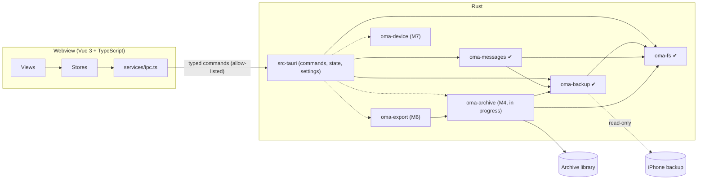

# Architecture

Status: Milestone 3 (the extraction check) is implemented; its sign-off
is pending (see the README roadmap). Sections marked *planned* describe the
intended design for later milestones. They will be revised against evidence
as each milestone lands. Nothing in them is implemented yet.

## Invariants

Every design decision below serves these five rules. A change that weakens
one of them needs an explicit decision record, not a quiet exception.

The app's [`AGENTS.md`](../AGENTS.md) lists seven invariants, numbered I1 to
I7, and the milestone 2 and 3 sections below cite that numbering. This document
numbers its five rules differently:

| This document | AGENTS.md | Rule |
|---|---|---|
| 1 | I1 | Source backups are read-only |
| 2 | I3 | No network |
| 3 | I2 | Paths from outside go through `oma-fs` (backups are hostile input) |
| 4 | I5 | Do not fabricate |
| 5 | I4 | The webview never supplies paths |
| — | I6 | Never log content or passwords |
| — | I7 | Render untrusted text as text |

1. **The source backup is immutable.** The application opens backups read-only
   and never writes inside one. Archive data cannot be stored inside a backup,
   inside the system's MobileSync store, or inside iMazing's default backup
   store. This is enforced in
   `crates/oma-fs`, not by convention.
2. **Message data never leaves the machine unless the user exports it.** The
   application has no telemetry, no update check, and no HTTP client. The
   webview's CSP allows connections to the IPC channel only.
3. **Backups are hostile input.** Manifest paths, filenames, plists, SQLite
   files and attachments may be malformed or malicious. Every untrusted path
   goes through `oma_fs::resolve_within` or `oma_fs::sanitize_filename`, which
   reject anything they cannot prove safe.
4. **Do not fabricate.** A value missing from the source stays missing.
   Unknown schema versions are reported as unsupported; they are not
   approximated. A message state the source does not record (delivered, read)
   is never shown.
5. **The frontend is a presentation layer.** It holds no business logic and
   has no filesystem access. Paths come from native dialogs that Rust opens,
   or from settings that Rust has already validated.

## Components



| Unit | Responsibility | State |
|---|---|---|
| `src/` | Vue 3 UI: views, Pinia stores, the typed IPC client, the shortcut registry, and the capability roadmap | M1, M2 (Backups page), M3 (extraction report) |
| `src-tauri/` | Tauri shell. Holds IPC commands, application state, settings persistence, archive-location validation, the backup registry, job table and DTOs, and (M3) the report mapping and the panic hook. Contains no domain logic. | M1, M2, M3 |
| `crates/oma-fs` | Filesystem safety: filename sanitization, contained path resolution, and guards for backups, MobileSync, iMazing's default store and cloud sync. From M4: volume facts (`volume`: free space, network/virtualised/FAT detection), the Unix private-permission check (`perm::check_private`), and durable placement (`place`: `fsync_dir`, `create_dir_durable`, `place_noreplace`, `open_nofollow`). From slice 4d: `check_owned_unshared` (the library folder), `rename_dir_noreplace`, `create_new_private` and `total_space` | M1, M4 (slices 4a, 4d) |
| `crates/oma-backup` | Discovers backups, parses Manifest.plist, Info.plist and Status.plist under a budget, classifies them, unwraps the keybag, stages and validates Manifest.db, checks sms.db in place, and extracts single files. From M3 it also stages sms.db with its `-wal` (blob stamps, content digest, WAL facts), opens staged databases under a read-only authorizer and operation budgets, and probes attachment blobs without extracting them. From M4: `copy_file_to` streams one listed file's plaintext into a caller's writer, hashing it, under `Limits::attachment_bytes` and per-file stamps | ✔ M2, M3, M4 (slice 4b) |
| `crates/oma-messages` | Scans and probes the sms.db schema by capability, streams typed records (handles, chats, the joins, messages, attachments, Recently Deleted links) as `Col<T>` values, decodes `attributedBody` with a clean-room typedstream decoder, and produces the aggregate `ExtractionReport`. Persists nothing. From M4: stable `KnownColumn` codes, raw values of unreadable cells (`raw_issues`), `payload_data` on request, the raw association columns, key-only passes and the storage class of text cells | ✔ M3, M4 (slice 4c) |
| `crates/oma-archive` | Owns the versioned archive schema and migrations, runs transactional and resumable imports, builds FTS5 indexes, verifies integrity. Slice 4d ships the skeleton: create, list, open (read-only first), the lock, the one hardened opener, the lock-free reader, schema v1 with its codes and fingerprint, the migration framework, write-open recovery and the creation sweep. Not yet used by the shell | M4 (slice 4d; import, verify and the shell follow) |
| `crates/oma-export` | Exports to TXT, CSV, JSON, HTML, PDF and XLSX | planned, M6 |
| `crates/oma-device` | Detects devices and creates backups behind a platform trait | planned, M7 |

Each library crate can be built and tested without Tauri. The shell only
converts between IPC types and library calls.

## The IPC boundary

- **Allow-listed commands.** `build.rs` declares every command, so
  `tauri-build` generates an `allow-<command>` permission for each one.
  `capabilities/default.json` grants exactly those permissions. The webview
  has no core window, filesystem, shell, HTTP, dialog or opener permissions.
  The dialog and opener plugins are driven from Rust.
- **Types defined once.** IPC types are Rust structs annotated with
  `#[derive(TS)]`. `cargo test` writes them to `src/types/generated/`, and
  CI fails if the committed copies are stale.
- **Inputs validated by deserialization.** Input types use
  `deny_unknown_fields`, and enums are closed. For example, `SettingsUpdate`
  has no `archiveDirectory` field, so the webview cannot set one.
- **Uniform errors.** Every failure crosses as `IpcError { code, message }`.
  `code` is a closed enum. `message` is a user-facing sentence. Errors never
  carry message content or secrets.
- **Progress and cancellation (M2).** `open_backup` returns a job id at once
  and runs the job on a dedicated `std::thread` (`oma-job-<n>`). Progress
  and exactly one terminal event (`finished`, `failed` or `cancelled`, each
  carrying `stagingRemoved`) travel over a `tauri::ipc::Channel<JobEvent>`
  passed as a command argument. `cancel_job` sets a `CancelToken` that the
  crate checks inside every loop, and a per-connection SQLite interrupt
  watcher covers long statements. One job runs at a time (D7); a second
  request gets `busy`. Progress is throttled to phase changes and at most one
  event per 100 ms.
- **No `core:*` permission for channels.** Small channel payloads (under
  8 KiB) are delivered with `webview.eval`. Larger ones are fetched through
  `plugin:__TAURI_CHANNEL__|fetch`, which Tauri 2.12.4 exempts from the ACL
  check (`src/webview/mod.rs`, under `// TODO: Remove this special check in
  v3`). **Every Tauri upgrade must re-verify, by hand, that a `finished`
  event over 8 KiB arrives without a `core:*` grant.** A channel cannot be
  reattached after a page reload, so the UI polls `get_backup_details`
  every 2 s while a job it cannot hear is active. A failed delivery never
  cancels the job.
- **The extraction check (M3).** `check_extraction` takes the `backupId`
  hash and an optional password (`deny_unknown_fields`), and runs one job
  on the same model: open, validate, check, close (D21). Its terminal event
  is a new variant, `extractionFinished` (D34), which carries **only a
  summary**: the outcome, `sourceChanged`, `stagingRemoved` and
  `plaintextRemovedAfterRowPass` (D47). The full report is fetched with
  `get_backup_details` as `lastExtractionReport`, so the check never
  depends on the channel's ACL-exempt fetch path. A guard test keeps the
  summary under 1 KiB. The report DTO has no free-text strings, and a
  key-based structural test walks every reachable DTO type (I7). Counters
  that are not recorded cross as `null`, never as 0 (I5), and integers
  outside ±(2⁵³ − 1) are clamped with a `saturated` flag.

## Settings

Settings are stored in `settings.json` in the platform config directory
(`app_config_dir()`). The file holds preferences, the archive library path
and, from M2, `backupFolders` (the folders the user added on the Backups
page, as `{ path, kind }`), nothing else. `backupFolders` is read leniently:
a malformed value or element is dropped with a notice, never treated as a
corrupt file. The webview cannot set it. Loading never fails:

| Condition | Behaviour |
|---|---|
| File missing | Defaults are used. The file is written on the first change. |
| Unreadable (I/O) | Defaults are used and settings are read-only for the session. A notice is shown. |
| Malformed or wrongly typed | The file is renamed to `settings.json.corrupt-<unix-time>` with its bytes preserved. Defaults are used and a notice is shown. |
| `schemaVersion` newer than this build | Defaults are used. The file is never overwritten, and a notice is shown. |

Saves are atomic: write to a sibling `.tmp`, `fsync`, then rename. Memory
changes only after the save succeeds.

## Archive library location

The user chooses one *library* directory. Each archive gets a subdirectory
inside it (from M4). A location is checked every time it is chosen or
re-checked:

| Check | Level | Why |
|---|---|---|
| `unicode-path` | error | The path is stored as UTF-8 and is never silently mangled |
| `absolute` | error | A relative path cannot be validated |
| `exists` | error | The directory may be on an unplugged drive |
| `not-root` | error | A drive root is never an archive |
| `outside-backup` | error | **Invariant 1.** No ancestor may contain two or more backup marker files, and the path must not be inside `MobileSync/Backup` or `iMazing/Backups` (iMazing's default store; both matched by component, case-insensitively). |
| `local-volume` | error or warning | From M4. The volume kind from `oma_fs::volume_kind`. **Network** (NFS, SMB/CIFS, AFS, Ceph, Coda on Linux; a UNC path, or one that `canonicalize` reveals as `\\?\UNC\…`, on Windows) is an error that stops the checks: SQLite's WAL "does not work over a network filesystem" (sqlite.org/wal.html), and staging needs file locks. **Virtualised** (FUSE, 9P, VirtualBox shared folders; Linux only) is a warning: backup checks keep working, but archives refuse such a folder (D54). **FAT/exFAT** (Linux only) is a warning: no hard links, and FAT's 4 GiB file limit. A recognised local file system is ok. An unknown kind adds no row: every drive letter on Windows, because detecting FAT or a mapped network drive there needs `unsafe` Win32 calls. **This changes behaviour:** a library already chosen on a network share is now refused. |
| `writable` | error | A probe file is created, written, `fsync`ed and removed. This catches ACLs, read-only mounts and quota problems. |
| `local-only` | warning | The folder is inside a known sync client's folder (OneDrive, Dropbox, iCloud Drive and others). **Invariant 2**: the user must know the data will leave the machine. This is a name heuristic, so it warns and never blocks. |

### Archive layout (M4)

```
<library>/
  .oma-staging/                   M2/M3 staging (unchanged)
  .oma-new-<32hex>/               an archive being created; swept when stale
  a<32hex>/                       one archive; 0700 on Unix
    archive.lock                  sidecar lock file; created once, never deleted
    archive.sqlite                schema v1, WAL, FTS5; 0600 on Unix
    archive.sqlite-wal, -shm      SQLite's own files; same mode as the database
    attachments/
      .incoming/                  <n>.partial while a copy is in flight
      <hh>/<64 hex>               content-addressed plaintext (from slice 4i)
    imports/
      session-<n>.json            content-free provenance (from slice 4j)
```

The directory name is a random id (`a` and 32 lowercase hex characters);
the user's label lives only in the database (D52). There is no
`thumbnails/` directory in M4 (D72). Attachments are content-addressed by
SHA-256, and a stored name is parsed against `^[0-9a-f]{64}$` before any
path is built from it. The original filename stays in the database and is
used only on export, after `sanitize_filename`.

## Data flow

Milestone 2 (implemented):

```
backup dir (read-only, never opened by SQLite)
  → oma-backup inspect: marker stats, two header reads, three budgeted plist reads
  → OpenBackup::open: [password → PBKDF2 ×2 → class keys → ManifestKey]
      → Manifest.db copied (or decrypted) into <library>/.oma-staging/s<16hex>/m/
  → validate: hardened read-only open, quick_check, schema, row pass, blob guards
      → sms.db checked in place: header (and first/last block when encrypted); no copy
  → close(): connection closed, keys zeroized, staging removed (bounded retry)
```

Milestone 3, the extraction check (implemented; one job, `check_extraction`):

```
  open → validate (M2) → if not importable: skippedNotImportable
  → oma_messages::check(&open_backup):
      a. extract_database_with(HomeDomain, Library/SMS/sms.db, WAL best effort)
         → <library>/.oma-staging/s<16hex>/db/<n>/sms.db[-wal]
           (source blobs stamped by length and mtime; staged content digested;
            WAL header and frames validated; Windows temporary attributes)
      b. hardened open of the staged copy: read-only authorizer, DQS off,
         triggers and views off, SMS_DB_LIMITS, operation budgets
      c. scan sqlite_schema (no virtual table is connected)
         → any CREATE VIRTUAL TABLE: Unsupported(VirtualTablePresent)
      d. PRAGMA quick_check(1) under an op budget
         → not "ok": Damaged(IntegrityProblems); over budget: Incomplete
      e. probe each known table with pragma_table_xinfo, rowid shape, count(*)
         → missing minimum, view instead of table, bad rowid: Unsupported
      f. record passes: handles, chats, chat_handle_join, chat_message_join,
         messages (bodies, summaries, associations, GUID sets),
         message_attachment_join, attachments (classify, look up, probe the blob),
         Recently Deleted links; each pass's row count must equal count(*)
      g. aggregates: integer SQL under op budgets; GUID checks in Rust
      h. assert query_only, no authorizer denials, total_changes() == 0
      i. connection dropped; staged sms.db removed straight after the row pass
  → unchanged_since_open() (now covers the sms.db and -wal blobs)
  → close(): keys zeroized, staging removed
  → exactly one terminal event: extractionFinished | failed | cancelled
```

Planned (M4–M5):

```
  → oma-archive: the same for_each_* passes, cursors bound to the content digest;
      single write transaction per batch, keyed for idempotent re-import;
      a changed source aborts the import; FTS5 index updated incrementally
  → UI: paged queries (keyset pagination by timestamp+id), virtualized thread list,
        attachments loaded on demand through a scoped asset protocol
```

Decrypted intermediates are written only inside the archive library's
staging directory, never in the system temp folder. They are removed when
the job ends, and leftovers from a crash are removed by the sweep at the next
start with the same library. docs/privacy.md explains the limits of
deletion.

## Backups (milestone 2)

### Discovery

On Windows, `list_backups` scans `<home>\Apple\MobileSync\Backup`,
`<roaming>\Apple Computer\MobileSync\Backup` (both subfolders are
UNVERIFIED by Apple; see supported-formats.md) and iMazing's default
`<roaming>\iMazing\Backups` (observed in iMazing's settings on one Windows 11
machine; configurable in iMazing), plus every folder the user added. A root
scan never lists a child named `iMazing.Versions`, where iMazing keeps
archived snapshots in a layout that is UNVERIFIED. Linux has no standard location. Scanning happens only when the
Backups page opens or the user clicks Refresh, never at startup. A listing is
bounded by counts, not time: at most 512 candidates are inspected and 256 MiB
of plist bytes read per refresh, and at most 256 candidates come from one
root. The rest are listed as `notInspected`. `BackupId` and `LocationId` are
hashes of the canonical path, computed in Rust; the webview can only echo
them.

### Budgeted plist reader (D17)

Backup plists are never parsed with `plist::Value::from_reader`, because a
binary plist can reference one object many times and expand without bound.
`oma_backup::bplist::read_bounded` iterates `plist::stream::Reader` and caps
events (`4 × len + 1024`), cumulative string and data bytes (`2 × len`) and
depth while streaming. Size caps are 1 MiB for Status.plist, 32 MiB for
Manifest.plist and 64 MiB for Info.plist (Info.plist failures are never
fatal). The identifying root keys (`Unique Identifier`, serial number,
IMEI, ICCID, MEID, phone number and others) are skipped while streaming:
the stream reader still decodes their values, which are counted against the
budgets and discarded, and no output struct has a field for them (D14).
Skipping applies to root keys only; Manifest.plist's `Lockdown` dictionary
is built whole and four keys are kept from it.

### Staging (D5, D6)

```
<library>/.oma-staging/          real directory, 0700 on Unix
  s<16hex>/                      one per job; .lock held with File::try_lock
    m/Manifest.db[-wal]          the staged (decrypted) index
    x/<n>, db/<n>/<basename>     extraction outputs (M3 API)
```

`StagingRoot::new` refuses a staging directory that is a link, is not at
`<canonical library>/.oma-staging`, is owned by another user or readable by
others (Unix), or would sit inside the backup, inside any backup, inside
`MobileSync/Backup`, or inside `iMazing/Backups`. `OpenBackup::close()` deletes plaintext first, releases
the lock, then removes the session with up to five attempts (50–400 ms
between attempts, about 0.75 s in total). Every extraction writes through
`<dest>.partial`; on any error the partial file (and, for a database, a main
file whose `-wal` then failed) is removed at once, not left until close. The sweep runs at startup, before each job, and against the old
location after the archive location changes; it touches only `s<16hex>`
directories whose lock it can take, never follows links, and never creates a
lock. On Windows, staging inherits the library's permissions. On Linux, a
volume that does not keep POSIX modes (FAT, exFAT or NTFS without a private
umask, many network shares) reports group and other bits on the new 0700
directory, so `StagingRoot::new` refuses it (`LoosePermissions`), and
`inspect_location` marks such a folder unusable (the `private` check) so it
is not accepted as an archive location in the first place. The
`RunEvent::Exit` handler cancels running jobs and waits up to 5 s for their
cleanup; a kill or crash skips it, and the sweep covers that case. M4's archive enumeration must skip directories whose names start with
a dot.

### Hardened SQLite open

The staged Manifest.db is opened `SQLITE_OPEN_READ_ONLY | NO_MUTEX`. If
SQLite cannot open a staged WAL database read-only (`SQLITE_CANTOPEN`), it
reopens the **staged copy** (never the backup) `SQLITE_OPEN_READ_WRITE`, with
the same hardening including `query_only` (`OpenMode::ReadWriteQueryOnly`);
SQLite may then create a `-shm` inside staging. Either way the connection has
`SQLITE_DBCONFIG_DEFENSIVE` on, `TRUSTED_SCHEMA` off, `query_only`,
`cell_size_check`, `temp_store = MEMORY` (decrypted pages never spill to the
OS temp folder), `mmap_size = 0`, and tight `sqlite3_limit` values following
sqlite.org/security.html. Extensions are never enabled; queries use bound
parameters and name their columns. Databases extracted for M3 are opened
the same way through `StagedDatabase::open`, which returns a
`StagedConnection` that borrows the `OpenBackup` (so it is closed before
`close()` deletes the file) and uses wider, provisional limits for sms.db's
many columns and long values. The backup's own Manifest.db is never
opened by SQLite, because SQLite creates a `-shm` next to a WAL database it
opens. The backup's `-shm` is never copied. On Linux, a read-only connection
applies a staged `-wal` without a `-shm` (tested with the `plain-wal`
fixture).

## The extraction check (milestone 3)

The design is recorded in full in the Milestone 3 spec; this section states
what the code does and why.

### Staging sms.db (D22, superseding D11 for the check)

M2 checked sms.db in place and never copied it (D11). The extraction check
must read every row, so it stages a plaintext copy, decrypted for an
encrypted backup, through `extract_database_with` into
`<library>/.oma-staging/s<16hex>/db/<n>/`, with the `-wal` when one is
listed (`WalPolicy::BestEffort`, D23). The copy is removed straight after
the row pass (`StagedDatabase::remove`); `close()` is the backstop and the
sweep covers crashes. The staged connection borrows the `StagedDatabase`,
so it cannot outlive the file it reads. sms.db is refused above 32 GiB
(`Limits::sms_db_bytes`, D40). Before closing, `unchanged_since_open()`
compares the length and modification time of Status.plist, Manifest.db, and
now the sms.db and `-wal` blobs; a change is the qualifier `SourceChanged`
(D31). A `-wal` is reported as *staged*, never as *applied*.

### The read-only guard (D36)

`StagedConnection::conn()` is crate-private, so no caller outside
`oma-backup` holds a bare `rusqlite::Connection`. Every staged sms.db
connection has:

- **an authorizer** that allows only reads, a fixed list of functions and
  pragmas, and denies `recoverable_message_part.part_text` (deleted message
  content) outright;
- **double-quoted string literals off** (`DQS_DML`, `DQS_DDL`), so a
  misspelt identifier can never become a string;
- **triggers and views off** (S18);
- **operation budgets** through `sqlite3_progress_handler` on every
  statement whose cost grows with the data (`quick_check` and the
  aggregates), instead of wall-clock deadlines (D45);
- the M2 hardening (`query_only`, defensive mode, `trusted_schema` off,
  `temp_store = MEMORY`, `mmap_size = 0`) and wider but still bounded
  `SMS_DB_LIMITS`.

At the end of the row pass the check asserts `query_only`, zero authorizer
denials and `total_changes() == 0`. Those are checks, not proof; the
authorizer is the guard.

### Schema: scan, integrity, probe (D37, D44)

1. **Scan** `sqlite_schema` without touching any table. A virtual table is
   refused before `quick_check`, which would otherwise run FTS or R-tree
   integrity code on attacker data (D44). A `table` row is virtual when its
   rootpage is 0 or when its whole SQL, tokenised the way SQLite's schema
   loader reads it (comments and any whitespace skipped), starts `CREATE
   VIRTUAL`; a reserved `sqlite_` name does not exempt it. This replaces the
   design's 32-byte prefix test, which a commented or padded statement with
   a non-zero rootpage could bypass. `pragma_table_list` is not used: it
   connects every virtual table to count its columns. Names and SQL text are
   classified, never stored or logged.
2. **`PRAGMA quick_check(1)`**, under an op budget. Only `"ok"` is read;
   anything else is `Damaged(IntegrityProblems)` and no row is read.
3. **Probe** each known table by capability (`pragma_table_xinfo`, columns
   matched by exact name). A required column missing, a table that is a
   view, or an unsafe rowid shape (including `INTEGER PRIMARY KEY DESC`,
   which is not a rowid alias) is `Unsupported` with reasons.

### Values: `Col<T>` and redaction (D49)

Every source field is a `Col<T>`: the column is absent, the value is NULL,
the value is unreadable (wrong type, invalid UTF-8), the value was withheld
because it is over its byte cap, or the value. M4 can therefore tell "not
recorded" from "NULL" from "bad". Content and identifiers are
`Redacted<SqlText>` or `Redacted<RawBlob>`: their `Debug` prints only a
length, they have no `Display` or `Serialize`, and they are zeroized on
drop. Coded values keep the raw integer and are mapped only where a source
documents the meaning. Timestamps are classified per value (seconds,
nanoseconds, zero, negative, ambiguous), not per database (D27).

### Typedstream (D26)

`attributedBody` is decoded by a clean-room module in `oma-messages`
(`src/typedstream/`): a budgeted generic walk, then an interpretation of a
closed set of Foundation classes, with every length checked before use and
every reference bounds-checked. Run problems keep the text and mark the
runs; nothing is clamped silently. Neither body source is preferred: the
`text` column and the decoded body are both kept, and M4 decides.
Provenance is recorded file by file in `scripts/fixtures/PROVENANCE.md`.

### Attachments (D29, D30, D50)

`attachment.filename` is an untrusted lookup key, never a path. Only the
`~/Library/SMS/Attachments/` and `~/Library/SMS/StickerCache/` classes are
looked up, in `MediaDomain`, after an unusual-name gate built on
`oma_fs::resolve_within`. A hit is probed (metadata, and the file key
unwrapped in memory for an encrypted backup) without writing any plaintext.
A blob whose length differs from the Manifest's `Size` (padded to the next
16-byte block when encrypted, as validation compares it) is a size
mismatch, never "present"; this adds an outcome to the design's probe
set, so a truncated or empty blob is not reported as the file. Every other
class is counted only. Without an `attachment` table nothing is looked up,
and the shell sends no attachment section, so its counters read "not
recorded", never 0.

### The attachment copy for the archive (M4 slice 4b)

`OpenBackup::copy_file_to(entry, sink, ctx)` is how the archive import
(M4) will read attachment files. It shares one read-and-decrypt loop with
`extract_file` and `extract_database_with`; only the destination differs.

- **It never writes to the file system.** The plaintext goes to a
  `&mut dyn Write` the caller owns, so `oma-backup` keeps its rule of
  writing only inside staging, the archive's files never carry
  `FILE_ATTRIBUTE_TEMPORARY`, and buffering, `sync_all`, placement and
  cleanup stay with the caller. On any error the caller discards what the
  writer received.
- **SHA-256 of the plaintext is computed while it streams** and returned
  in `CopiedFile` with the plaintext length, the Manifest `Size` and
  whether they match (`None` when no `Size` is recorded). A mismatch is
  recorded, never corrected. `CopiedFile`'s `Debug` prints the digest as
  `<sha256>`, because the digest names the archived file.
- **`Limits::attachment_bytes` (8 GiB, fixed like D40)** is checked
  against the stored blob's length before a byte is read, and again
  against the open handle's length. For an encrypted backup that is the
  ciphertext, up to 16 bytes longer than the plaintext. A larger blob is
  `LimitExceeded { what: AttachmentBytes }`.
- **Per-file stamps.** The blob's length and modification time are taken
  before the copy and compared after it; a difference is `SourceChanged`.
  They are not added to the stamps `unchanged_since_open()` compares, so
  that check stays O(1) however many attachments are copied. A change that
  keeps both the length and the modification time is not detected; the
  full verifier re-hashes stored files.
- **Errors keep their side.** A failed write or flush of the caller's
  writer is `Io { side: Sink, .. }` with its `kind` and OS code, so the
  import can tell a full volume (`StorageFull`) or a per-file size limit
  (`FileTooLarge`, `EFBIG`, `ERROR_FILE_TOO_LARGE`) from a source problem.
- **Progress** is `Phase::Copying` in bytes of the stored blob (the shell
  maps it to `copyingAttachments`). Cancellation is checked before every
  1 MiB read, so a cancel inside a large file stops within one chunk.
- **Not done here:** `AttachmentKey` stays opaque and cannot be persisted,
  so the import must copy inside its attachment pass (M4 §9.1).

### The reader additions for the archive import (M4 slice 4c)

`oma-messages` gains what the archive import needs to store every source
value without a second read and without fabricating one (M4 spec §3.3).
All of it is additive; the extraction check's report is unchanged, because
every new read is off unless asked for.

- **Stable column codes.** `KnownColumn::code()` is a `u16` written beside
  each column in the static list: the table's `code_base()` (`message`
  100, `handle` 200, `chat` 300, the joins 400–600 and 800, `attachment`
  700, `_SqliteDatabaseProperties` 900) plus a per-column number.
  `KnownColumn::from_code` reverses it. Reordering the list cannot change
  a code; a compile-time check keeps codes in their table's range and
  unique, and a unit test pins every code. A removed column retires its
  code. The archive stores these codes (`value_issue.col`), so a code is
  never reused.
- **Raw values of unreadable cells (R2).** Every record has
  `raw_issues: Vec<RawIssue>`, where `RawIssue { column, raw: RawSql }`
  holds what SQLite returned for an `Unreadable` cell, in its storage
  class (`Integer`, `Real`, `Text` or `Blob`). It is filled only when
  asked: `MessageReadOptions::keep_raw_blobs` for messages, and
  `ProbeOptions::with_keep_raw_values` for the other passes. A text or
  blob value is kept up to the column's cap, or `CAP_RAW_UNREADABLE`
  (4 KiB) for an integer, boolean or time column; a larger one is not
  kept, and the `Col` still says "unreadable". Columns read for presence
  only (`chat.properties`) never materialise a value, so they have no raw
  value. A property list that does not parse is not a raw issue: its bytes
  are `raw_message_summary_info`. Issues are listed in column-code order.
  `RawSql`'s `Debug` prints only the class and a length, never a value,
  not even an integer.
- **`payload_data` on request (R3).** With `keep_raw_blobs`, the message
  pass uses a third form of its query that also selects
  `CASE WHEN octet_length("payload_data") <= 1048576 THEN "payload_data"
  END` and its length, so `MessageRecord::payload_data` is
  `Some(Col<Redacted<RawBlob>>)` and a larger value is `Oversized`.
  Without it the field is `None` and the bytes are never read, as in M3.
  The value's counts go to a scratch counter, so a pass's `ValueIssues`
  does not depend on the option. Its contents (polls, app and link
  payloads) are not decoded. Whether the import keeps it is D59, which
  the owner confirmed on 2026-10-18: the import always keeps the raw
  `attributedBody`, `message_summary_info` and `payload_data` bytes within
  the caps, and privacy.md discloses it.
- **Raw association columns (R4).** `MessageRecord::assoc_raw` holds the
  five `associated_message_*` columns exactly as read, for every row.
  `Association` maps `''` to NULL and returns `None` for several distinct
  states; `assoc_raw` keeps them apart, and `AssocRaw::association()`
  derives the same `Association` the record carries.
- **Key-only passes (R6).** `for_each_message_key`, `for_each_chat_key`
  and `for_each_attachment_key` yield `KeyRow { rowid, guid }`, and
  `for_each_handle_key` yields `HandleKeyRow { rowid, id, service }`
  (sms.db's own uniqueness). They select the key and those columns only,
  under the same caps, pages, cursors and cancellation as the record
  passes, so the import's duplicate-key scan never reads a body. They
  report the phase of the table's record pass (`ReadingMessages`,
  `ReadingChats`, `CheckingAttachments`, `ReadingHandles`), so the shell's
  phase mapping is unchanged. An absent optional `attachment` table gives
  an empty pass.
- **Storage class of text (R7).** `SqlText::class()` is `TextClass::Text`
  or `TextClass::Blob`, as SQLite reported the cell. Equality compares the
  class as well as the bytes, and `Debug` adds `, blob` for a BLOB cell.
  The archive stores text as BLOBs, so it records the class separately.
- **Statement limits.** `record_queries()` now lists every form (records,
  the raw message form and the four key forms); each still fits the
  `sql_length` and `vdbe_op` limits with a 2x margin.
- **Not done here:** `chat.properties` raw bytes (R5) are deferred
  (M4 §21.2); the property list is still read for presence and size only.

### The archive skeleton (M4 slice 4d)

`crates/oma-archive` is a library with no Tauri dependency. Slice 4d ships
everything an import needs before it writes a row (spec §4, §5, §6, §7):

- **`Library::new`** canonicalises the folder and refuses a file, a
  file-system root, anything inside a backup, `MobileSync/Backup` or
  `iMazing/Backups` (I1), a network or virtualised volume (D54), and on
  Unix a folder owned by someone else or writable by group or others.
- **`Library::create`** builds the archive in `.oma-new-<32hex>` under its
  own lock: the database is created empty with mode 0600, switched to WAL,
  and filled in one transaction (the v1 DDL, `application_id` "OMA1",
  `user_version`, the meta row, FTS `secure-delete`), then checkpointed.
  The store directories are created and flushed, the directory is flushed,
  every handle is closed, and it is renamed to `a<32hex>` without replacing
  anything (`renameat2(RENAME_NOREPLACE)` on Linux; a checked rename with
  retries on Windows), and the library is flushed. Creation needs 64 MiB
  free; unknown free space does not block it.
- **`Library::open` writes nothing** (§5.3). In order: the id is parsed;
  the directory must be real; on Unix the directory, database, `-wal`,
  `-shm`, lock and store directories must be private (links and wrong
  types are refused everywhere); the volume is checked; the lock is taken
  (five retries at 200 ms, then `Locked`) and self-tested (a second handle
  must be refused, otherwise `LockUnreliable`); a ReadOnly connection reads
  `application_id` and `user_version`, then the schema fingerprint, then
  `archive_meta`. A newer schema is `NewerSchema`; a newer
  `max_deriver_version` or `max_decoder_version` sets
  `ImportBlock::NewerRules` (read and verify only); an older schema opens
  with `needs_migration()` set. The only exception to "writes nothing" is a
  missing lock file, which is recreated.
- **`ArchiveReader`** (`Library::open_read`) takes no lock, so details can
  be read while an import holds the archive; in WAL mode it sees only
  committed state. It refuses an older schema with `NeedsMigration`. It
  reads the label (re-validated; an invalid one is `Unreadable`), stats,
  session counts and the newest unfinished session.
- **`Library::list`** reports every real `a<32hex>` directory as `Ready`,
  `InUse` (lock held; never waits), `NeedsMigration`, `NewerSchema`,
  `NotAnArchive`, `Damaged` or `Refused`, and never writes archive data.
- **`Library::sweep`** removes creation directories at least five minutes
  old that are unlocked and hold only what creation makes; anything else is
  counted and left alone.
- **`conn.rs` is the one opener** (§5.5), so M8 can add a key pragma in one
  place. Both profiles set `DEFENSIVE`, `TRUSTED_SCHEMA` off, DQS off, views
  off, `foreign_keys` on, `temp_store` MEMORY, `mmap_size` 0,
  `SQLITE_LIMIT_ATTACHED` 0 and length limits, and use the `win32-longpath`
  VFS with a verbatim path on Windows. ReadOnly adds `query_only`, triggers
  off and an op budget (progress handler; an exhausted budget is
  `Damaged(WorkBudget)`). ReadWrite adds `synchronous` FULL,
  `secure_delete`, `journal_size_limit` 64 MiB, and checks that the file is
  in WAL mode. The database path is reachable only through a key type that
  module alone can make, and clippy forbids `File::open`, `OpenOptions`,
  `fs::copy` and other connection openers in the crate.
- **The fingerprint** (§7.3) builds the expected objects in memory from
  `v1.sql` plus the migrations up to the file's version, and compares
  `(type, name, tbl_name, sql)` exactly; FTS5 shadow tables by name and
  type only; `sqlite_stat1`/`sqlite_stat4` are tolerated and reported.
  At most a few rows more than expected are read.
- **Codes** (`schema::codes`) are closed numeric codes for every value
  `v1.sql` constrains, pinned by tests, and the column-rule table of §8.7:
  each of the 81 source-value columns gets a stable code and its rule
  (key, raw, history, time, body raw). A test checks the table against
  `v1.sql` in both directions; the history columns are D82's closed list.
- **Migrations** run only through `Archive::migrate()` (D87): the current
  fingerprint is checked, free space must be at least three times the
  database plus the reserve (unknown space does not block), unfinished
  sessions are superseded, then each step runs with `foreign_keys` off in
  one `BEGIN IMMEDIATE` with a foreign-key check, the fingerprint of the
  target version and the FTS rank-1 integrity check before `user_version`,
  `archive_meta.schema_version` and a `schema_migration` row are written.
  Any failure rolls back and drops the write connection. M4 ships no real
  migration; a step not marked test-only is refused until the
  pre-migration copy exists (it ships with the first real migration).
- **`Archive::begin_write(Recovery::Run)`** is the first write: it sweeps
  `attachments/.incoming/<n>.partial` and `imports/session-<n>.json.tmp`,
  reconciles `blob_intent` (a placed file without a `blob` row is removed),
  and marks running sessions interrupted. `Recovery::Skip` opens the writer
  only. `Archive::close` checkpoints with TRUNCATE if a writer was opened.
- **Test hooks** (a failed lock self-test, test-only v2 schema plans, a
  skewed expected shadow DDL, a smaller op budget) exist only with the
  non-default `fault-injection` feature (D85), which only the crate's own
  tests enable.

**Owner decisions.** `v1.sql` and the codes implement D51 (the archive is
the de-duplication scope), D59 (`attributedBody`, `message_summary_info`
and `payload_data` are kept raw within caps), D60 (Recently Deleted
excluded by default) and D61 (text captured before an unsend is kept),
all four **owner-confirmed on 2026-10-18** (the M4 decision table below).
D69, D70, D71, D79 and D82 (the closed history-column list in
`schema::codes`) follow the spec's leans, which still await the owner's
confirmation.

**Not in this slice:** the import (4f–4j), `open_blob` and the verifier
(4k), the `StoreFs` trait, the `max_page_count` guard during a migration
step, provenance files, and any use from the shell.

### The import catalogue and its content model (M4 slice 4e)

`tests/fixtures/imports/` holds the synthetic backups the import is tested
on (spec §19.1), written by `scripts/fixtures/make_synthetic_imports.py`.
That generator imports the M2 and M3 generators as modules and leaves them
untouched, so the frozen catalogues cannot change by accident.

- **Twelve entries.** Device 1 as v1, as v2 (rowids shuffled, an edit, an
  unsend, a deleted message, new bytes for one attachment GUID, a lost blob,
  a dropped column, a later date), as v2 encrypted with the same sms.db
  bytes (equal rank), and as undated and out-of-range-date copies of v1's
  sms.db. Then a second device, hostile keys and values, attachment
  outcomes, Recently Deleted, full-text search text, and a `-wal` that is
  staged or missing.
- **Two pins.** `SHA256SUMS` covers the inputs and its own hash is pinned
  in `crates/oma-archive/tests/import_fixtures.rs`: the inputs are frozen.
  `EXPECTED.SHA256SUMS` covers `*.expected/` and `scenarios/`. Its own hash
  is pinned too (since slice 4f, with `import.json` and the scenario
  counts).
- **The content manifest** (`content.json`) is the generator's model of
  what an import must leave in the archive. It covers each row's key or
  unkeyed occurrence, a sample of `Col` states, history values,
  `display_text` or its none-reason, every body version, joins, the
  attachment order, the current blob and every blob read, Recently Deleted
  markers, "not in the latest import" per lineage, and the rows the
  Recently Deleted policy excluded. It also states each session's rank. It
  restates §6.2, §6.5, §8.7, §8.8, §9 and D58; it does not run the Rust
  code. There is one manifest per entry (imported alone) and ten
  `scenarios/` (sequences). Where a scenario lists two orders, the
  generator asserts that the model gives the same content for both.
- **What is checked now.** `import_fixtures.rs` checks both sum files. It
  also checks that every entry opens and that the M3 check reads it as
  readable (`WalSkipped` only for the missing `-wal`). Against the Rust
  readers it checks the model's keyed rows and row counts per entity (the
  R6 key passes), every content digest (staging), the order key, its
  source, the out-of-range qualifier and the 41-byte rank (the plist dates
  read by `oma-backup`), and every attachment hash (`copy_file_to`). The
  manifests themselves are asserted against archives from slice 4f on
  (handles and chats so far).
- **Readings the model makes,** for the import slices to confirm or change
  (they re-pin `EXPECTED.SHA256SUMS`, never the inputs):
  - an empty GUID or handle address is not a usable key, so such a row is
    unkeyed;
  - `current_blob_id` is the blob of the highest-ranked session that read
    bytes. A session that read none never moves it, which keeps the result
    order-independent when a newer backup has lost a file;
  - a Recently Deleted message already in the archive is re-observed for
    its lineage and its marker only;
  - under the default exclusion, importing v1 then the Recently Deleted
    backup differs from the reverse order in the markers, which §8.7 states.
    **It also differs in "not in the latest import"**: in the reverse order
    the deleted messages were never seen by the newer session, so they are
    labelled. §8.7's list of exceptions does not name this case yet;
  - the display none-reasons are named (`attributedBodyUnusable`,
    `textEmpty`, `noSource`); their codes are fixed in slice 4g.
- **Owner decisions.** The model applies D60 (Recently Deleted excluded
  by default, its attachments included when opted in), D61 (text from
  before an unsend stays as an earlier body version) and D59 (raw values
  kept within caps), all **owner-confirmed on 2026-10-18**, and D82 (the
  history columns), a lean that still awaits the owner's confirmation.

### The import core (M4 slice 4f)

`Archive::import_core` (`crates/oma-archive/src/import/`) is the import as
far as slice 4f builds it: staging and the probe, the session's facts, the
resume decision, the duplicate-key scan, the session bookkeeping, and the
first two passes, **P1 handles and P2 chats**, in batches. The shell does
not call it yet (slice 4l).

- **Facts first, reads only** (`session.rs`, spec §8.2). The content digest
  and its framing (`main_len`, the WAL outcome and length), the read
  profile (SHA-256 of every column cap and the row budget), the code
  versions, the options and the lineage form the **binding** a resume must
  match. The rank is 41 bytes, compared with memcmp: the order class, the
  Status.plist `Date` (else Info.plist `Last Backup Date`) biased by 2^63,
  then the digest; a date outside 2007-01-01 .. import start + 48 h is
  ignored and sets `backupDateOutOfRange` (D81). The qualifiers bitmask
  holds the WAL ones (which decide "full observation" later), the encoding,
  the size mismatch, unknown tables and columns, and "iOS version
  untested".
- **Resume or supersede** (§8.2 step 1). A session in state 0, 2, 4 or 6
  whose binding equals this import's is continued (`resumes + 1`, counts
  reloaded); every other unfinished session is superseded (state 5) and
  its map, occurrence and duplicate-key rows are deleted (D64). **A
  continued session writes at its stored rank** and keeps its
  `source_backup` row: the order key is not part of the binding, so a
  resume after the host clock moved, or from a later backup with
  byte-identical sms.db but a newer Status.plist date, would otherwise
  merge one session at two ranks (§8.7). The session-local rows of a
  session that ends for good (superseded here or by `migrate()`, or
  failed) are deleted in the transaction that records its state, through
  one helper (`session::supersede_sessions`, `drop_session_local`); each
  import also deletes any such rows a failed or superseded session still
  owns.
- **The key scan runs before the resume decision**, on every import,
  so the gate (slice 4j) can show its evidence before the lineage is
  chosen; a continued session keeps its stored duplicate set (the same
  set, as the digest is bound). Staging reports its bytes as the
  `StagingMessagesDb` phase.
- **`source_backup`** holds the plist strings exactly as recorded
  (`oma_backup::RawText`: not sanitised, not truncated), never the display
  copies. A value of the wrong type or over 4,096 bytes is NULL with its
  bit set in `wrong_type_fields` or `oversized_fields`; NULL with neither
  bit is absent. `observed_key` hashes each field in its state.
- **Keys** (`keys.rs`, `preflight.rs`, §6.2, D56, D83). The tagged encoding
  (0 Absent, 1 Null, 2 Unreadable(kind), 3 Oversized(u64), 4 Value) is
  pinned byte for byte. A handle is keyed by the tagged (address, service),
  every other entity by its exact GUID bytes, when the identifying field is
  a readable, **non-empty** value and its 128-bit key digest is not in the
  session's duplicate set. The key scan sorts the digests of all four keyed
  tables (cap 4,194,304 rows each) and persists the duplicated ones in
  `import_dup_key`; a resume reuses them. Every other row is unkeyed: a
  SHA-256 fingerprint over every raw field (with the storage class of text
  and the raw value of an unreadable cell) and a durable occurrence number
  from `import_occurrence`.
- **Batches** (`batch.rs`, §8.5, D63). A pass reads records into a buffer
  with no archive transaction open, until 1,000 rows (16–8,192), 32 MiB
  (1–256 MiB) or 2 s on the context's clock (tests turn the time budget
  off). The buffer is then written in one `IMMEDIATE` transaction with one
  savepoint per record, the importer's own cursor (the last completed
  rowid), the counts JSON and the issue deltas. After any statement error
  the batch rolls back, and `ROLLBACK` is issued if SQLite left the
  transaction open; nothing commits after an error. `SQLITE_FULL` stops the
  session resumably (state 6); a constraint error is a bug (state 3,
  `Internal`). `rows_done` must equal the probe's `count(*)`. A pass's
  `read` takes `&self` (so P6 can hold its attachment locator), and
  `before_batch` lets a pass commit work of its own before its batch (P6's
  intents and placement, §9.1); handles and chats use neither.
- **Merge** (`merge.rs`, §8.7, D57, D82). Read the stored row and its
  `value_issue` rows, decide per cell, then `UPDATE` only the changed
  columns. A Value or Null observation replaces the stored cell at a rank
  at least `last_rank`, or when the stored cell is Absent, Oversized or
  Unreadable; those three never replace a Value or Null and are counted as
  "not applied". A history column keeps every other observed Value or Null
  in `value_history` (set semantics, hashed with the storage class). A
  changed cell's `value_issue` rows are rewritten. `first_rank` and
  `last_rank` move by min and max; an equal rank keeps the earlier
  session.
- **Cancel** (§8.6). The callback checks the token at the start of each
  record; the engine checks it every 128 rows. Either way the completed
  records are committed and the session becomes cancelled (2), resumable.
- **Until finalize exists**, a session whose passes all ran stays running
  (state 0) and the outcome is `CoreOutcome::PassesDone`: it is never
  marked completed or a full observation. Two consequences: an import of
  the **same content** continues the earlier session and has nothing left
  to do, and every new import supersedes the previous one. The scenario
  tests therefore stand in for finalize between steps (they mark the
  session completed and empty its session-local tables), so a repeated
  digest is a fresh session: the model's per-step counts and order
  independence are asserted for every scenario, including the four that
  repeat a digest.
- **Crash points** (`fault.rs`, D85). `fault::point(FaultPoint::…)` marks
  the record start, before and after each batch commit, after the session
  transaction and the terminal state, each recovery step of `begin_write`,
  and both sides of the creation rename. Without the `fault-injection`
  feature the call is empty. `tests/crash.rs` kills a re-executed child at
  every point in `FaultPoint::ALL` (the terminal commit through a child
  that cancels during the chat pass) and checks that the archive is
  consistent and that continuing gives the uninterrupted result. The
  checks after a kill run on a **copy** of the database, `-wal` and
  `-shm`, and the test asserts that the `-wal` the kill left is unchanged
  when the resume starts, so the resume opens a hot WAL and the dead
  child's `-shm`. Each child stages under a directory the parent removes.
  `tests/resume.rs` does the same in process with panics at random batch
  boundaries and with a cancel at every record.
- **`StoreFs`** (`store_fs.rs`). Creation makes its directory fsyncs and
  its no-replace rename through a `StoreFs` (`RealFs` in production), so a
  recording implementation can check the order: subdirectories durably
  made, the creation directory flushed, the rename, then the library
  directory flushed. Before the rename the creation directory gets the
  permission checks every open runs, so a drive that ignores modes (vfat
  or exFAT with the usual umask) fails creation instead of leaving an
  archive no open accepts. A failed library flush **after** the rename is
  a logged durability warning, and the id is returned. The intent
  reconcile flushes each `attachments/<hh>/` it removed a file from,
  through the same trait, before the intents' deletion commits. The
  attachment store (slice 4i) uses the same trait.
- **Store paths** (`blobs.rs`, `store_dir`). Before any file under
  `attachments/<hh>/` is touched, `attachments/` and `<hh>` must each be
  a real directory (no link, junction or reparse point) and, on Unix,
  private (`check_private`). The reconcile goes through it today; slice
  4i's placement and reads and the verifier will. A planted link at
  `<hh>` leaves the intent in place and counts the file as left.
- **Counts** (`counts.rs`). `ImportCounts` is numbers only; the handle and
  chat groups hold seen, inserted, already present, unkeyed, cells
  replaced, not applied, history added and value-issue cells.
  `import.json` (per entry) and `scenarios/*.counts.json` hold the model's
  counts, and `EXPECTED.SHA256SUMS` is now pinned.

**Readings this slice takes.** These are implementation readings of the
spec, not owner decisions. `owner-decisions.md` existed when this slice
was written and confirms D51, D59, D60 and D61 (owner-confirmed
2026-10-18; see the M4 decision table); D69, D70, D71, D79 and D82 remain
leans awaiting the owner's confirmation.

- an empty GUID or address is not a key (the catalogue model's reading,
  now implemented);
- **`value_history.first_rank` and `first_session_id` mean "no earlier
  than"**, not "the observation that first saw the value". A value that
  leaves the current slot is recorded at the row's `last_rank` and
  `last_session_id` before the replacing observation, and those move with
  any higher-ranked observation of the row, including one where this
  column was absent, oversized or unreadable. Example: S1 (rank r1)
  observes `chat.display_name` 'A', S2 (r2 > r1) lacks the column, S3
  (r3 > r2) observes 'B'; 'A' goes to history with first rank r2 and
  session S2, which never observed 'A'. Imported in the order S1, S3, S2,
  the same row records r1 and S1. Exact with two sessions; with three or
  more, the rank is an upper bound on the first observation, the session
  may not have observed the value, and the provenance depends on order.
  This is an exception to §8.7's order independence beyond the spec's
  list (which names column values, not history provenance); the value set
  in `value_history` itself is order independent. Exact per-value
  provenance needs a per-cell rank and is left for the v1 freeze review;
- a key's tagged encoding ignores the text storage class (two sessions
  that disagree only in class are one key), while fingerprints and history
  include it;
- the resume binding is the spec's list only: a second backup with the
  same sms.db bytes but other plist dates continues the first one's
  session, and the continued session keeps its stored rank and
  `source_backup` row (tested with a clock change between segments in
  `tests/resume.rs`);
- the unkeyed fingerprints are pinned byte for byte against digests
  computed outside the crate (`bind.rs`), because they are the identity
  of every unkeyed row across sessions.

### Status and qualifiers (D43)

The report's status is `Readable { qualifiers }`, `Damaged`, `Unsupported`
or `Incomplete`. **D43 is the decision record for how invariant 4 (I5,
"an unknown schema or iOS version is reported as unsupported") is read in
M3:** an *unknown schema* is one that lacks the required minimum, has
virtual tables, has an unsafe rowid shape, or exceeds our schema limits,
and that is `Unsupported`. A database with the minimum plus unknown extra
tables or columns, an untested iOS version, or a WAL or source caveat is
*readable with qualifiers*, and each qualifier is stated in its own
sentence. The UI never says just "can be read" when a qualifier applies.
The shell adds `iosVersionUntested` unless the backup's iOS version is in
`TESTED_REAL_IOS_VERSIONS`, which is empty in M3 because no real backup has
been tested, so every readable result from a real backup carries it.
(Damaged, unsupported and incomplete results carry no qualifiers; their
iOS version is untested too.) Without this
reading, every real backup today would be "unsupported" and the check would
give no evidence; the qualifiers keep the claim honest.

### Constant-time reasoning

No step in M2 gives an attacker a timing oracle: the app is local and
single-user, and nothing is decrypted on anyone else's behalf. The code never
compares key material by hand; aes-kw compares the public integrity value
with `==`; PKCS#7 unpadding is not constant-time; fileIDs are not secret. A
future network feature must re-examine this.

## Key decisions

| Decision | Choice | Reasoning and trade-off |
|---|---|---|
| Who touches the filesystem | Rust only | One place to enforce the invariants. The cost is that every capability needs an IPC command. |
| How the archive directory is chosen | The backend opens the native picker | The webview cannot inject a path, even after an XSS. The cost: no drag-and-drop of folders until a validated path is designed for it. |
| Bootstrap's JavaScript | Not loaded; CSS only | Bootstrap's JavaScript mutates the DOM behind Vue. Dialogs use native `<dialog>`, and overlays and toasts are Vue components. |
| IPC type sharing | ts-rs, generated from Rust | No hand-maintained duplicate types, and drift fails CI. |
| Device communication (M7) | Tentatively the `idevice` crate (MIT, pure Rust, includes mobilebackup2) rather than shelling out to `idevicebackup2` | Passwords stay in the process, never on a command line, with no LGPL binaries to ship. The crate is pre-1.0 and may break between releases, so pin it exactly. This must be confirmed on real hardware in M7. See [supported-formats.md](supported-formats.md). |
| Reference implementations | GPL, LGPL and CC BY-SA projects (imessage-exporter, imessage-database, crabstep, crabapple, pymobiledevice3, pyiosbackup, libimobiledevice including `idevicebackup2`, the andrewdotn answer) are behavioural references only | The project must remain Apache-2.0. Clean-room code, or MIT/BSD sources with attribution. |
| sms.db parsing | Capability-based: probe columns by name and treat missing ones as absent | The schema changes with every major iOS release. Positional `SELECT *` breaks silently. |
| Node.js worker | None | Nothing so far needs one. Revisit only with a concrete requirement. |
| Single instance | Not enforced in M1 or M2 | Atomic settings writes keep two instances safe. Staging sessions are locked, and the sweep skips sessions younger than 5 minutes. The archive database (M4) will take an exclusive lock per archive. |

### Milestone 2 decisions

| # | Topic | Choice | Main alternative |
|---|---|---|---|
| D1 | Where IPC types live | DTOs in the shell (`src-tauri/src/backups/dto.rs`); `oma-backup` has no ts-rs | `TS` in the library behind a feature |
| D2 | Progress transport | `tauri::ipc::Channel<JobEvent>`, no `core:*` grant; re-verified on every Tauri upgrade | `job://progress` events with `core:event:*` |
| D3 | Cancellation | `cancel_job` sets a `CancelToken`, checked in every loop, plus a SQLite interrupt watcher per connection | Discard results after uninterruptible work |
| D4 | PBKDF2 | Written in the crate on `hmac`, with cancellation and progress; differential tests against the `pbkdf2` crate | Call `pbkdf2::pbkdf2_hmac` (up to ~5 s uninterruptible) |
| D5 | Session lifetime | Scoped to the job; keys zeroized and staging removed at its end | Keep the unlocked session open (M3 needs that) |
| D6 | Staging location | `<library>/.oma-staging/s<16hex>/`; validation needs a usable archive folder | The app cache directory |
| D7 | Concurrency | One job globally; a second request gets `busy` | Parallel jobs |
| D8 | Remembering added folders | `backupFolders: [{ path, kind }]`, lenient; schema version stays 1 | Re-add every session |
| D9 | Guards on files opened from a backup | Regular, non-link files only; each `xx/` directory validated once | Canonicalise every blob, or `O_NOFOLLOW` |
| D10 | Extraction destination | Sequence numbers inside staging (`x/<n>`, `db/<n>/<basename>`) | Mirror `relativePath` |
| D11 | sms.db during validation | Checked in place; no plaintext copy on disk | Extract and open a full copy |
| D12 | Fixtures | Committed Python generator on `cryptography`, `SHA256SUMS`, and a recorded oracle run | Generate fixtures in Rust |
| D13 | Library in a synced folder | Allowed, with a warning before every validation | Block, or require an acknowledgement |
| D14 | Identifying fields | Never stored, UDID included: root keys are skipped while streaming (values decoded and discarded), and no struct has a field for them. Backup folder paths, usually named after the UDID, are shown in the details panel and, for an added backup folder, in the Locations panel; never logged | Parse and redact |
| D15 | Persistent diagnostic log file | Deferred to M4 | Ship in M2 |
| D16 | OS credential store for passwords | Dropped, with no milestone planned; the password is asked for on each validation | Opt-in storage |
| D17 | Plist parsing | Budgeted event-stream reader | `Value::from_reader` with size caps |
| D18 | Keybag strictness | Fail closed only on what decryption uses; the rest becomes a note | Refuse any unexpected shape |
| D19 | `relativePath` | A lookup key, not a path; unusual names are counted, never refused | Refuse rows that fail `resolve_within` |
| D20 | Scope | Domain classes, attachment counts and size measurement deferred to M3/M4 | Ship them in M2 |

D11 still describes M2's validation. For the extraction check it is
superseded by D22: sms.db is staged on disk.

### Milestone 3 decisions

| # | Topic | Choice | Main alternative | Trade-off |
|---|---|---|---|---|
| D21 | Session lifetime | One job: open → validate → check → close; the password is asked for on each run | Keep the session open between jobs | The password is asked twice, versus keys and plaintext lingering |
| D22 | sms.db plaintext | Staged on disk, removed after the row pass, Windows temporary attributes | `sqlite3_deserialize` into memory | Memory would scale with the database, and a `-wal` could not be applied. The disk copy is swept and documented in privacy.md |
| D23 | WAL | `BestEffort`, frames validated, the wording "staged" | Fail the whole check | One missing file would block the check, versus possibly missing the newest messages, which is always stated |
| D24 | Progress phases | Own `MessagesPhase` with an adapter | Add to `oma_backup::Phase` | `oma-backup` stays free of M3 knowledge |
| D25 | Reader API | Callback with `ControlFlow<B>`, a `Cursor`, resume tested | `Iterator` or `Vec` | Bounded memory and resumability for M4 |
| D26 | Typedstream | Clean-room module in `oma-messages` | Adopt `imessage-core` (MIT), or a separate crate | An unaudited young dependency versus our own code; it can be split out later |
| D27 | Timestamp units | Per value, unit windows, `Zero` as its own state | Per database or per iOS version | Some dates are withheld (and counted), versus mixing units |
| D28 | Schema problems | `Unsupported`, `Damaged`, `Incomplete` as values with reasons | Job errors | The UI can explain why, without a partial read |
| D29 | Attachment lookup | Cached single lookups | Batched `IN` | Simpler; Manifest.db's `variable_number = 10` stays |
| D30 | Attachment presence | Metadata probe plus key unwrap in memory | Presence only, or full decrypt | Catches a damaged `EncryptionKey` without writing plaintext |
| D31 | Report content | Aggregates and a date range (shown, never logged or persisted); a changed source is a qualifier | No date range; fail on change | Most useful sanity check; M4 will abort on a change |
| D32 | Raw blobs | Off by default; within caps when on | Always keep | Memory versus re-decoding later; M4 decides |
| D33 | Recently Deleted | Counted only | Ignore or import | Import policy belongs with M4's privacy design |
| D34 | Terminal event | New `extractionFinished` variant | A field on `finished` | M2's contract stays intact |
| D35 | Fixture generator | Separate `make_synthetic_messages.py` importing the M2 module, with a reference-environment check | A mode of the M2 script | The frozen M2 catalogue is untouched |
| D36 | Write protection | Authorizer, crate-private `conn()`, DQS off, triggers and views off, clippy list; end-of-check assertions are checks only | Convention plus `total_changes` | Enforced by SQLite rather than review |
| D37 | `quick_check` | Always, first after the scan; anything but `"ok"` is `Damaged` | Report and continue | A slightly damaged real database gives no counts; the reason is stated |
| D38 | Unknown names | Counted only | List them | Names are untrusted |
| D39 | Group chats | No group field; buckets of other linked handles; `style` raw | `style = 43` means group | That meaning is **UNVERIFIED** |
| D40 | sms.db size cap | 32 GiB, fixed | None, or a free-space check | Protects the volume; the error names the cap |
| D41 | `ErrorCode` | None new; stage-aware sentences | `MessagesDbUnreadable` | Fewer cross-cutting edits |
| D42 | Mutation testing | In-test seeded harness | `proptest` or `cargo-fuzz` | No shrinking, but a stable dependency tree |
| **D43** | **How invariant 4 (I5) is read** | See "Status and qualifiers" above: unknown schema means no required minimum, virtual tables, unsafe rowid shape or over our limits (**Unsupported**); unknown extras, an untested iOS version, WAL or source caveats are **stated qualifiers** | Treat any unknown column or untested version as unsupported | Every real backup would be unsupported, and the check would give no evidence |
| D44 | Virtual tables | Refused before `quick_check` | Let `quick_check` run their integrity code | No FTS or R-tree code runs on attacker data; revisit if real sms.db has them (**UNVERIFIED**) |
| D45 | Statement cost | Op budgets, plan-safe integer aggregates, GUID checks in Rust | Wall-clock deadlines, or `hard_heap_limit` | Deterministic bounds; `hard_heap_limit` is process-wide and was rejected |
| D46 | GUID sets | Sorted `Vec<u64>` of truncated SHA-256, 4,194,304-entry cap | A `RandomState` `HashSet` | Reproducible counts and half the memory; a crafted collision can change only a count |
| D47 | Event size | Summary-only event; the report is fetched by `get_backup_details` | Rely on the ACL-exempt channel fetch path | No dependency on a Tauri special case marked "remove in v3" |
| D48 | Scope cut | The deferred list in the README | Ship everything | Reviewable PRs |
| D49 | Source values | `Col<T>` | `Option<T>` | M4 can tell "not recorded" from "NULL" from "bad" |
| D50 | Lookup scope | Only `Library/SMS/Attachments/` and `StickerCache/` | Every `~/` and `/var/mobile` class | Never reaches non-Messages files; the other classes stay counts |

### Milestone 4 decisions in force (slices 4d–4f)

The full M4 decision list (D51–D88) lands with the M4 documentation slice.
These are the ones the archive skeleton and the import core already
implement. D51, D59, D60 and D61 are owner-confirmed (2026-10-18); of the
owner questions, D69, D70, D71, D79 and D82 remain leans awaiting the
owner's confirmation.

| # | Topic | Choice | Main alternative | Trade-off |
|---|---|---|---|---|
| D51 | Device identity (**owner-confirmed 2026-10-18**) | The archive is the de-duplication scope; boolean device evidence at the gate and the user picks the lineage (D80); the UDID is never stored or hashed, D14 unchanged | Identify the phone by UDID | No device identifier in the archive, at the cost of the user choosing the lineage |
| D59 | Raw blobs (**owner-confirmed 2026-10-18**) | Always keep the raw `attributedBody`, `message_summary_info` and `payload_data` bytes within the caps; disclosed in privacy.md | Keep only decoded text | Re-derivation with a newer decoder needs no backup; the archive holds more source bytes |
| D60 | Recently Deleted (**owner-confirmed 2026-10-18**) | Excluded by default; opt-in per import; attachments included when opted in; already-archived messages are marked but not updated from their deleted state | Import everything | The user decides per import; deleted-state rows never overwrite archived ones |
| D61 | Text captured before an unsend (**owner-confirmed 2026-10-18**) | Kept; the message is marked unsent by the sender; disclosed in privacy.md | Remove the earlier text | The archive keeps what it already captured, and says so |
| D52 | Archive naming | `a<32hex>`; label in the database; created through `.oma-new-*` with a no-replace rename | Label as directory name | No untrusted names on disk |
| D53 | Locking | Sidecar `archive.lock` + `try_lock` + self-test; NORMAL locking with WAL; lock-free `ArchiveReader` | `locking_mode=EXCLUSIVE` | Details can be read during imports; external tools can still read the database |
| D54 | Volumes | Network and virtualised volumes refused for archives; FAT warned | Warn on virtualised | WAL and locks are unreliable there |
| D75 | `application_id` | `0x4F4D4131` ("OMA1"), unregistered | Register it | Registration is optional |
| D76 | Views | None in v1; views are disabled on every connection | Read views | `highlight()` fails in views with `TRUSTED_SCHEMA` off |
| D78 | Permissions | 0700/0600 on Unix, re-checked at every open; the library itself must be ours and not writable by others | Leave the umask | Plaintext archive; ACL inheritance on Windows is disclosed with the privacy write-up |
| D84 | Reader | `ArchiveReader`: lock-free, query-only, fingerprint first | Read through the locked `Archive` | Details during imports |
| D56 | Keys | Exact GUID bytes, or the tagged (address, service); unkeyed rows by fingerprint and durable occurrence | Synthesise keys | No fabrication; unkeyed rows may repeat across changed sources |
| D57 | Merge | Never delete; rank decides; missing or unreadable values never replace values; only changed columns are updated | Last import wins | Older backups can be imported later without regression |
| D63 | Transactions | `IMMEDIATE` batches (1,000 rows / 32 MiB / 2 s), a savepoint per record, the importer's own cursor, `synchronous=FULL` | Per-row transactions | Durable and resumable at batch granularity |
| D64 | Resume binding | Digest and framing, versions, read profile, options and lineage; otherwise supersede | Resume across any change | One rule set per session |
| D80 | Lineage | The caller (the gate, later) picks an existing lineage or a new one | Infer from device fields | No silent identity claim |
| D81 | Rank | (dated, bounded date, content digest), memcmp-compared; undated below dated | Session id as tie-break | Order independence; no host-clock wins |
| D82 | Value history (column list: a lean **awaiting the owner's confirmation**) | The closed list of 11 history columns keeps every other observed value | History for every column | Content kept where it matters |
| D83 | In-source duplicate keys | Every occurrence unkeyed; found by a sorted 128-bit digest scan; persisted per session | Key the first in rowid order | Rowid-order independence; a collision can only demote |
| D85 | Fault injection | Non-default `fault-injection` feature, per-thread hooks and fault points; crash by killing a re-executed child | Environment variables in release builds; `abort()` | No test hooks in shipped code; deterministic boundaries |
| D86 | Windows long paths | `win32-longpath` with a verbatim path; if WAL and `-shm` fail there in CI, refuse library paths whose deepest archive path exceeds 240 characters | `EXCLUSIVE` locking | Keeps D53's reader. **UNVERIFIED** until the Windows run |
| D87 | Migrations | Explicit `migrate()` only; fingerprint first; space checked before anything changes; unfinished sessions superseded; a real migration refused until the pre-migration copy exists | Migrate on open | No surprise writes; reads never migrate |

## Logging

`tracing` writes to stderr, filtered by `OMA_LOG` (default `info`). Log
events record kinds, states and counts. They never record message bodies,
contact details, attachment contents or passwords. M1 does not log the
archive path at info level.

Milestone 2 logs backup ids (hashes), job ids, classification and phase
names, counts, durations, `io::ErrorKind`, raw OS error numbers, SQLite
primary result codes, and limit names and values. It never logs passwords
(not even their length), key bytes, paths, folder names, device names,
UDIDs, SnapshotState values, relativePaths, domains of individual rows,
fileIDs or SQLite message text. Two test binaries
(`crates/oma-backup/tests/log_hygiene.rs` and
`src-tauri/tests/log_hygiene.rs`) install a global capturing subscriber and
assert this over every fixture. Tauri's own `tracing` feature stays off.

Milestone 3 logs, at `info`, one line per phase change and one summary line
(totals, the status kind, elapsed time); at `debug`, failure-kind counts.
It also logs `OpenMode`, the WAL outcome kind, the integrity kind and
qualifier kinds. It **never** logs:

- any string from sms.db, including table, view, trigger, index and
  collation names, DDL text and `quick_check` output;
- any GUID, the content digest, the date range or any timestamp;
- raw code values;
- unknown column, table, class, attribute-key and plist-key names;
- `_ClientVersion`;
- attachment paths or fileIDs;
- typedstream offsets;
- panic payloads. The release build aborts on panic; the shell installs a
  panic hook that prints only the thread name and source location
  (`src-tauri/src/panic_hook.rs`).

`#[tracing::instrument]` without `skip_all` is banned in `oma-messages` and
`src-tauri`, because it formats every argument with `Debug`. A source test
enforces this in `oma-messages` (`crates/oma-messages/tests/source_rules.rs`);
in `src-tauri` it is a review rule, and no `instrument` is used there today. The log-hygiene tests in
`crates/oma-messages/tests/` and `src-tauri/tests/` run every catalogue
entry, including the failure paths, and a forced panic.

Milestone 4's `oma-archive` logs, at `info`, archive creation, a write
open's recovery counts and migration steps (versions only); at `debug`,
placement and directory-sync outcomes, checkpoint results and unknown free
space. It never logs a path, an archive id, the label or SQLite error
text, and its errors carry codes and kinds only.
`crates/oma-archive/tests/log_hygiene.rs` checks logs, `Debug` and
`Display` against the label, the id, the library path and any 32-hex run;
`tests/source_rules.rs` bans `instrument` without `skip_all`.

The persistent, redacted diagnostic log file is deferred to M4 (D15); the
M4 spec defers it again, to M8 (D71, awaiting the owner).
